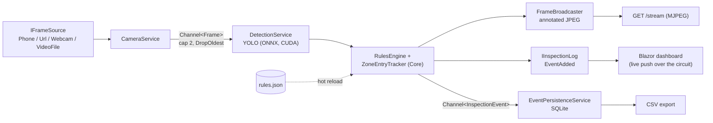

# QualityVision

Real-time industrial visual quality inspection in C#/.NET 10: a live camera feed, an open-vocabulary YOLO detector on the GPU, a configurable rules engine and a German Blazor dashboard.

A camera image is shown in the browser with an inspection zone (*Prüfzone*). Objects are detected, judged by a rules engine (OK / NOK / DANGER / UNKNOWN / IGNORE) and counted once when they **enter** the zone. The dashboard shows KPIs, a per-minute chart and a live event log. Events are stored in SQLite and can be exported as CSV.

The design goal is **robust and explainable over clever**: simple, testable components with trade-offs recorded as ADRs.

## Features

- Live camera sources: iPhone browser page (HTTPS upload), MJPEG URL, local webcam, or a looping video file (fallback).
- Automatic fallback to the recorded video if the live source is lost.
- Object detection with YOLO-World v2 (open vocabulary, detects objects that are not COCO classes) or YOLO11 (COCO).
- CUDA acceleration with automatic CPU fallback (`Detection:Device = Auto`).
- Rules engine with hot reload: edit `rules.json` or use the web editor at `/regeln`.
- Zone-entry counting with frame-based debounce (each object is counted once per entry).
- Real-time dashboard (German UI): KPIs, scrap rate, FPS, inference time, per-minute chart, live event log, visual and audible alarm for NOK / DANGER.
- MJPEG stream at `/stream` (JPEG encoded once, served to any number of clients).
- Persistence in SQLite without slowing inference (separate channel and background writer); streaming CSV export.
- `/health` endpoint (camera, model, database).

## Architecture



Dependency rule: **Web → Infrastructure → Core**, enforced by architecture tests.

| Layer | Project | Responsibility |
|---|---|---|
| Core | `src/QualityVision.Core` | Domain: `Frame`, `Detection`, `Verdict`, `RuleSet`, `RulesEngine`, `InspectionZone`, `ZoneEntryTracker`, ports. Zero NuGet packages. |
| Infrastructure | `src/QualityVision.Infrastructure` | Frame sources (OpenCV, phone), YoloDotNet detector, rules provider, EF Core + SQLite. |
| Web | `src/QualityVision.Web` | Blazor Server UI, rules editor, `/stream`, minimal API endpoints, hosted services. |
| Tests | `tests/QualityVision.Tests` | xUnit unit tests and architecture tests. |

## Tech stack

- .NET 10, Blazor Server (Interactive Server)
- ONNX Runtime (CUDA execution provider) via YoloDotNet
- YOLO11 (COCO) and YOLO-World v2 (open vocabulary) models
- OpenCvSharp (capture, FFmpeg backend), SkiaSharp (annotation)
- EF Core with SQLite
- xUnit, 417 tests

## Performance

Measured on an RTX 5070 Ti (inference time per frame, 640×640 input):

| Model | CPU | CUDA |
|---|---|---|
| YOLO11n | ~25–45 ms | 3.9 ms |
| YOLO11s | ~50–85 ms | 4.3 ms |
| YOLO11m | 198 ms | 6.4–6.9 ms |
| YOLO-World v2 L | – | ~10 ms |

Live with the full app (YOLO11m on CUDA): about 6.3 ms inference, 20 FPS output, about 890 MB VRAM. See [ADR-004](docs/adr/ADR-004-gpu-acceleration.md).

## Setup and running

### Prerequisites

- .NET 10 SDK
- Optional, for GPU inference: NVIDIA driver, CUDA 13 and cuDNN 9. Without them the app falls back to YOLO11n on CPU.
- [uv](https://docs.astral.sh/uv/) to export the models (Python is only needed for that step).

### 1. Create the models

The YOLO11 ONNX models are in `models/`. The YOLO-World model (177 MB) is **not in git**; generate it once:

```bash
uv run tools/export-model/export.py --mode world   # -> models/yoloworld-qv.onnx
```

See [`tools/export-model/README.md`](tools/export-model/README.md) and [`models/README.md`](models/README.md).

### 2. HTTPS for the phone page (optional)

Browsers only allow camera capture on secure origins, so the phone page `/kamera` needs HTTPS. Create a certificate **outside the repo** and point to it in the git-ignored `src/QualityVision.Web/appsettings.Local.json`:

```json
{
  "Kestrel": {
    "Endpoints": {
      "Https": {
        "Url": "https://0.0.0.0:5443",
        "Certificate": { "Path": "/path/to/cert.pem", "KeyPath": "/path/to/key.pem" }
      }
    }
  }
}
```

### 3. Run

```bash
./run-demo.sh            # publish + run in the Production environment
./run-demo.sh --video    # fallback: loop samples/demo.mp4 (see samples/README.md)
./run-demo.sh --no-build # reuse the previous publish output
```

- Dashboard: `http://<host>:5080`
- Phone capture page: `https://<host>:5443/kamera`
- Health: `http://<host>:5080/health`

For development: `dotnet run --project src/QualityVision.Web`.

The app is LAN-only and has no authentication by design; restrict the ports with a firewall (see ADR-001).

## Configuration

| Where | What |
|---|---|
| `rules.json` | Class → verdict map (`Ok`, `Nok`, `Danger`, `Ignore`; unknown classes → UNKNOWN). Hot-reloaded; the `/regeln` editor writes only this file. Distractor classes are mapped to `Ignore`. |
| `Detection` | `Device` (`Auto`/`Cuda`/`Cpu`), `GpuId`, `ModelPath`, `CpuModelPath`, `Confidence` (0.45), `Iou`. |
| `Camera` | `Source` = `Phone` \| `Url` \| `Webcam` \| `VideoFile`, plus `Url`, `WebcamIndex`, `VideoFile`, requested size and `MaxFps`. Set `Camera__RecordTo` to record the raw feed as a fallback. |
| `Inspection` | Normalised `Zone` rectangle and `AbsenceFrames` (debounce, in frames). |

All settings are in `src/QualityVision.Web/appsettings.json` and can be overridden with environment variables (e.g. `Camera__Source=VideoFile`).

## Quality gates

Every milestone had to pass:

```bash
dotnet build -warnaserror            # 0 warnings, 0 errors
dotnet test                          # 417 tests green
dotnet format --verify-no-changes    # clean
```

plus a code review without blockers, a real functional check, and a learning note.

## How it was built

The project was developed by a team of AI agents (architect, backend, vision, frontend, QA, code reviewer, tech writer) coordinated by an orchestrator session, with the developer approving each milestone. Work was split into contracts, run in parallel, then integrated and verified by the orchestrator. Independent reviews caught real bugs before release. Details: the development-method sections of [`docs/README.de.md`](docs/README.de.md) (German) and [`docs/README.es.md`](docs/README.es.md) (Spanish).

## Documentation

- [Architecture decision records](docs/adr/README.md) (ADR-001 to ADR-005)
- [Project plan](docs/PLAN.md) (Spanish)
- Learning notes per milestone (Spanish): [`docs/aprendizaje/`](docs/aprendizaje/)
- Full project documentation: [`docs/README.es.md`](docs/README.es.md) (Spanish), [`docs/README.de.md`](docs/README.de.md) (German)

## Roadmap to production

- Add authentication/authorisation and TLS termination (the app is LAN-only by design, see ADR-001).
- Resolve model licensing for commercial use (see Licensing).
- Fine-tune a detector on the manufacturer's own parts instead of relying on open vocabulary.
- Integrate with plant systems (PLC/MES) to act on NOK / DANGER verdicts.

## Licensing

There is no licence file in this repository yet. Third-party terms to be aware of: YOLO11 code and weights are **AGPL-3.0**, YOLO-World is **GPL-3.0**, and YoloDotNet is **MIT**. Fine for evaluation and research; a commercial product would need to resolve this. See [ADR-003](docs/adr/ADR-003-object-detection-model.md) and [ADR-005](docs/adr/ADR-005-open-vocabulary-model.md).
