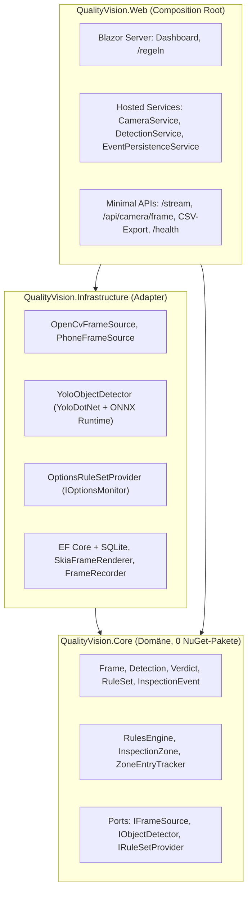
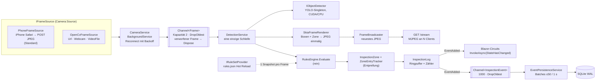
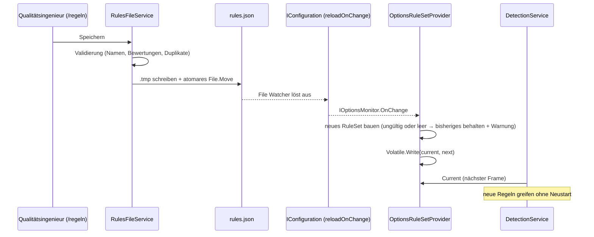
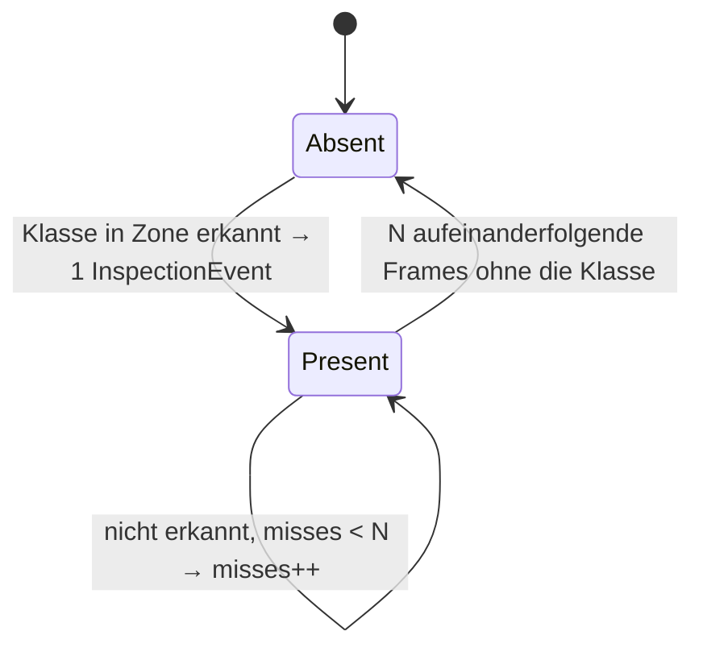
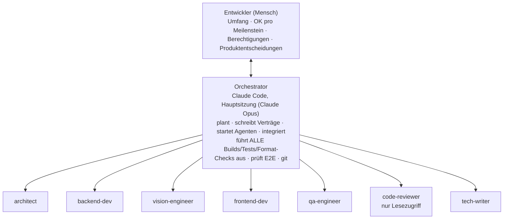
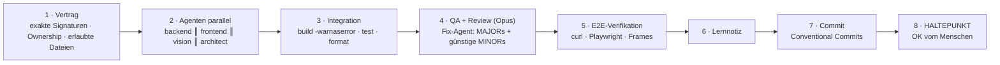
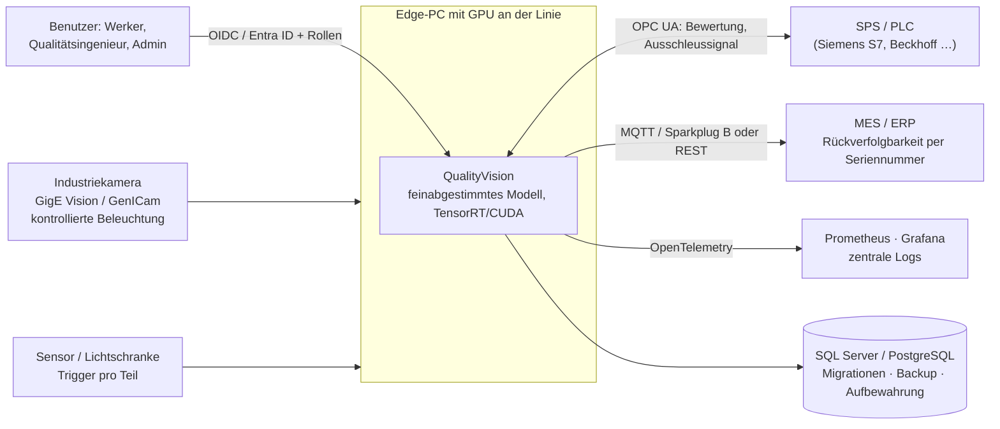

# QualityVision — Projektdokumentation

> **Optische Qualitätsprüfung in Echtzeit mit C#/.NET 10, ONNX und Blazor Server**
> Technisches Referenzdokument. Es beschreibt, was gebaut wurde, warum jede Entscheidung so getroffen wurde, wo die
> Grenzen liegen und wie sich das System in die Produktion überführen lässt.
>
> Stand: M1–M6 abgeschlossen. Quellen: ursprüngliches Briefing, Projektplan,
> ADR-001…005, Code-Reviews und der Code.
>
> Weitere Sprachen: [English](../README.md) · [Español](README.es.md)

---

## Inhalt

1. [Management Summary](#1-management-summary)
2. [Industrieller Anwendungsfall](#2-industrieller-anwendungsfall)
3. [Architektur](#3-architektur)
4. [Computer Vision](#4-computer-vision)
5. [Regeln, Prüfzone und Zählung](#5-regeln-prüfzone-und-zählung)
6. [Dashboard, Persistenz und Plan B](#6-echtzeit-dashboard-persistenz-und-plan-b)
7. [Qualität](#7-qualität)
8. [Entwicklungsmethode: Arbeit mit KI-Agenten](#8-entwicklungsmethode-arbeit-mit-ki-agenten)
9. [Entscheidungen, Trade-offs und Weg in die Produktion](#9-entscheidungen-trade-offs-und-weg-in-die-produktion)
10. [Inbetriebnahme und Ausführung](#10-inbetriebnahme-und-ausführung)
11. [Glossar ES / DE / EN](#11-glossar-es--de--en)

---

## 1. Management Summary

**Problem.** In einer Fertigungslinie muss für jedes Teil entschieden werden, ob es gut (*i.O.*) oder schlecht
(*n.i.O.*) ist. Jedes Teil soll genau einmal gezählt werden, bei einem Fehler oder einem gefährlichen Gegenstand muss
sofort ein Alarm kommen, und alles muss rückverfolgbar protokolliert werden. Macht das ein Mensch, ist es langsam,
teuer und hängt davon ab, wer gerade hinschaut. Kommerzielle Bildverarbeitungssysteme sind dagegen oft geschlossene
Blackboxen, die sich nur schwer integrieren lassen.

**Lösung.** QualityVision ist eine optische Prüfstation, komplett umgesetzt in **einer einzigen .NET-10-Anwendung**:

- Die Kamera (ein iPhone im lokalen Netz, eine Webcam, eine MJPEG-URL oder eine Videodatei) speist eine **Pipeline
  mit Gegendruck** (*Backpressure*).
- Ein **YOLO-Objektdetektor im ONNX-Format** läuft **auf der GPU (CUDA)** und fällt automatisch auf die CPU zurück,
  wenn die GPU ausfällt.
- Eine **reine Regel-Engine**, die sich im laufenden Betrieb über die Weboberfläche ändern lässt, ordnet jedem Objekt
  eine Bewertung zu: OK / NOK / GEFAHR / Unbekannt / Ignorieren.
- Eine **Prüfzone** mit *Entprellung* zählt jedes Teil nur beim Eintritt in die Zone.
- Ein **deutschsprachiges Blazor-Dashboard** zeigt KPIs, ein Minutendiagramm, das Ereignisprotokoll sowie einen
  optischen und akustischen Alarm.
- Jede Prüfung wird in **SQLite** gespeichert und lässt sich als **CSV** exportieren – direkt passend für ein deutsches Excel.

**Ergebnisse (gemessen, nicht geschätzt).**

| Kennzahl | Wert |
|---|---|
| Inferenz YOLO11m auf der GPU (RTX 5070 Ti, CUDA) | **6,4–6,9 ms** gegenüber **198 ms** auf der CPU (rund 30-mal schneller) |
| Inferenz YOLO-World v2 L (Demo-Modell) auf der GPU | **~10 ms** |
| Konfidenz beim echten Demo-Objekt (Textmarker, keine COCO-Klasse) | **0,86–0,97** live |
| Automatisierte Tests | **417**, alle grün |
| Compiler-Warnungen | **0** (`TreatWarningsAsErrors`, Analyzer auf Stufe `latest`) |
| Umfang | ~5.600 Zeilen Produktcode (C#/Razor) und ~4.500 Zeilen Tests |
| Dokumentation | 5 ADRs, 6 Schnittstellenverträge, 7 Code-Reviews, 8 Lernnotizen |
| Zeitrahmen | 8 Commits, entwickelt mit einem Team aus KI-Agenten unter ingenieurmäßiger Kontrolle (§8) |

**Kerneigenschaften:** Das ist kein Bildverarbeitungsskript mit einer Weboberfläche obendrauf. Es ist eine
.NET-Anwendung mit einer **durch Tests abgesicherten Schichtenarchitektur**, mit **konstruktionsbedingt begrenztem
Speicher und begrenzter Latenz**, mit **kontrollierter Degradation** (ohne GPU läuft sie auf der CPU weiter, eine
fehlerhafte `rules.json` behält die vorherigen Regeln, ohne Datenbank läuft die Demo trotzdem) und mit
**Entscheidungen, die in ADRs dokumentiert sind** – jeweils samt der verworfenen Alternativen.

---

## 2. Industrieller Anwendungsfall

### 2.1 Das Problem in der Fachsprache

In der deutschen Fertigung ist die **optische Prüfung** bzw. **Sichtprüfung** einer der häufigsten Qualitätsprüfpunkte:
Nach der Montage, der Verpackung oder der Lackierung entscheidet eine Kamera, ob das Teil
**i.O. (in Ordnung)** oder **n.i.O. (nicht in Ordnung)** ist.

| Begriff | Bedeutung | In QualityVision |
|---|---|---|
| **Prüfzone** | Bildbereich, in dem das Teil bewertet wird | Konfigurierbares Rechteck in der Bildmitte (`Inspection:Zone`, normierte Koordinaten 0..1) |
| **i.O. / n.i.O.** | Gutteil / Schlechtteil | Bewertungen `Ok` (grün) und `Nok` (rot mit Alarm) |
| **Ausschuss** | Aussortierte Teile | n.i.O.-Zähler |
| **Ausschussquote** | Anteil n.i.O. an den geprüften Teilen | KPI = `Nok / (Ok + Nok)` |
| **Gefahr** | Sicherheitsereignis (Fremdkörper oder gefährlicher Gegenstand in der Zelle) | Bewertung `Danger` (orange, Alarm mit Vorrang) |
| **Prüfprotokoll / Rückverfolgbarkeit** | Nachvollziehbare Aufzeichnung jeder Prüfung | SQLite mit Zeitpunkt, Klasse, Bewertung und Konfidenz; als CSV exportierbar |

### 2.2 Warum die Ausschussquote so definiert ist

Die erste Version teilte durch *alle* Detektionen. Das Code-Review zu M4 (Befund #5) hat das korrigiert – mit einem
Qualitäts- und nicht mit einem Code-Argument: **GEFAHR ist ein Sicherheitsereignis und keine Bewertung eines Teils**,
und **Unbekannt ist kein geprüftes Teil**. Nimmt man beide in den Nenner, „verbessert“ jedes Objekt, das durchs Bild
läuft, die Quote künstlich. In der deutschen Praxis gilt: *Ausschussquote = n.i.O.-Teile / geprüfte Teile*. Deshalb
sind GEFAHR und Unbekannt eigene KPIs.
### 2.3 Warum das für die Fertigungsindustrie relevant ist

- **Fehlerkosten:** Ein Fehler, der bis zum Endkunden durchrutscht (*Schlupf*), kostet ein Vielfaches dessen, was
  seine Erkennung in der Linie kostet. Mit automatischer Prüfung gilt in jeder Schicht dasselbe Kriterium.
- **Rückverfolgbarkeit:** IATF 16949 (Automotive) und ISO 9001 verlangen einen Nachweis der Prüfung. Jedes Ereignis
  wird mit Zeitstempel gespeichert, und die CSV-Datei passt in die Schichtberichte, die das Werk ohnehin schon nutzt.
- **Arbeitssicherheit:** Gefährliche Gegenstände in der Zelle zu erkennen ist ein realer Anwendungsfall (vergessenes
  Werkzeug, Hände in der Zone).
- **Integration:** Der eigentliche Mehrwert liegt nicht im Modell, sondern in der **Anbindung**: Regeln, die der
  *Qualitätsingenieur* ohne Programmierer ändern kann, Daten für das MES und Signale an die SPS. Siehe dazu §9.2.

### 2.4 Was diese Demo ist – und was nicht

Es ist eine **technische Demonstration mit Alltagsgegenständen** (Flasche, Tasse, Textmarker, Schere), die für
„Gutteil“, „Schlechtteil“ und „gefährlichen Gegenstand“ stehen. Sie erkennt **keine** echten Bauteilfehler (Kratzer,
Grate, fehlende Teile). Dafür bräuchte man ein Modell, das mit gelabelten Bildern des Kunden trainiert wurde (§4.6).
Die Architektur ist so ausgelegt, dass dieser Wechsel nur **eine Modelldatei und eine Klasse in der Infrastructure**
betrifft, sonst nichts.

---

## 3. Architektur

### 3.1 Schichten und Abhängigkeitsregel



| Projekt | Verantwortung | Darf referenzieren |
|---|---|---|
| `QualityVision.Core` | Domänenmodell, Geschäftsregeln und Ports (Schnittstellen) | **Nichts**: null NuGet-Pakete |
| `QualityVision.Infrastructure` | Adapter: Kamera, YOLO, Konfiguration, Datenbank, Rendering | Core |
| `QualityVision.Web` | Composition Root, Hintergrunddienste, UI, Endpunkte | Infrastructure, Core |
| `QualityVision.Tests` | xUnit, inklusive `ArchitectureTests` | Core, Infrastructure |

**Regel:** Web → Infrastructure → Core. Core weiß nichts von YOLO, OpenCV, SkiaSharp, EF Core und nicht einmal von
`Microsoft.Extensions.*`. Das ist eine **schlanke hexagonale Architektur** (*Ports & Adapters*): Core definiert
`IObjectDetector`, die Infrastructure implementiert es und übersetzt die YoloDotNet-Typen in `Detection` mit
normierten Koordinaten.

**Das ist nicht nur eine Konvention – ein Test prüft es.** `ArchitectureTests` macht zwei Dinge:

- Er prüft, dass die Core-Assembly nur `System.*`, `netstandard` und `mscorlib` referenziert.
- Er prüft, dass die `.csproj` weder eine `PackageReference` noch eine `FrameworkReference` enthält.

Wer die Regel bricht, bringt `dotnet test` zum Scheitern.

**Warum das wichtig ist:** Die Geschäftsregeln (Bewertung, Zone, Entprellung) lassen sich ohne Kamera, ohne Modell,
ohne Konfiguration und ohne Uhr testen. Und ein Wechsel von Modell, Kamera oder Datenbank berührt die Domäne nicht.

**Ein Beispiel für diese Disziplin (ADR-002).** Das Briefing verlangte Hot Reload über `IOptionsMonitor` *und* einen
abhängigkeitsfreien Core – beides widerspricht sich. Die Lösung: Core definiert den Port
`IRuleSetProvider { RuleSet Current }` und bekommt einen **unveränderlichen Snapshot** `RuleSet`. Nur der Adapter
`OptionsRuleSetProvider` in der Infrastructure kennt `IOptionsMonitor`. Kurz gesagt: *„Das Domänenmodell
bekommt einen Snapshot; nur der Adapter weiß, woher er kommt.“*

### 3.2 Die Pipeline



**Ein Frame, Schritt für Schritt:**

1. `CameraService` liest einen Frame aus der aktiven Quelle und schreibt ihn in den `Channel<Frame>`. Ab diesem Moment
   ist der Channel **Eigentümer** des Frames.
2. `DetectionService` holt ihn aus dem Channel und ruft `detector.Detect(frame)` auf; dabei wird die Inferenzzeit gemessen.
3. Er liest `ruleSetProvider.Current` **einmal pro Frame**, damit alle Detektionen dieses Frames nach denselben Regeln
   bewertet werden, und ruft für jede Detektion `RulesEngine.Evaluate` auf.
4. Er behält die Detektionen innerhalb der Prüfzone und übergibt die Liste an `ZoneEntryTracker.Update`, das nur die
   **neuen Eintritte** zurückgibt. Jeder Eintritt wird zu einem `InspectionEvent`, das an `InspectionLog` geht.
5. Er zeichnet Boxen und Zone mit SkiaSharp, **kodiert das JPEG genau einmal** und veröffentlicht es im `FrameBroadcaster`.
6. Er gibt den Frame per `Dispose` frei (`using`) und wartet den Rest des `Stream:MaxFps`-Intervalls (20) ab.

### 3.3 Backpressure: warum ein begrenzter `Channel` mit `DropOldest`

```csharp
// src/QualityVision.Web/Program.cs
Channel.CreateBounded<Frame>(
    new BoundedChannelOptions(2) { FullMode = BoundedChannelFullMode.DropOldest, SingleReader = true, SingleWriter = true },
    static dropped => dropped.Dispose());
```

- **Das Problem:** Die Kamera liefert in ihrem Takt, die Detektion verarbeitet in ihrem. Mit einer unbegrenzten
  Warteschlange wächst die Queue, sobald die Inferenz langsamer ist: **unbegrenzte Latenz** (das Bild hinkt der
  Realität um Sekunden hinterher) und **unbegrenzter Speicher** (am Ende steht eine *OutOfMemory*-Exception).
- **Die Entscheidung:** Kapazität 2, und das **älteste** Element wird verworfen. Für Live-Monitoring ist immer der
  neueste Frame der relevante. Die Latenz bleibt auf etwa 2 Frames begrenzt.
- **Das Detail, das eine Demo von einem ernsthaften System unterscheidet:** Der `itemDropped`-Callback ruft `Dispose`
  auf dem verworfenen Frame auf. Ohne ihn würde jeder verworfene Frame einen Puffer von rund 3,7 MB (1280×720 BGRA)
  verlieren.
- **Dasselbe Muster gibt es zweimal:** Der zweite Channel (`Channel<InspectionEvent>`, 1000, `DropOldest`) entkoppelt
  die Datenbank. Ein langsames `INSERT` in SQLite bremst die Inferenz **niemals** aus.
- **Bewusst in Kauf genommener Trade-off:** Unter Last gehen Frames verloren. Für Monitoring ist das richtig. Bei einer
  **100-%-Prüfung mit Triggerung** (ein Bild pro Teil) ist jedes Bild Pflicht, und das Design sähe anders aus:
  Auslösung per Sensor und eine Queue ohne Verwerfen (§9.2).

### 3.4 Threading-Modell

| Akteur | Ausführungskontext | Gemeinsame Daten und ihr Schutz |
|---|---|---|
| `CameraService` | `async`-Schleife des Hosts; blockierende OpenCV-Lesezugriffe laufen in `Task.Run` | Schreibt nur in den Channel (`SingleWriter`) |
| `POST /api/camera/frame` | Request-Threads von Kestrel | `FrameUploadGate` (höchstens 2 gleichzeitige Dekodierungen, `SemaphoreSlim.Wait(0)` → 503) |
| `DetectionService` | **Eine einzige Schleife** (`SingleReader`) | `ZoneEntryTracker` ist **per Vertrag nicht thread-safe**: Nur diese Schleife nutzt ihn, daher braucht es keine Locks |
| `YoloObjectDetector` | Singleton | `lock` um die ONNX-Session; `Dispose` im selben Lock, damit die Session nie mitten in einer Inferenz freigegeben wird |
| `OptionsRuleSetProvider` | Thread des *File Watchers* | Tauscht das unveränderliche `RuleSet` atomar aus (`Volatile.Write`); Leser sehen nie einen Zwischenzustand |
| `InspectionLog` | Die Detektion schreibt, UI und Endpunkte lesen | Ein `lock` für Zähler und *Ringpuffer*; das Ereignis `EventAdded` wird **außerhalb des Locks** ausgelöst, mit einem `try/catch` pro Abonnent |
| Blazor-Circuits | Synchronisationskontext des jeweiligen Circuits | `InvokeAsync(StateHasChanged)`; Ereignisse werden gebündelt, der anstehende Alarm hat ein eigenes *Gate* |
| `EventPersistenceService` | `BackgroundService` | Liest aus seinem eigenen Channel; ein kurzlebiger `DbContext` pro Batch (`IDbContextFactory`) |
| `Frame.Dispose` | Beliebiger Thread | `Interlocked.Exchange`: Der Puffer geht **genau einmal** an den *Pool* zurück |

Projektweite Regeln: *async all the way*, jede `async`-Methode nimmt ein `CancellationToken` entgegen und respektiert
es, niemals `.Result` oder `.Wait()`. `TimeProvider` wird überall dort injiziert, wo die Zeit eine Rolle spielt
(Zeitstempel, Minutenstatistik, *Backoff*, Videotakt), und die Tests verwenden `FakeTimeProvider` ganz ohne
`Thread.Sleep`.

### 3.5 Nativer Speicher und *Disposal*

`Mat` (OpenCV) und `SKBitmap` (SkiaSharp) kapseln **nicht verwalteten** Speicher: Der GC sieht ihre tatsächliche Größe
nicht und gibt sie nicht rechtzeitig frei. Ein Speicherleck von einem Frame pro Durchlauf frisst den RAM in wenigen
Minuten auf. Die Maßnahmen:

- **`Frame` besitzt den Puffer:** BGRA-Pixel in einem `byte[]`, das aus dem `ArrayPool` gemietet ist. Sein `Dispose`
  gibt ihn genau einmal an den *Pool* zurück (idempotent und thread-safe).
- **Die Eigentumsübergabe ist explizit und im Code kommentiert.** Gelingt `TryWrite`, gehört der Frame dem Channel.
  Schlägt es fehl (Channel geschlossen), bleibt der Produzent Eigentümer und ruft `Dispose` auf.
- **`PinnedFrame` und `SKBitmap` leben nur innerhalb des Inferenz-`lock`s**, in `using`-Blöcken, und werden in der
  richtigen Reihenfolge freigegeben: erst die Bitmap, dann der *Pin*. Keine Referenz auf die Pixel überlebt den Aufruf.
- **Beim Herunterfahren:** `DetectionService` schließt den Channel und gibt die noch wartenden Frames per `Dispose` frei.
- **Einmal kodieren, vielfach ausliefern:** Das annotierte JPEG wird einmal pro Frame erzeugt. Jeder `/stream`-Client
  wartet im `FrameBroadcaster` auf die nächste Sequenznummer. Die Kosten pro Client liegen also bei O(1), und ein
  langsamer Client überspringt Frames, ohne die anderen auszubremsen.
- **YOLO als Singleton:** Das Laden der ONNX-Session ist teuer (rund 5,5 s beim ersten Laden mit CUDA). Es passiert
  daher nur einmal, gefolgt von einem *Warm-up* mit einem schwarzen 640×640-Bild.

### 3.6 Robustheit: wie das System mit Fehlern umgeht

| Fehler | Verhalten |
|---|---|
| Kamera fällt aus | `CameraService` verbindet sich mit exponentiellem *Backoff* neu (1, 2, 4 … bis 10 s), das Dashboard zeigt „Kamera nicht erreichbar – neuer Versuch in N s“. Der Host stürzt nie ab. |
| Inferenz eines Frames schlägt fehl | Der Frame wird ohne Boxen angezeigt und zählt für die Entprellung **nicht** als Abwesenheit. Das Log ist auf eine Zeile alle 5 s gedrosselt. |
| Keine GPU, kein Treiber, kein CUDA oder cuDNN | Mit `Device=Auto` wird auf YOLO11n auf der CPU umgeschaltet, eine Warnung geloggt und das *Badge* „CPU“ macht es sichtbar |
| `rules.json` mit Syntaxfehler oder leer | Die letzten gültigen Regeln bleiben aktiv, eine Warnung wird geloggt |
| SQLite fällt aus | Die Demo läuft weiter (Zähler bei null, keine Persistenz), der Fehler wird geloggt |
| Ein `EventAdded`-Abonnent wirft eine Exception | Wird isoliert: Die übrigen Eintritte des Frames gehen nicht verloren |
| Ein Client missbraucht `POST /api/camera/frame` | Limit von 2 MB, Prüfung der JPEG-*Magic Bytes*, SOF-Header auf 4096 px Kantenlänge begrenzt (gegen *Decompression Bombs*), höchstens 2 gleichzeitige Uploads und **nur HTTPS** |
| Strg+C bei offenen Dashboards | `/stream` hört auch auf `ApplicationStopping` und beendet sich sofort, statt 30 s zu warten (Befund aus dem M2-Review) |

---

## 4. Computer Vision

### 4.1 YOLO, ONNX und YoloDotNet

- **YOLO11** (Ultralytics) ist ein Single-Pass-Detektor: Pro Bild liefert er Boxen, Klasse und Konfidenz. Die Varianten
  `n` (Nano) und `m` (Medium) sind auf **COCO** trainiert (80 Alltagsklassen: Flasche, Tasse, Schere, Handy …).
- **ONNX** ist das framework-unabhängige Standardformat. Exportiert wird einmalig aus Python
  (`tools/export-model/export.py`, Python 3.12 mit `uv`) mit **Opset 17 und statischem Eingang 1×3×640×640**. Statische
  Shapes machen den Vertrag mit C# explizit und vereinfachen die Graph-Optimierung. **Zur Laufzeit wird kein Python
  benötigt.**
- **ONNX Runtime** führt das Modell In-Process in .NET aus, mit CPU- oder CUDA-Provider.
- **YoloDotNet** (MIT) liefert Vor- und Nachverarbeitung: seitenverhältnistreues *Letterboxing*, NMS und das Mapping der
  Boxen. Das selbst nachzubauen hätte der Demo nichts gebracht und nur Risiko erzeugt (ADR-003).
- **Kapselung:** Kein YoloDotNet-Typ verlässt `YoloObjectDetector`. Der Rest des Systems sieht nur `Detection` mit einer
  auf [0,1] normierten, auflösungsunabhängigen Box.

**Warum kein Python-Microservice (FastAPI + ultralytics)?** Das bedeutet eine zweite Laufzeitumgebung, einen
Netzwerk-Hop pro Frame, doppelten Deployment-Aufwand und doppelt so viele Fehlerquellen. ONNX im .NET-Prozess ist
schnell genug und hält die Lösung in einem einzigen Stack.

### 4.2 GPU mit CUDA und automatischer Rückfall auf die CPU (ADR-004)

Gemessen auf dem Demo-PC (RTX 5070 Ti, ONNX Runtime 1.32.0, Opset 17, Eingang 640):

| Modell | CPU (12 Threads) | CUDA |
|---|---|---|
| yolo11n (10,7 MB) | ~25–45 ms | 3,9 ms |
| yolo11s | ~50–85 ms | 4,3 ms |
| yolo11m (80,7 MB) | **198 ms** (unter 5 FPS, nicht interaktiv) | **6,4–6,9 ms** |
| YOLO-World v2 L (177 MB, aktuelles Modell) | — | **~10 ms** |

**Entscheidung:** das große Modell auf der GPU und `DetectionOptions.Device = Auto | Cuda | Cpu`:

- `Auto` (Standard): versucht CUDA mit `ModelPath`. Bei **jeder** Exception werden der Grund und ein Hinweis geloggt
  („install cuDNN 9 / CUDA 13“), und `CpuModelPath` (YOLO11n) wird auf der CPU geladen.
- `Cuda`: Schlägt es fehl, scheitert der Start (*Fail Fast*). `Cpu`: erzwingt die CPU.
- `ActiveDevice` und `ActiveModel` erscheinen im Log, unter `/api/pipeline/metrics`, unter `/health` und als **Badge
  im Dashboard**: Man sieht sofort, was gerade läuft.

**Der Packaging-Bug.** Das CPU- und das GPU-Paket von ONNX Runtime bringen jeweils
eine native Bibliothek mit **demselben Namen** mit (`libonnxruntime.so`). Die CPU-Version (34,8 MB) landete über eine
transitive Abhängigkeit im Ausgabeverzeichnis und **überschrieb stillschweigend** die GPU-Version (38,1 MB) – CUDA wurde
also nicht geladen. Die Lösung ist `ExcludeAssets="native;runtime"` am CPU-Paket. **Das nicht offensichtliche Detail:
`ExcludeAssets` wird nicht über `ProjectReference` weitergegeben** – es muss in *jedem* ausführbaren Projekt (Web und
Tests) wiederholt werden. Heute sichert das der Test `OnnxRuntimeNativeLibrary_InOutput_IsGpuBuild` ab, der sogar ohne
GPU funktioniert, weil der GPU-Build den CUDA-Provider auch ohne Grafikkarte auflistet.

### 4.3 YOLO-World: offenes Vokabular und Ablenkerklassen (ADR-005)

**Das reale Problem:** Das Demo-Objekt ist ein **Textmarker**, und „marker pen“ ist **keine COCO-Klasse**. Ein Modell
kann nicht benennen, was nicht in seinem Vokabular steht – egal wie groß es ist oder wie man den Schwellwert setzt.

| Option | Bewertung |
|---|---|
| Konfidenzschwelle senken | Nutzlos: Die Klasse existiert nicht; es tauchen nur mehr Fehlalarme anderer Klassen auf |
| *Fine-Tuning* von YOLO11 mit eigenen Fotos | Langfristig die beste Lösung, erfordert aber einen gelabelten Datensatz, Training und Validierung. Im Zeitrahmen nicht machbar |
| **Detektor mit offenem Vokabular** | Die Klassen werden als **Text** vorgegeben. Zwei wurden am echten Tisch getestet: **YOLO-World v2 L** (Textmarker 0,86–0,97, Tasse 0,94, Flasche 0,91, Handy 0,46–0,71) und **YOLOE-11-L** (fand auf einem Produktfoto gar nichts) |

**Wie das ohne eine Zeile C# ging:** Die 14 Textklassen werden **beim Export festgelegt** (`set_classes([...])`, danach
der ONNX-Export). Das Ergebnis ist ein Standard-YOLO-ONNX (Ausgabe `1×(4+14)×8400`, Klassennamen in den Metadaten),
das YoloDotNet unverändert ausführt. Die Klassenliste zu ändern heißt **neu exportieren (Sekunden), nicht neu trainieren**.

**Ablenkerklassen (*Negative Prompting*).** Bei einer Schwelle von 0,25 tauchten falsche „marker pen“-Treffer mit
Konfidenz 0,25–0,36 auf ähnlichen Gegenständen auf. Die Lösung: Diese Gegenstände bekommen **eine eigene Klasse**
(`pencil`, `cable`, `reed diffuser`, `notebook`, `keyboard`, `computer mouse`, `laptop`), damit das Modell ihnen das
Label zuordnet. In `rules.json` sind sie auf `Ignore` gemappt – so ließ sich die Schwelle auf **0,45** anheben, ohne den
Textmarker zu verlieren.

Aktuelle Klassen (die Reihenfolge ist wichtig; Quelle: `tools/export-model/world-classes.txt`) und ihre Regeln:

| Bewertung | Klassen |
|---|---|
| `Ok` (i.O., grün) | marker pen, bottle, cell phone, banana |
| `Nok` (n.i.O., rot + Alarm) | cup |
| `Danger` (GEFAHR, orange + Alarm mit Vorrang) | scissors |
| `Ignore` (wird weder gezählt noch gezeichnet) | person, pencil, cable, reed diffuser, notebook, laptop, keyboard, computer mouse |
| `Unknown` (grau) | jede Klasse ohne Regel (fester *Fallback* des `RuleSet`) |

### 4.4 Bekannte Grenzen

- **Der CPU-Fallback (YOLO11n, COCO) erkennt den Textmarker nicht.** Flasche, Tasse, Schere und Handy schon. Das ist in
  ADR-005 dokumentiert.
- **Ein Objektdetektor ist kein Fehlerdetektor.** Die Tasse „ist“ NOK per Regel, nicht weil ein Fehler sichtbar wäre.
- **Offenes Vokabular ist eine Brücke, nicht der Endzustand:** Es reagiert empfindlicher auf Beleuchtung, Hintergrund
  und Textformulierungen als ein Modell, das auf die Teile des Kunden feinabgestimmt ist.
- **Keine Objektidentität:** Zwei Objekte derselben Klasse gleichzeitig in der Zone zählen als eines (§5.3).
- **Keine kontrollierte Beleuchtung und keine Industrieoptik:** In einer echten Linie sind Licht und Kamera genauso
  wichtig wie das Modell.

### 4.5 Lizenzen

| Komponente | Lizenz | Konsequenz |
|---|---|---|
| YOLO11 (Code **und Gewichte**, Ultralytics) | **AGPL-3.0** | § 13 der AGPL greift auch bei Nutzung **über das Netzwerk** (eine gehostete UI reicht): Pflicht, den Quellcode anzubieten, auch ohne Weitergabe. Für eine interne Demo akzeptabel, **für ein kommerzielles Produkt nicht** |
| YOLO-World (Tencent AILab) | **GPL-3.0** (und die Ultralytics-Toolchain ist AGPL) | Dieselbe Einschränkung |
| YoloDotNet 4.2.0 | **MIT** (im *nuspec* verifiziert; ein Review behauptete GPL, der Orchestrator hat das korrigiert) | Keine Einschränkungen |
| ONNX Runtime | MIT | Keine Einschränkungen |
| OpenCvSharp | Apache-2.0 | Keine Einschränkungen |
| Schriftart DejaVu Sans (Beschriftungen im Video) | Freie Lizenz, enthalten in `Assets/Fonts/` | Keine Einschränkungen |

**Kommerzieller Weg:**

- (a) eine **Enterprise-Lizenz von Ultralytics**; oder
- (b) ein **Modell mit permissiver Lizenz**: das originale RT-DETR von Baidu/`lyuwenyu` oder YOLOX, beide Apache-2.0.
  Achtung: Der RT-DETR-*Port* von Ultralytics ist AGPL. Ausgeführt würde das Modell mit ONNX Runtime oder YoloDotNet,
  beide MIT.

Da nur `YoloObjectDetector` das YOLO-Ausgabeformat kennt, beschränkt sich der Wechsel auf diese Klasse (mit eigener
Nachverarbeitung, falls das Format abweicht) und auf die Modelldatei.

### 4.6 Der professionelle Weg: *Fine-Tuning* mit gelabelten Daten

In einem echten Kundenprojekt sähe der Ablauf so aus:

1. **Datenerfassung in der Linie** mit der finalen Kamera, Optik und Beleuchtung. Gesammelt werden Hunderte bis
   Tausende Bilder pro Fehlerklasse, einschließlich Grenzfällen.
2. **Labeling** (CVAT, Label Studio …) nach Kriterien, die mit der QS (*Qualitätssicherung*) abgestimmt sind, gestützt
   auf den *Fehlerkatalog* des Kunden.
3. ***Fine-Tuning*** eines Basismodells und **Validierung mit einem separaten Datensatz**. Die Metrik ist nicht nur mAP:
   Gemessen werden vor allem die **Schlupfrate** (n.i.O.-Teile, die als i.O. durchgehen) und der **Pseudoausschuss**
   (zu Unrecht aussortierte Gutteile). Der Kunde entscheidet, was von beidem teurer ist.
4. **Versionierung des Modells** (Datei, Hash, Datensatz, Metriken) und kontrolliertes Ausrollen (Schattenbetrieb
   parallel zum Werker, danach Produktivbetrieb).
5. **Kontinuierliches Nachtrainieren** mit den Zweifelsfällen, die der Werker markiert (*Human in the Loop*).

Die Integration in QualityVision bedeutet: die `.onnx`-Datei austauschen und, falls sich das Ausgabeformat ändert,
`YoloObjectDetector` anpassen. Regeln, Zone, Zählung, UI und Persistenz bleiben unverändert.

---

## 5. Regeln, Prüfzone und Zählung

### 5.1 `RulesEngine`: eine reine Funktion

```csharp
// Core: no state, no configuration, no clock
public static Verdict Evaluate(Detection detection, RuleSet rules);
```

- `RuleSet` ist eine **unveränderliche** Zuordnung Klasse → Bewertung, **unabhängig von Groß- und Kleinschreibung**
  (`OrdinalIgnoreCase`); jede Klasse ohne Regel ergibt `Unknown`. Weil es unveränderlich ist, kann es ohne Locks
  zwischen Threads geteilt werden.
- **Es gibt kein `IRulesEngine`:** Eine reine Funktion braucht keinen *Mock*. Das ist bewusste Einfachheit, kein Versehen.
- `DetectionService` liest `IRuleSetProvider.Current` **einmal pro Frame**. Ein Frame wird also nie nach zwei
  verschiedenen Regelständen bewertet.

### 5.2 Hot Reload



Details, die das im Live-Betrieb robust machen:

- **Eigene Datei `rules.json`.** Der Editor schreibt **niemals** in `appsettings.json`: Wenn ein Schreibfehler eine
  Datei beschädigt, dann höchstens die Regeldatei.
- **Atomares Schreiben** (temporäre Datei plus `Move`), serialisiert über ein `SemaphoreSlim`: Der *File Watcher* liest
  nie eine halb geschriebene Datei.
- **Bewertungen werden als `string` gelesen** und im Adapter mit `Enum.TryParse(ignoreCase: true)` geparst. Einen
  ungültigen Wert behandelt unser eigener Code, statt dass der *Binder* im *Watcher*-Thread eine Exception wirft.
- **Ein JSON mit Syntaxfehler** wird geloggt (`OnLoadException`, mit `Ignore = true`), und die bisherigen Regeln bleiben
  aktiv. **Eine leere oder fehlende Datei beim Neuladen** behält ebenfalls die bisherigen Regeln (MAJOR-Befund aus dem
  M4-Review: Vorher wurden alle Regeln gelöscht, und eine Person in der Zone wäre als „Unbekannt“ gezählt worden).
- **Web-Editor `/regeln`:** Tabelle Klasse → Bewertung auf Deutsch, Validierung mit deutschen Meldungen und
  „Gespeichert – Regeln werden live übernommen“. Er liest die Datei **genauso tolerant** wie das
  Konfigurationssystem (Kommentare und abschließende Kommas). MAJOR-Befund aus dem M5-Review: Mit einem strengeren
  Parser führte ein Kommentar in `rules.json` dazu, dass der Editor eine leere Tabelle anzeigte – ein Klick auf
  Speichern hätte **alle Regeln gelöscht**.

### 5.3 Prüfzone und Entprellung über Abwesenheits-Frames

**Zone:** normiertes Rechteck (Standard: X 0,3 · Y 0,2 · 40 % × 60 % des Bildes). Ein Objekt ist „in der Zone“, wenn
**der Mittelpunkt seiner Box** darin liegt, Ränder eingeschlossen. Der Mittelpunkt ist stabil und leicht zu erklären:
Eine Box, die die Zone nur streift, zählt nicht.

**Problem:** YOLO vergibt keine Objektidentität. Jeder Frame ist unabhängig, und die Detektion „flackert“ (in einem
Frame wird die Tasse nicht erkannt, im nächsten schon). Würde man „Detektionen“ zählen, würde jedes Teil 20-mal pro
Sekunde gezählt.

**Lösung: ein Zustandsautomat pro Klasse** (`ZoneEntryTracker`, im Core und ohne Uhr):



- **N = `Inspection:AbsenceFrames`** (Standard 5, Bereich 1–100, beim Start validiert). Eine Lücke von N−1 Frames
  (Flackern) **zählt nicht erneut**. Wird das Objekt N Frames lang herausgenommen und wieder hineingelegt, **zählt es
  erneut**.
- **Warum Frames und nicht Sekunden? (ADR-002)** Das Flackern ist ein Phänomen *des Detektors*, pro Frame – der Frame
  ist also seine natürliche Einheit. Außerdem bleibt der *Tracker* eine **reine Funktion der Eingangsfolge** und ist
  ohne `FakeTimeProvider` testbar. **Bewusst in Kauf genommener Trade-off:** Die zeitliche Entsprechung hängt von den
  FPS ab (N = 5 sind 0,25 s bei 20 FPS und 0,5 s bei 10 FPS). Das lässt sich in der Konfiguration nachjustieren, ohne
  Code anzufassen. Eine zeitbasierte und eine hybride Entprellung wurden verworfen: mehr Parameter ohne sichtbaren Nutzen.
- **Ein Frame mit Inferenzfehler speist den *Tracker* nicht**: Ein Fehler ist keine „Abwesenheit“ und führt nicht zu
  einer falschen Zählung.
- **Ändert sich N im laufenden Betrieb**, wird der *Tracker* neu erzeugt und mit dem aktuellen Frame „vorbelegt“, wobei
  dessen Eintritte verworfen werden. Andernfalls würde alles, was schon in der Zone liegt, doppelt gezählt (Befund aus
  dem M4-Review).
- **Bewusste Einschränkung:** Zwei Objekte derselben Klasse gleichzeitig in der Zone zählen als eines. In der Demo
  werden die Objekte einzeln präsentiert. **Die Verbesserung wäre ein *Multi-Object-Tracker* (SORT / ByteTrack)**, der
  Track-IDs vergibt. Der Schlüssel des Dictionarys würde dann von „Klasse“ auf „Track-ID“ wechseln, ohne den Rest der
  Pipeline zu ändern.

---

## 6. Echtzeit-Dashboard, Persistenz und Plan B

### 6.1 Blazor Server: Der Circuit ist bereits SignalR

Das Briefing verlangte einen eigenen SignalR-Hub. **Die endgültige Entscheidung (Projektplan) war, keinen zu
bauen.** In Blazor Server (Interactive Server) hält jeder Browser-Tab einen **Circuit**, und der *ist bereits* eine
SignalR-Verbindung. Die Komponente abonniert `IInspectionLog.EventAdded` und ruft `InvokeAsync(StateHasChanged)` auf.
Blazor berechnet den DOM-*Diff* und schickt nur die Änderungen.

| Option | Begründung |
|---|---|
| Eigener Hub + JS-Client | Zwei Transportwege, doppelte Serialisierung und JS-Code, der gepflegt werden muss |
| **Blazor-Circuit (gewählt)** | Ein einziger Transportweg, kein JS-Client, weniger Teile, die man erklären muss und die ausfallen können |
| Blazor WebAssembly | Bräuchte eine API-Schicht und einen größeren Download, ohne Vorteil im LAN |

Details der Umsetzung:

- **Ereignisse** (Eintritte in die Zone): werden sofort gesendet. Kommen mehrere kurz hintereinander, werden sie in
  einem einzigen `InvokeAsync` gebündelt.
- **Metriken** (FPS, Inferenz in ms, Zähler): ein `PeriodicTimer` mit 1 s auf Basis des injizierten `TimeProvider`. Für
  Menschen gut lesbar und für den Server günstig.
- **Minutendiagramm:** gestapelte Balken (i.O. / n.i.O. / Gefahr / Unbekannt) der letzten 15 Minuten als **serverseitig
  per Razor erzeugtes SVG**. Keine Chart-Bibliothek, kein JS-Interop, keine an den Client serialisierten Daten. Gelöste
  Falle: Die Zahlen im SVG werden mit `InvariantCulture` geschrieben, denn unter `de-DE` wäre „3,5“ ein ungültiges
  SVG-Attribut.
- **KPIs:** i.O., n.i.O., Gefahr, Unbekannt, Ausschussquote, FPS, Inferenz in ms und das GPU/CPU-*Badge* mit dem
  Modellnamen.
- **Ereignisprotokoll:** die letzten Ereignisse mit Uhrzeit, deutscher Bezeichnung, Bewertung und Konfidenz.
- **Kamerastatus:** Quelle, ● Verbunden / ● Getrennt, Eingangs-FPS und der letzte Fehler auf Deutsch (der technische
  Fehler steht im Log).
- **Live-Video:** `` mit MJPEG (`multipart/x-mixed-replace`). WebRTC wurde verworfen: Es braucht
  Signalisierung und einen JS-Stack, und MJPEG reicht im LAN völlig aus. Boxen und deutsche Beschriftungen (Schrift
  DejaVu, kräftige Strichstärke) werden serverseitig gezeichnet und bleiben auch bei stark komprimiertem Video
  lesbar.

### 6.2 Alarm

- **Optisches Banner** für 4 s: rot bei n.i.O., orange bei GEFAHR. **GEFAHR hat Vorrang**: Ein NOK überdeckt nie einen
  Gefahrenalarm.
- **Ton über die Web Audio API**, ganz ohne Audiodateien: NOK sind 2 Pieptöne mit 880 Hz, GEFAHR 3 Pieptöne mit 600 Hz,
  ohne Überlappung. Browser blockieren Audio bis zur ersten Benutzerinteraktion – deshalb gibt es den Button
  **„Ton an“**, der vor Beginn gedrückt werden muss.

### 6.3 Persistenz: EF Core + SQLite

- **Warum SQLite:** eine Datei, kein Server, keine Installation. Für eine einzelne Station reicht das. In der Produktion
  käme SQL Server oder PostgreSQL zum Einsatz (§9.2), und da der Zugriff über EF Core läuft, betrifft der Wechsel nur
  den Provider, nicht den Anwendungscode.
- **`IDbContextFactory`:** Der `DbContext` ist nicht thread-safe und für kurze Arbeitseinheiten gedacht. Ein
  `BackgroundService` ist ein Singleton, deshalb wird **pro Batch ein Kontext** mit `await using` erzeugt. Ein Fehler
  hinterlässt keinen verschmutzten *Change Tracker* für den nächsten Batch.
- **Batches:** höchstens 50 Ereignisse oder 1 s, je nachdem, was zuerst eintritt. Beim Herunterfahren wird der Channel
  geleert und alles Ausstehende geschrieben.
- **`DateTimeOffset` → UTC-Ticks (`long`)** über einen *Value Converter*: SQLite hat keinen Datumstyp. So sind Index,
  `ORDER BY` und Bereichsfilter reine Ganzzahlvergleiche.
- **WAL-Modus:** Der CSV-Export streamt über einen offenen Cursor. Mit dem Standard-*Journal* würde er die `INSERT`s
  blockieren. WAL erlaubt gleichzeitig Leser und einen Schreiber (MINOR-Befund aus dem M6-Review).
- **Geordneter Start:** `InspectionDatabaseInitializer` wird *vor* der Pipeline registriert (Hosted Services starten
  in Reihenfolge). Er legt das Schema an und **lädt die Zähler und Ereignisse des Tages vor** – ein Neustart setzt die
  Schicht also nicht auf null. Die vorgeladenen Ereignisse bekommen eine negative Sequenznummer, damit sie nicht mit
  dem `@key` der UI kollidieren.
- **`EnsureCreated` statt Migrationen:** ein Demo-Trade-off, im Code dokumentiert. In der Produktion werden Migrationen
  verwendet (beides lässt sich in derselben Datenbank nicht mischen).

### 6.4 CSV-Export und Injection

`GET /api/inspection/export.csv?from=yyyy-MM-dd&to=yyyy-MM-dd` (standardmäßig der heutige Tag):

- Ausgelegt für **deutsches Excel**: Trennzeichen `;`, Dezimalkomma, **UTF-8 mit BOM** (damit Excel die Kodierung und
  die Umlaute erkennt), CRLF, Kopfzeile `Zeitpunkt;Klasse;Bezeichnung;Bewertung;Konfidenz` und Dateiname
  `pruefungen-JJJJMMTT.csv`.
- ***Streaming*** mit `IAsyncEnumerable` (`AsAsyncEnumerable` + `AsNoTracking`): Der Export lädt nie die ganze Tabelle
  in den Speicher.
- **CSV-*Formula Injection* (OWASP), MAJOR-Befund aus dem M6-Review:** Ein Feld, das mit `= + - @`, TAB oder CR beginnt,
  würde beim Öffnen in Excel als Formel ausgeführt. Heute stammen die Werte vom Modell, aber die Klassennamen sind
  konfigurierbar – also eine nicht vertrauenswürdige Eingabe. Neutralisiert wird mit dem Präfix `'`, danach wird das
  Feld in Anführungszeichen gesetzt und Anführungszeichen werden escaped. Das ist durch Tests abgedeckt.

### 6.5 Plan B: aufgezeichnetes Video

Die Kamera ist die störanfälligste Komponente (WLAN, Handy-Akku, Zertifikat). Die Abstraktion
`IFrameSource` (Strategy-Muster) macht den Plan B zu **einem Konfigurationswert**:

| `Camera:Source` | Implementierung | Einsatz |
|---|---|---|
| `Phone` (Standard) | `PhoneFrameSource`: Die Seite `/kamera` in Safari auf dem iPhone sendet JPEGs über HTTPS | Hauptkamera. Gegenüber DroidCam wegen der **geringeren Latenz** gewählt (Entscheidung des Entwicklers) |
| `Url` | `OpenCvFrameSource` + FFmpeg (DroidCam MJPEG, RTSP) | Alternative |
| `Webcam` | `OpenCvFrameSource`, V4L2-Index | Lokale USB-Kamera |
| `VideoFile` | `OpenCvFrameSource`, in Schleife und im FPS-Takt der Datei | **Plan B** |

- **Aufzeichnung:** `Camera__RecordTo=<absoluter Pfad>` zeichnet die *Rohframes* auf (ohne Annotationen, damit die
  Pipeline sie live erneut verarbeitet), als MP4 mit 15 fps und begrenzt durch `Camera__RecordMaxSeconds` (120 s).
  Schlägt die Aufzeichnung fehl, wird sie deaktiviert, ohne die Erfassung zu unterbrechen.
- **Im M6-Review entdeckter Bug (MAJOR):** Der *Recorder* hat Frames nur *übersprungen*, aber nie dupliziert – das Video
  lief mit **1,5-facher Geschwindigkeit**. Jetzt schreibt er pro Zeit-*Slot*: Er dupliziert Frames, wenn die Quelle
  langsamer ist, und verwirft sie, wenn sie schneller ist. Ein Test liest die MP4-Datei mit OpenCV wieder ein und prüft
  die Anzahl der Frames.
- **Wiedergabe:** `./run-demo.sh --video` setzt `Camera__Source=VideoFile` und den absoluten Pfad zu `samples/demo.mp4`.
- **Ehrlich zum Umfang:** Der Wechsel auf das Video erfolgt **manuell** (Neustart mit `--video`). Der *automatische*
  Wechsel auf das Video bei Kameraverlust, wie in ADR-001 vorgesehen, **wurde nicht umgesetzt**; die Wiederverbindung
  mit *Backoff* und das Kamerastatus-Banner gibt es dagegen. **Stand heute ist `samples/demo.mp4` noch nicht
  aufgezeichnet** (siehe §10.1).

---

## 7. Qualität

### 7.1 Quality Gates (Definition of Done je Meilenstein)

| # | Gate | Werkzeug |
|---|---|---|
| 1 | 0 Warnungen, 0 Fehler | `dotnet build -warnaserror` (`TreatWarningsAsErrors`, `Nullable`, `AnalysisLevel latest`, `EnforceCodeStyleInBuild`, IDE0005 für überflüssige `using`s) |
| 2 | Tests grün | `dotnet test` (xUnit) |
| 3 | Sauberes Format | `dotnet format --verify-no-changes` + `.editorconfig` |
| 4 | Review ohne BLOCKER | Bericht des Agenten `code-reviewer` |
| 5 | Echte Funktionsprüfung | curl, Screenshots mit Playwright/Chromium, Sichtung der annotierten MJPEG-Frames |
| 6 | Lernnotiz | pro Meilenstein, auf Spanisch, mit Kontrollfragen |
| 7 | Commit | Conventional Commits, einer pro Meilenstein |
| 8 | **Haltepunkt** | Der verantwortliche Mensch gibt das OK, bevor der nächste Meilenstein beginnt |

Zusätzlich: **Central Package Management** (`Directory.Packages.props`, keine Versionen in den `.csproj`-Dateien),
`global.json` zum Fixieren des SDK und Projektkonventionen (Englisch im Code, Deutsch in der UI, strukturiertes
Logging mit Message-Templates statt String-Interpolation).

### 7.2 417 Tests: was sie abdecken

| Bereich | Beispiele |
|---|---|
| Domäne (Core) | `RulesEngine` und `RuleSet` (Groß-/Kleinschreibung, *Fallback* Unknown, Duplikate), `InspectionZone` (Ränder), `ZoneEntryTracker` (Eintritt, Flackern von N−1, Austritt und Wiedereintritt, konfigurierbares N, Ignore), `Frame` (idempotentes Dispose) |
| Architektur | `ArchitectureTests`: Core ohne Abhängigkeiten |
| Infrastructure | `OptionsRuleSetProvider` mit gefälschtem `IOptionsMonitor` (Neuladen, ungültiges Neuladen, leeres Neuladen, *Unsubscribe*), `PhoneFrameSource` und `JpegHeader` (SOF-Header, *Decompression Bomb*), `SkiaFrameRenderer` (Farben je Bewertung per Pixel-Stichprobe), echter YOLO-Detektor mit `bus.jpg`, Absicherung der nativen GPU-Bibliothek, `FrameRecorder` (erneutes Einlesen der MP4) |
| Web | `DetectionService` mit geskriptetem Detektor, `FrameBroadcaster`, `FrameUploadGate`, `InspectionLog` (pro Minute, Vorbelegung), `EventPersistenceService` und Initializer mit **In-Memory-SQLite**, `InspectionCsv` (Format und Injection), `RulesFileService`, Options-*Binding*, Health Checks |

### 7.3 Echte Bugs, die die Reviews vor der Demo gefunden haben

| Meilenstein | Befund | Auswirkung ohne Korrektur |
|---|---|---|
| M2 | `/stream` ignorierte das Herunterfahren des Hosts | Strg+C dauerte 30 s: Die App wirkt, als hänge sie |
| M2 | *Decompression Bomb* bei `POST /api/camera/frame`: Ein JPEG unter 2 MB kann 2^30 px deklarieren | Rund 3 GB pro Request: Der Prozess stürzt wegen Speichermangels ab |
| M2 | URL ohne Timeout geöffnet | Jeder Wiederverbindungsversuch dauerte rund 30 s |
| M3 | Ein Inferenzfehler ließ den Stream einfrieren | Das Bild wäre stehen geblieben |
| M4 | Neuladen mit leerer oder fehlender `rules.json` löschte alle Regeln | Personen in der Zone wären als „Unbekannt“ gezählt worden |
| M4 | Definition der Ausschussquote | Falscher KPI nach deutscher Qualitätspraxis |
| M4b | Die native CPU-Bibliothek von ONNX Runtime überschrieb die GPU-Bibliothek | CUDA wurde nicht geladen, die App lief unbemerkt auf der CPU |
| M5 | Der Editor las `rules.json` mit einem strengeren Parser | Ein Kommentar in der Datei und ein Klick auf Speichern hätten alle Regeln gelöscht |
| M6 | Formel-Injection im CSV (OWASP) | Ausführung von Formeln beim Öffnen des Exports in Excel |
| M6 | Das Plan-B-Video lief mit 1,5-facher Geschwindigkeit | Sichtbar fehlerhafter Plan B |

Und umgekehrt – **prüfen statt vertrauen**: Der Reviewer von M3 behauptete, YoloDotNet sei GPL-lizenziert. Der
Orchestrator hat das *nuspec* geprüft (MIT) und die Aussage korrigiert. Ein Agent meldete außerdem eine falsche
Testanzahl, die anhand des echten Testlaufs korrigiert wurde.

### 7.4 Sicherheit (bewusst abgegrenzter Umfang)

Die Demo ist **nur für das LAN gedacht und bewusst ohne Authentifizierung** (ADR-001, „Security considerations“).
Angemessene Maßnahmen:

- **Netzwerk:** Host-Firewall, die Port 5080 nur von der IP des Laptops und Port 5443 nur von der des iPhones zulässt;
  niemals in einem öffentlichen Netz; die App wird nach der Demo beendet.
- **Umgebung `Production`:** keine Developer-Exception-Page und keine *Stack Traces* für Benutzer.
- **Gehärteter Frame-Endpunkt** (§3.6).
- **Regeleditor**, der in einen festen Pfad schreibt – mit Validierung und atomarem Schreiben.
- **Neutralisierter CSV-Export.**
- **TLS-Zertifikate außerhalb des Repositorys** (`appsettings.Local.json` in `.gitignore`).

---

## 8. Entwicklungsmethode: Arbeit mit KI-Agenten

> Dieser Abschnitt beschreibt die Methode: **kontrolliertes Engineering mit KI**, nicht „die KI hat das gemacht“.

### 8.1 Rahmen

Die KI wurde eingesetzt wie **ein Team aus Junior-Entwicklern und Spezialisten**, das schnell arbeitet, aber präzise
Vorgaben, Reviews und Verifikation braucht. **Die technische Verantwortung liegt beim Entwickler**: Umfang festlegen,
jeden Meilenstein freigeben, Systemberechtigungen erteilen und entscheiden. Jede Zeile ist durch automatische Gates,
ein unabhängiges Review und eine echte Funktionsprüfung abgedeckt. Und alles ist so dokumentiert, dass der
Entwickler es nachvollziehen und erklären kann (die Lernnotizen sind Teil der *Definition of Done*).

### 8.2 Rollen



| Rolle | Verantwortung | Einschränkung |
|---|---|---|
| **Entwickler (Mensch)** | Umfang, Freigabe jedes Meilensteins (**verpflichtender Haltepunkt**), Systemberechtigungen, Produktentscheidungen | — |
| **Orchestrator** | Plan, Verträge, Delegation, Integration, Gates, Live-Verifikation, git, Projektgedächtnis | **Schreibt keinen Produktcode** (globale Regel): delegiert |
| `architect` | Struktur, Verträge zwischen den Schichten, ADRs | Implementiert nicht |
| `backend-dev` | Pipeline, DI, *Hosted Services*, EF Core, Endpunkte | Fasst die UI nicht an |
| `vision-engineer` | Kamera, ONNX, Detektion, Performance, *Disposal* | Fasst die UI nicht an |
| `frontend-dev` | Blazor, Dashboard, UX auf Deutsch | Schreibt keine Domänenlogik |
| `qa-engineer` | xUnit-Tests und Verifikation | Schreibt keinen Produktcode |
| `code-reviewer` | Review mit Befunden BLOCKER / MAJOR / MINOR | **Nur Lesezugriff**: darf ausschließlich seinen Review-Bericht anlegen |
| `tech-writer` | README, Lernnotizen, Projektdokumentation | Schreibt keinen Code |

Jede Rolle ist in `.claude/agents/<rolle>.md` definiert, und jeder Auftrag enthält diese Definition plus die konkrete
Aufgabe. **Die Agenten dürfen `dotnet` nicht ausführen**: Alle Builds, Tests und Format-Prüfungen laufen über den
Orchestrator. Kein Agent kann also etwas als „grün“ melden, das es nicht ist.

### 8.3 Vorgehen pro Meilenstein



- **Verträge ermöglichen Parallelität:** Mit exakten Signaturen und einer Dateiliste pro Rolle arbeiten Backend und
  Frontend gleichzeitig, ohne sich in die Quere zu kommen. Das entspricht einem *Interface-first*-Ansatz zwischen
  menschlichen Teams.
- **Echte Parallelität:** In M4 implementierte `backend-dev` die `RulesEngine` und den *Tracker*, während
  `qa-engineer` Tests gegen dieselbe Schnittstelle schrieb. In M5 arbeiteten Backend und Dashboard gegen denselben
  Vertrag.

### 8.4 Sichtbare Agenten und Modellwahl

- **Sichtbarkeit:** Jeder Agent läuft in **einem eigenen Konsole-Fenster** (Skripte `lanzar-claude.sh` und
  `run-claude.sh`), das ein KWin-Skript auf dem virtuellen Desktop „Desarrollo“ platziert – so **sieht der Entwickler
  jeden Agenten bei der Arbeit**. Der Exit-Code wird in `<name>.exit` geschrieben; der Orchestrator wartet darauf und
  schließt anschließend das Fenster.
- **Modell je nach Aufgabe** (Kosten gegenüber Leistungsfähigkeit):

| Modell | Einsatz |
|---|---|
| Claude Sonnet | Großteil der Implementierung und der Tests (schnell und günstig) |
| Claude Opus | *Code-Reviews* und die anspruchsvollere UI-Arbeit |
| Claude Haiku | Ein trivialer *Fix* |

- **Hintergrund:** Ursprünglich war OpenCode mit DeepSeek v4 Pro geplant. Dessen Kontingent war aufgebraucht, und die
  Agenten liefen danach als Claude-CLI-Sitzungen. **Insgesamt gab es 67 Agentenaufträge.**

### 8.5 Mensch in der Schleife: was der Entwickler entschieden hat

| Entscheidung des Entwicklers | Wirkung |
|---|---|
| Umfang und vollständiges Briefing festgelegt | Maßgebliche Quelle (`PROMPT_ORIGINAL.md`) |
| Jeden Meilenstein nach dem Haltepunkt freigegeben | Kein Meilenstein ging ohne OK weiter |
| Tailscale abgelehnt („hat mit diesem Projekt nichts zu tun“) | Komplexität außerhalb des Umfangs vermieden |
| iPhone-Seite statt DroidCam gewählt, wegen der Latenz | `Camera:Source = Phone` als Standard |
| Volle Nutzung der GPU gefordert | ADR-004, CUDA |
| Erkennung des Textmarkers gefordert | ADR-005, YOLO-World |
| cuDNN selbst installiert, als der Berechtigungsklassifikator es blockierte | **Die KI hat nie `sudo` ausgeführt** |

**Was die KI gemacht hat:** Plan, Verträge und ADRs verfassen, implementieren, Tests schreiben, reviewen, verifizieren
und dokumentieren – immer innerhalb der oben genannten Grenzen.

### 8.6 Vorfälle und Lehren

| Vorfall | Lehre bzw. neue Regel |
|---|---|
| Die Reviews fanden echte Bugs (§7.3) | Ein unabhängiges Review mit einem starken Modell lohnt seine Kosten |
| Der Reviewer behauptete, YoloDotNet sei GPL | **An der Quelle prüfen** (*nuspec*: MIT), bevor man eine Aussage übernimmt |
| Ein Agent meldete eine falsche Testanzahl | Zahlen stammen immer aus dem echten Lauf des Orchestrators |
| `pkill -f <Projektname>` beendete einen Agenten, dessen Prompt diesen Text enthielt | Prozesse werden **nur per PID** beendet |
| Ein *Heredoc* ohne Anführungszeichen ließ die Shell die Backticks eines Prompts ausführen (ohne Schaden) | Prompts werden immer mit *Heredocs* in Anführungszeichen geschrieben |
| Ein Nutzungslimit stoppte einen Agenten mitten im Meilenstein | Neu gestartet mit dem Hinweis, welche Dateien schon existierten; ein anderer halbfertiger Agent wurde mit „prüfe `git diff`, behalte das Richtige, vervollständige den Rest“ fortgesetzt |

**Produktentscheidungen auf Basis von Daten, nicht nach Gefühl:** GPU (198 ms gegenüber gemessenen 6,5 ms),
Textmarker (Schwelle senken hilft nicht; YOLO-World lieferte live 0,86–0,97; der professionelle Weg ist
*Fine-Tuning*) und kein eigener SignalR-Hub (der Blazor-Circuit ist bereits einer).

### 8.7 Zeitlicher Ablauf

| Phase | Arbeit |
|---|---|
| 1 | M0: Umgebung (Installation des .NET-10-SDK; `uv` und Python 3.12 nur für den Modellexport) |
| 2 | M1 (*Scaffold*, Agenten, ADR-001), M2 (Erfassung, MJPEG, iPhone-Seite), M3 (YOLO11 und Boxen), M4 (Regeln, Zone, Entprellung, Hot Reload) |
| 3 | M4b (GPU), M5 (Dashboard, Alarm, Editor), YOLO-World und `run-demo.sh`, M6 (SQLite, CSV, Aufzeichnung) |

**Offen aus dem ursprünglichen Plan:** M7 (Feinschliff: Serilog, Kamera-Health-Check, README, 10-Minuten-Probelauf) und
M8 (Projektdokumentation).

---

## 9. Entscheidungen, Trade-offs und Weg in die Produktion

### 9.1 Entscheidungstabelle

| Entscheidung | Alternative | Begründung |
|---|---|---|
| .NET-Monolith mit ONNX im Prozess | Python-Microservice (FastAPI) | Eine Laufzeitumgebung, kein Netzwerk-Hop pro Frame, ein Deployment; ONNX ist schnell genug |
| Abhängigkeitsfreier Core + Ports | Bibliotheken direkt injizieren | Testbare, stabile Domäne; ein Modell- oder Kamerawechsel berührt sie nicht; per Test abgesichert |
| `Channel<Frame>` (2, `DropOldest`) | Unbegrenzte Queue / direkter Aufruf | Latenz und Speicher konstruktionsbedingt begrenzt |
| Zweiter Channel zur Datenbank | Direkt aus der Detektion schreiben | I/O bremst die Inferenz nie aus |
| JPEG einmal kodiert + `FrameBroadcaster` | Pro Client kodieren | O(1) pro Zuschauer |
| MJPEG per `` | WebRTC | Trivial und robust im LAN; WebRTC verlangt Signalisierung und JS |
| Blazor Server (Circuit = SignalR) | Eigener Hub / Blazor WASM | Ein Transportweg, weniger Code, keine zusätzliche API-Schicht |
| Serverseitig erzeugtes SVG-Diagramm | Chart.js per Interop | Keine Abhängigkeiten, kein JS; Blazor aktualisiert es mit demselben *Diff* |
| Reine `RulesEngine` + unveränderliches `RuleSet` | `IOptionsMonitor` in der Engine | Core ohne `Microsoft.Extensions.*`; konsistenter Snapshot pro Frame |
| Separate `rules.json` mit atomarem Schreiben | `appsettings.json` neu schreiben | Ein Schreibfehler kann die Hauptkonfiguration nicht beschädigen |
| *Entprellung* über Abwesenheits-Frames | Zeitbasiert / hybrid | Flackern ist ein Phänomen pro Frame; reine Funktion ohne Uhr; N einstellbar |
| Zählung pro Klasse | *Tracker* SORT/ByteTrack | Reicht bei einem Objekt zur Zeit; die Verbesserung ist dokumentiert und lokal begrenzt |
| YoloDotNet | ONNX Runtime mit eigener Vor- und Nachverarbeitung | *Letterboxing* und NMS nicht nachbauen; weniger Risiko |
| GPU mit `Auto` → CPU | Nur CPU / nur GPU | Besseres Modell und 30-mal schneller, und trotzdem startfähig auf einem Rechner ohne GPU |
| YOLO-World mit Ablenkerklassen | *Fine-Tuning* / Schwelle senken | Die Klasse existiert in COCO nicht; keine Zeit für einen Datensatz; keine Änderungen in C# |
| SQLite + `EnsureCreated` | DB-Server + Migrationen | Null Installationsaufwand für eine Demo-Station; in der Produktion Migrationen |
| `IDbContextFactory` | `DbContext` in ein Singleton injiziert | Der `DbContext` ist nicht thread-safe und kurzlebig |
| Kameraquellen als Strategy (`IFrameSource`) | Eine Klasse pro Modus / fest verdrahtet | Der Plan B ist ein Konfigurationswert |
| Ohne Authentifizierung (nur LAN, Firewall) | Vollständige Auth | Außerhalb des Demo-Umfangs; angemessene Netzwerkmaßnahmen |
| Kein Docker | Container | Kamera- und GPU-Zugriff aus dem Container bringen Risiko ohne Nutzen auf einem einzelnen Rechner |
| Injizierter `TimeProvider` | `DateTime.Now` | Deterministische Tests ohne *Sleeps* |

### 9.2 Roadmap zur Produktion



| Bereich | Maßnahme |
|---|---|
| **Sicherheit und Zugriff** | Durchgängig HTTPS; Authentifizierung per OIDC (Entra ID / Keycloak) mit **Rollen**: Der *Werker* sieht, der *Qualitätsingenieur* bearbeitet Regeln, der Administrator konfiguriert; **Audit Trail** für jede Regeländerung (wer, wann, vorher und nachher) – zentral für Rückverfolgbarkeit und IATF-Audits |
| **Anbindung im Werk** | **OPC UA** zur SPS (Bewertung, Signal an den *Ausschleuser*, Trigger pro Teil); **MQTT** (Sparkplug B) oder REST zum **MES**; jedes Ereignis der **Serien- oder Chargennummer** des Teils zuordnen |
| **Prüfmodus** | Triggerung per Sensor (ein Bild pro Teil, **ohne Verwerfen**) statt kontinuierlichem Video mit `DropOldest`, wenn zu 100 % geprüft wird |
| **Modell** | *Fine-Tuning* mit gelabelten Kundendaten (§4.6); Kennzahlen für *Schlupf* und *Pseudoausschuss*; Versionierung und Modellregister; Schattenbetrieb; Nachtrainieren mit Zweifelsfällen; TensorRT für mehr Performance; *Tracker* ByteTrack, wenn mehrere Teile gleichzeitig im Bild sind |
| **Hardware** | Industriekamera (GigE Vision / USB3 Vision, GenICam), Optik und **kontrollierte Beleuchtung**; Edge-PC mit GPU oder NVIDIA Jetson |
| **Daten** | SQL Server oder PostgreSQL mit **EF-Core-Migrationen**, Backup, Aufbewahrungsrichtlinie, Schichtberichte |
| **Betrieb** | Zentrales strukturiertes Logging (Serilog → Seq/ELK), **OpenTelemetry** (Metriken: FPS, Latenz, Quote, Kamerazustand), Health Checks für *Liveness* und *Readiness* (inklusive Kamera), Alerting |
| **Deployment** | Docker-Container mit GPU-Zugriff (NVIDIA Container Toolkit); mehrere Stationen → Kubernetes am Edge (K3s) oder Managed Deployment; CI/CD mit denselben Quality Gates |
| **Lizenzen** | Modell mit kommerzieller (Ultralytics Enterprise) oder permissiver Lizenz (Apache-2.0); Lizenzprüfung aller Abhängigkeiten |
| **Compliance (Deutschland)** | Wenn die Kamera Personen erfassen kann: **DSGVO** und **Betriebsvereinbarung mit dem *Betriebsrat***, denn technische Einrichtungen zur Überwachung von Beschäftigten sind mitbestimmungspflichtig (§ 87 Abs. 1 Nr. 6 BetrVG). Im aktuellen Design gilt `person → Ignore`, und es werden keine Bilder gespeichert, nur Ereignisse – ein guter Ausgangspunkt |
| **Vorgehen** | Kundenanforderungen (*Lastenheft*) → Spezifikation (*Pflichtenheft*) → Pilot → formale *Abnahme* mit messbaren Kriterien |

---

## 10. Inbetriebnahme und Ausführung

### 10.1 Vorbereitung

1. **Plan-B-Video aufzeichnen (offen: `samples/demo.mp4` existiert noch nicht).** Bei funktionierender Kamera:
   ```bash
   Camera__RecordTo=$PWD/samples/demo.mp4 ASPNETCORE_ENVIRONMENT=Production \
     dotnet run --project src/QualityVision.Web --no-launch-profile
   ```
   Textmarker, Flasche, Tasse und Schere einzeln vor die Kamera halten und dabei in die Zone hinein- und wieder
   herausbewegen. Einen **absoluten Pfad** verwenden. Mit Strg+C oder nach 120 s beenden; im Log steht
   `Recorded N frames to …`. Mit `./run-demo.sh --video` prüfen.
2. **Modell prüfen:** `models/yoloworld-qv.onnx` (177 MB, nicht in git, reproduzierbar mit
   `tools/export-model/export.py`). Ohne diese Datei kann `Auto` das GPU-Modell nicht laden und fällt auf YOLO11n auf
   der CPU zurück, das **den Textmarker nicht erkennt**.
3. **Die App starten und warten, bis sie bereit ist** (das erste Laden mit CUDA dauert rund 5,5 s, dazu kommt das
   *Warm-up*):
   ```bash
   ./run-demo.sh            # publish Release + Production
   ./run-demo.sh --no-build # if it is already published
   ```
   Das Skript prüft die GPU (`nvidia-smi`) und ob die Ports 5080 und 5443 frei sind, kopiert
   `appsettings.Local.json` (den HTTPS-Endpunkt für das iPhone) und gibt die URLs aus.
4. **iPhone:** `https://<PC-IP>:5443/kamera` in Safari öffnen (selbstsigniertes Zertifikat, bereits akzeptiert), die
   Kamera erlauben und das Handy fest mit Blick auf den Tisch aufstellen.
5. **Laptop:** Chrome mit `http://<PC-IP>:5080`, das **GPU-Badge** prüfen und **„Ton an“** drücken.
6. **Firewall:** Ports auf die IPs von Laptop und iPhone beschränkt.

### 10.2 URLs

| URL | Zweck |
|---|---|
| `http://<IP>:5080/` | Dashboard (Video, KPIs, Diagramm, Ereignisse, Alarm, CSV) |
| `http://<IP>:5080/regeln` | Regeleditor mit Live-Übernahme |
| `http://<IP>:5080/health` | Health Checks (Modell, Datenbank) |
| `http://<IP>:5080/api/pipeline/metrics` | FPS, Inferenz in ms, Gerät, Modell, aktuelle Detektionen (JSON) |
| `http://<IP>:5080/api/camera/status` | Status der Kameraquelle (JSON) |
| `http://<IP>:5080/api/inspection/export.csv` | CSV-Export (heute; optional `?from=…&to=…`) |
| `https://<IP>:5443/kamera` | Erfassungsseite für das iPhone |

### 10.3 Beispielablauf zur Funktionsprüfung (rund 10 Minuten)

| # | Schritt | Technischer Hintergrund |
|---|---|---|
| 1 | Dashboard im Ruhezustand: Video, Prüfzone, GPU-*Badge*, FPS und Inferenz | „Eine .NET-10-Anwendung; YOLO als ONNX auf der GPU, rund 10 ms pro Bild; fällt die GPU aus, läuft sie automatisch auf der CPU weiter“ |
| 2 | **Textmarker** in die Zone legen → grün, i.O. +1, Ereignis | „Gezählt wird beim *Eintritt*, nicht pro Frame: Entprellung über Abwesenheits-Frames“ |
| 3 | Ihn **innerhalb** der Zone bewegen → keine erneute Zählung; heraus- und wieder hineinlegen → +1 | Zustandsautomat, reine Funktion, getestet |
| 4 | **Tasse** → rot, Banner, Piepton, Ausschussquote steigt | „Ausschussquote = n.i.O. / (i.O. + n.i.O.); GEFAHR und Unbekannt sind keine Teile“ |
| 5 | **Schere** → orange, GEFAHR-Alarm | Sicherheitsereignis mit Vorrang vor NOK |
| 6 | Person oder Bleistift im Bild → wird nicht gezählt | Ablenkerklassen auf `Ignore` gemappt (offenes Vokabular) |
| 7 | `/regeln`: `cup` auf `Ok` ändern → Speichern → die Tasse wird sofort grün | Hot Reload; atomares Schreiben; eine defekte Datei behält die bisherigen Regeln |
| 8 | Minutendiagramm und **CSV exportieren** → Datei öffnen | `;`, Dezimalkomma, BOM für Excel, Schutz gegen Formel-Injection |
| 9 | (Optional) `/health` und `/api/pipeline/metrics` | Betriebsfähigkeit |
| 10 | Code: Schichtenarchitektur, `ArchitectureTests`, der `Channel` in `Program.cs` und `ZoneEntryTracker` | „Die Abhängigkeitsregel wird durch einen Test geprüft“ |
| 11 | Entwicklungsmethode (§8) und Roadmap zur Produktion (§9.2) | Kontrolliertes Engineering mit KI; OPC UA/MQTT, *Fine-Tuning*, Rollen, *Betriebsrat* |

**Nach Schritt 7 `cup → Nok` wiederherstellen.**

### 10.4 Wenn etwas schiefgeht

| Symptom | Wahrscheinliche Ursache | Maßnahme |
|---|---|---|
| „Getrennt“ / kein Bild vom iPhone | WLAN, gesperrter Bildschirm, Safari im Hintergrund | `/kamera` auf dem iPhone neu laden. Ist es nach 30 s nicht wieder da → **Plan B**: Strg+C und `./run-demo.sh --no-build --video` |
| *Badge* „CPU“ statt GPU | Treiber, CUDA oder cuDNN fehlt, oder `yoloworld-qv.onnx` fehlt | Warnung im Log ansehen („CUDA unavailable…“). Auf der CPU funktionieren Flasche, Tasse, Schere und Handy, aber nicht der Textmarker: die Flasche als i.O.-Teil verwenden; der *Fallback* ist eine Designentscheidung (ADR-004) |
| Textmarker wird nicht erkannt | Licht, Winkel, zu weit weg | Näher heranhalten, drehen, Licht verbessern. Der professionelle Weg ist das *Fine-Tuning* (§4.6) |
| Doppelte Zählung | Flackern länger als N Frames | `Inspection:AbsenceFrames` erhöhen (zum Beispiel auf 10) (FPS-abhängiger Trade-off, siehe §5.3) |
| Kein Ton | „Ton an“ nicht gedrückt (*Autoplay*-Richtlinie des Browsers) | „Ton an“ drücken |
| `run-demo.sh`: „port 5080 already in use“ | Eine andere Instanz läuft noch | Sie (per PID) beenden und neu starten |
| `--video`: „demo.mp4 not found“ | Video nicht aufgezeichnet | Vorher aufzeichnen (§10.1) |
| Fehlerseite im Browser | Exception (in Production wird kein *Stack Trace* angezeigt) | Log im Terminal ansehen; Seite neu laden |
| Zähler mit alten Daten | Die heutigen Daten werden aus SQLite vorgeladen | Gewollt (übersteht Neustarts). Für einen Neustart bei null: App beenden und `artifacts/demo/data/qualityvision.db` löschen |

**Hinweis:** Kontrollierte Degradation ist Teil des Designs: Dafür gibt es den *Fallback* auf die CPU, und deshalb ist
der Plan B ein Konfigurationswert.

---

## 11. Glossar ES / DE / EN

| Español | Deutsch | English |
|---|---|---|
| Inspección óptica / visual | optische Prüfung, Sichtprüfung | visual / optical inspection |
| Estación de inspección | Prüfstation | inspection station |
| Zona de inspección | Prüfzone | inspection zone / region of interest |
| Pieza buena / mala | i.O.-Teil / n.i.O.-Teil (in Ordnung / nicht in Ordnung) | OK / NOK part (pass / fail) |
| Rechazo, piezas rechazadas | Ausschuss | scrap, rejects |
| Tasa de rechazo | Ausschussquote | scrap rate / reject rate |
| Retrabajo | Nacharbeit | rework |
| Defecto que pasa sin detectar | Schlupf | escape / false negative |
| Pseudo-rechazo (pieza buena rechazada) | Pseudoausschuss, Fehlausschuss | false reject / false positive |
| Peligro, evento de seguridad | Gefahr, Sicherheitsereignis | hazard, safety event |
| Desconocido | Unbekannt | unknown |
| Aseguramiento de la calidad | Qualitätssicherung (QS) | quality assurance (QA) |
| Catálogo de defectos | Fehlerkatalog | defect catalogue |
| Registro de inspección | Prüfprotokoll | inspection log / record |
| Trazabilidad | Rückverfolgbarkeit | traceability |
| Informe de turno | Schichtbericht | shift report |
| Operario | Werker, Bediener | operator |
| Tiempo de ciclo | Taktzeit | cycle time |
| Autómata programable | SPS (speicherprogrammierbare Steuerung) | PLC |
| Sistema de ejecución de fabricación | MES (Fertigungsmanagementsystem) | MES |
| Expulsor de piezas | Ausschleuser | reject / ejector unit |
| Fotocélula, sensor de disparo | Lichtschranke, Trigger | light barrier, trigger |
| Comité de empresa | Betriebsrat | works council |
| Pliego de requisitos / especificación | Lastenheft / Pflichtenheft | requirements spec / functional spec |
| Aceptación formal | Abnahme | acceptance |
| Puesta en marcha | Inbetriebnahme | commissioning |
| Detección de objetos | Objekterkennung | object detection |
| Inferencia | Inferenz | inference |
| Confianza (*score*) | Konfidenz | confidence |
| Umbral | Schwellwert | threshold |
| Caja delimitadora | Begrenzungsrahmen, Bounding Box | bounding box |
| Vocabulario abierto | offenes Vokabular | open vocabulary |
| Clase distractora | Ablenkerklasse, Negativklasse | distractor class / negative prompt |
| Ajuste fino | Feinabstimmung, Fine-Tuning | fine-tuning |
| Etiquetado de datos | Annotation, Labeling | data labelling / annotation |
| Conjunto de validación | Validierungsdatensatz | validation set |
| Vuelta automática (a CPU) | automatischer Rückfall, Fallback | automatic fallback |
| Antirrebote | Entprellung | debounce |
| Parpadeo de la detección | Flackern | flicker |
| Contrapresión | Gegendruck, Backpressure | backpressure |
| Cola acotada | begrenzte Warteschlange | bounded queue / channel |
| Descartar el más antiguo | ältestes Element verwerfen | drop oldest |
| Latencia | Latenz | latency |
| Fotogramas por segundo | Bilder pro Sekunde (FPS) | frames per second |
| Fuga de memoria | Speicherleck | memory leak |
| Liberar recursos | Ressourcen freigeben (Dispose) | dispose |
| Inyección de dependencias | Dependency Injection, Abhängigkeitsinjektion | dependency injection |
| Arquitectura por capas | Schichtenarchitektur | layered architecture |
| Puertos y adaptadores | Ports und Adapter (hexagonale Architektur) | ports and adapters |
| Regla de dependencias | Abhängigkeitsregel | dependency rule |
| Recarga en caliente | Hot Reload, Neuladen zur Laufzeit | hot reload |
| Instantánea inmutable | unveränderlicher Snapshot | immutable snapshot |
| Función pura | reine Funktion | pure function |
| Escritura atómica | atomares Schreiben | atomic write |
| Persistencia | Persistenz | persistence |
| Exportación CSV | CSV-Export | CSV export |
| Inyección de fórmulas | Formel-Injektion (CSV-Injection) | CSV / formula injection |
| Comprobación de salud | Health Check, Zustandsprüfung | health check |
| Puerta de calidad | Quality Gate | quality gate |
| Criterio de terminado | Definition of Done | definition of done |
| Revisión de código | Code-Review | code review |
| Registro de decisiones de arquitectura | Architekturentscheidung (ADR) | architecture decision record |
| Plan B / modo de reserva | Plan B, Rückfallmodus | fallback mode |
| Orquestador | Orchestrator | orchestrator |
| Humano en el bucle | Mensch in der Schleife (Human in the Loop) | human in the loop |
