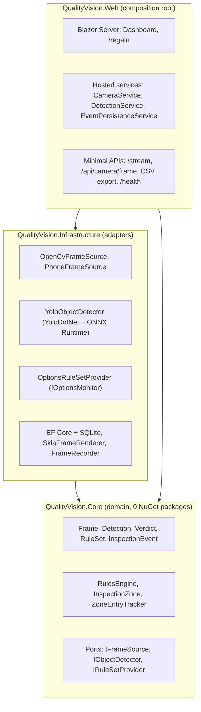
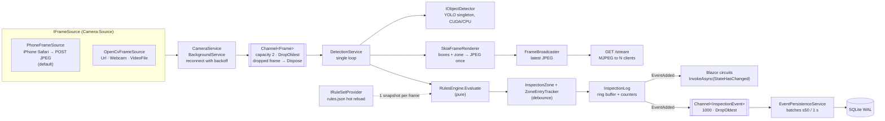
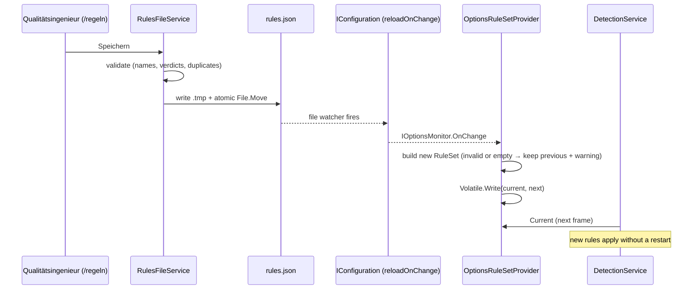
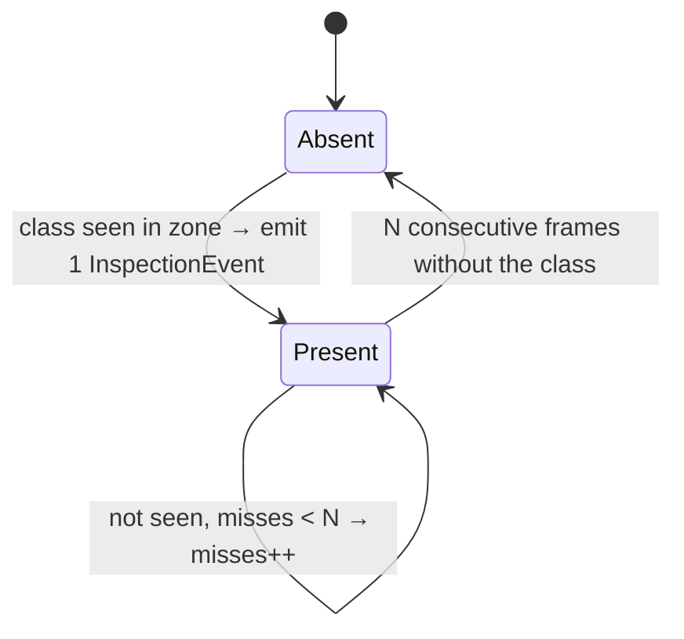
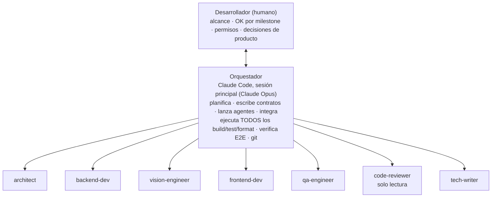
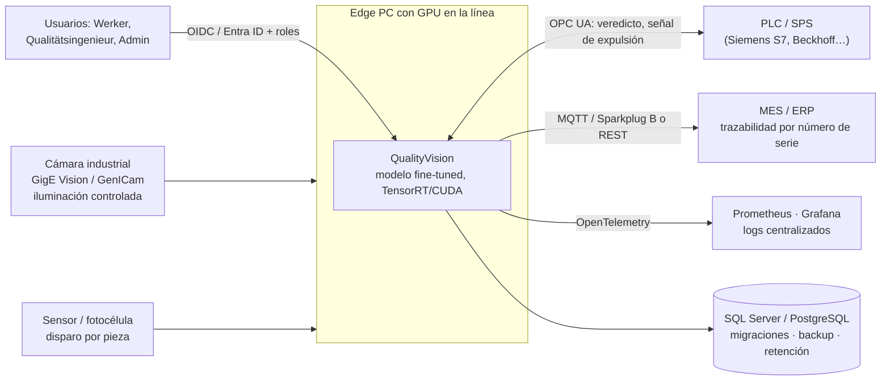

# QualityVision — documentación del proyecto

> **Inspección óptica de calidad en tiempo real con C#/.NET 10, ONNX y Blazor Server**
> Documentación técnica de referencia. Explica qué se construyó, por qué cada decisión es la que es, qué límites
> tiene y cómo se llevaría a producción en un entorno industrial.
>
> Estado: commit `bf0efb1` (M1–M6 cerrados). Fuentes: briefing original, plan del proyecto,
> ADR-001…005, *code reviews* y el código.
>
> Otras versiones: [English](../README.md) · [Deutsch](README.de.md)

---

## Índice

1. [Resumen ejecutivo](#1-resumen-ejecutivo)
2. [Caso de uso industrial](#2-caso-de-uso-industrial)
3. [Arquitectura](#3-arquitectura)
4. [Visión por computador](#4-visión-por-computador)
5. [Reglas, zona y conteo](#5-reglas-zona-y-conteo)
6. [Dashboard, persistencia y Plan B](#6-dashboard-en-tiempo-real-persistencia-y-plan-b)
7. [Calidad](#7-calidad)
8. [Cómo se construyó: desarrollo con agentes de IA](#8-cómo-se-construyó-desarrollo-con-agentes-de-ia)
9. [Decisiones, trade-offs y hoja de ruta hacia producción](#9-decisiones-trade-offs-y-hoja-de-ruta-hacia-producción)
10. [Puesta en marcha y ejecución](#10-puesta-en-marcha-y-ejecución)
11. [Glosario ES / DE / EN](#11-glosario-es--de--en)

---

## 1. Resumen ejecutivo

**Problema.** En una línea de fabricación hay que decidir para cada pieza si es buena (*i.O.*) o mala (*n.i.O.*),
contarla una sola vez, avisar al instante cuando aparece un defecto o un objeto peligroso y dejar un registro trazable.
Si lo hace una persona, el resultado es lento, caro y depende de quién mire. Los sistemas comerciales de visión suelen
ser cajas cerradas difíciles de integrar.

**Solución.** QualityVision es una estación de inspección óptica construida entera en **una sola aplicación .NET 10**:

- La cámara (un iPhone por la red local, una webcam, una URL MJPEG o un vídeo) alimenta un **pipeline con
  contrapresión** (*backpressure*).
- Un detector de objetos **YOLO en ONNX** corre **en GPU (CUDA)** y, si la GPU falla, pasa solo a CPU.
- Un **motor de reglas puro**, editable en caliente desde la web, asigna a cada objeto un veredicto:
  OK / NOK / GEFAHR / Unbekannt / Ignorieren.
- Una **Prüfzone** con *debounce* cuenta cada pieza solo cuando entra en la zona.
- Un **dashboard Blazor en alemán** muestra KPIs, la gráfica por minuto, el registro de eventos y una alarma visual y sonora.
- Cada inspección se guarda en **SQLite** y se puede exportar a **CSV** listo para Excel alemán.

**Resultados (medidos, no estimados).**

| Indicador | Valor |
|---|---|
| Inferencia YOLO11m en GPU (RTX 5070 Ti, CUDA) | **6,4–6,9 ms**, frente a **198 ms** en CPU (unas 30 veces más rápida) |
| Inferencia YOLO-World v2 L (modelo de la demo) en GPU | **~10 ms** |
| Confianza en el objeto real de la demo (rotulador, que no es clase COCO) | **0,86–0,97** en directo |
| Tests automatizados | **417**, todos en verde |
| Warnings de compilación | **0** (`TreatWarningsAsErrors`, analizadores al nivel `latest`) |
| Tamaño | ~5.600 líneas de producto (C#/Razor) y ~4.500 líneas de tests |
| Documentación | 5 ADRs, 6 contratos de interfaz, 7 *code reviews*, 8 notas de aprendizaje |
| Desarrollo | 8 commits, construidos con un equipo de agentes de IA bajo control de ingeniería (§8) |

**Enfoque:** no es un script de visión con una web encima. Es una aplicación .NET con
**arquitectura por capas comprobada por tests**, **memoria y latencia acotadas por construcción**, **degradación
controlada** (sin GPU pasa a CPU, un `rules.json` roto conserva las reglas anteriores, sin base de datos la demo sigue)
y **decisiones documentadas en ADRs**, cada una con sus alternativas descartadas.

---

## 2. Caso de uso industrial

### 2.1 El problema

En la fabricación (aquí con la terminología alemana habitual), la **inspección óptica** (*optische Prüfung / Sichtprüfung*) es uno de los puntos de control
de calidad más comunes: tras el montaje, el embalaje o la pintura, una cámara decide si la pieza es
**i.O. (in Ordnung)** o **n.i.O. (nicht in Ordnung)**.

| Concepto | Significado | En QualityVision |
|---|---|---|
| **Prüfzone** | Zona de la imagen donde se evalúa la pieza | Rectángulo central configurable (`Inspection:Zone`, coordenadas normalizadas 0..1) |
| **i.O. / n.i.O.** | Pieza buena / pieza mala | Veredictos `Ok` (verde) y `Nok` (rojo y alarma) |
| **Ausschuss** | Piezas rechazadas | Contador n.i.O. |
| **Ausschussquote** | Tasa de rechazo = n.i.O. / piezas evaluadas | KPI = `Nok / (Ok + Nok)` |
| **Gefahr** | Evento de seguridad (objeto extraño o peligroso en la celda) | Veredicto `Danger` (naranja y alarma prioritaria) |
| **Prüfprotokoll / Rückverfolgbarkeit** | Registro trazable de cada inspección | SQLite con hora, clase, veredicto y confianza; exportable a CSV |

### 2.2 Por qué la Ausschussquote se define así

La primera versión dividía entre *todas* las detecciones. El *code review* de M4 (hallazgo #5) lo corrigió con un
argumento de calidad, no de código: **GEFAHR es un evento de seguridad, no un veredicto sobre una pieza**, y
**Unbekannt no es una pieza inspeccionada**. Si se meten en el denominador, cualquier objeto que cruce la imagen
"mejora" la cuota artificialmente. En la práctica alemana, *Ausschussquote = n.i.O.-Teile / geprüfte Teile*. Por eso
GEFAHR y Unbekannt son KPIs aparte.
### 2.3 Por qué importa en la fabricación industrial

- **Coste de la no calidad:** un defecto que llega al cliente final (*Schlupf*) cuesta mucho más que detectarlo en línea.
  Con la inspección automática, el criterio es el mismo en todos los turnos.
- **Trazabilidad:** IATF 16949 (automoción) y ISO 9001 exigen evidencia de la inspección. Cada evento se persiste con marca
  de tiempo, y el CSV encaja en los informes de turno (*Schichtbericht*) que ya usa la planta.
- **Seguridad laboral:** detectar objetos peligrosos en la celda es un caso real (herramientas olvidadas, manos en la zona).
- **Integración:** el valor no está en el modelo sino en **conectarlo**: reglas que el *Qualitätsingenieur* cambia sin
  programador, datos para el MES y señales a la PLC (*SPS*). Es el trabajo de integración descrito en §9.2.

### 2.4 Alcance de la aplicación

Es una **aplicación de referencia que usa objetos cotidianos** (botella, taza, rotulador, tijeras) que representan
"pieza buena", "pieza defectuosa" y "objeto peligroso". **No** detecta defectos reales de una pieza (arañazos, rebabas,
piezas que faltan). Para eso haría falta un modelo entrenado con imágenes etiquetadas del caso real (§4.6). La
arquitectura está pensada para que ese cambio afecte a **un archivo de modelo y una clase de Infrastructure**, nada más.

---

## 3. Arquitectura

### 3.1 Capas y regla de dependencias



| Proyecto | Responsabilidad | Puede referenciar |
|---|---|---|
| `QualityVision.Core` | Modelo de dominio, reglas de negocio y puertos (interfaces) | **Nada**: cero paquetes NuGet |
| `QualityVision.Infrastructure` | Adaptadores: cámara, YOLO, configuración, base de datos, renderizado | Core |
| `QualityVision.Web` | Composition root, servicios en segundo plano, UI, endpoints | Infrastructure, Core |
| `QualityVision.Tests` | xUnit, incluidos `ArchitectureTests` | Core, Infrastructure |

**Regla:** Web → Infrastructure → Core. Core no sabe que existen YOLO, OpenCV, SkiaSharp, EF Core ni siquiera
`Microsoft.Extensions.*`. Es un estilo **hexagonal ligero** (*ports & adapters*): Core define `IObjectDetector`, e
Infrastructure lo implementa y traduce los tipos de YoloDotNet a `Detection` con coordenadas normalizadas.

**No es solo una convención: hay un test que la comprueba.** `ArchitectureTests` hace dos cosas:

- comprueba que el ensamblado de Core solo referencia `System.*`, `netstandard` y `mscorlib`;
- comprueba que su `.csproj` no tiene ningún `PackageReference` ni `FrameworkReference`.

Si alguien rompe la regla, `dotnet test` falla.

**Por qué importa:** las reglas de negocio (veredicto, zona, *debounce*) se prueban sin cámara, sin modelo, sin
configuración y sin reloj. Además, cambiar el modelo, la cámara o la base de datos no toca el dominio.

**Ejemplo de esta disciplina (ADR-002).** El briefing pedía recarga en caliente con `IOptionsMonitor` *y* un Core sin
dependencias, y las dos cosas chocan. La solución es que Core define el puerto `IRuleSetProvider { RuleSet Current }`
y recibe una **instantánea inmutable** `RuleSet`. Solo el adaptador `OptionsRuleSetProvider` de Infrastructure conoce
`IOptionsMonitor`. En una frase: *"Das Domänenmodell bekommt einen Snapshot; nur der Adapter weiß, woher er kommt."*

### 3.2 El pipeline



**Un fotograma, paso a paso:**

1. `CameraService` lee un fotograma de la fuente activa y lo escribe en el `Channel<Frame>`. Desde ese momento el
   canal es **propietario** del fotograma.
2. `DetectionService` lo saca del canal y llama a `detector.Detect(frame)`, midiendo cuánto tarda la inferencia.
3. Lee `ruleSetProvider.Current` **una vez por fotograma**, así todas las detecciones del fotograma se juzgan con las
   mismas reglas, y llama a `RulesEngine.Evaluate` por cada detección.
4. Se queda con las detecciones dentro de la Prüfzone y pasa la lista a `ZoneEntryTracker.Update`, que devuelve solo
   las **entradas nuevas**. Cada entrada se convierte en un `InspectionEvent` que va a `InspectionLog`.
5. Dibuja las cajas y la zona con SkiaSharp, **codifica el JPEG una sola vez** y lo publica en `FrameBroadcaster`.
6. Hace `Dispose` del fotograma (`using`) y espera lo que quede del intervalo de `Stream:MaxFps` (20).

### 3.3 Contrapresión: por qué un `Channel` acotado con `DropOldest`

```csharp
// src/QualityVision.Web/Program.cs
Channel.CreateBounded<Frame>(
    new BoundedChannelOptions(2) { FullMode = BoundedChannelFullMode.DropOldest, SingleReader = true, SingleWriter = true },
    static dropped => dropped.Dispose());
```

- **El problema:** la cámara produce a su ritmo y la detección consume al suyo. Con una cola sin límite, si la
  inferencia es más lenta, la cola crece: **latencia sin límite** (la imagen se queda segundos por detrás de la
  realidad) y **memoria sin límite** (acaba en *OutOfMemory*).
- **La decisión:** capacidad 2 y descartar el **más antiguo**. Para la monitorización en directo, el fotograma
  relevante es siempre el último. La latencia queda acotada a unos 2 fotogramas.
- **El detalle que separa una demo de un sistema serio:** el *callback* `itemDropped` hace `Dispose` del fotograma
  descartado. Sin él, cada descarte perdería un búfer de unos 3,7 MB (1280×720 BGRA).
- **El mismo patrón se usa dos veces:** el segundo canal (`Channel<InspectionEvent>`, 1000, `DropOldest`) desacopla
  la base de datos. Un `INSERT` lento en SQLite **nunca** frena la inferencia.
- **Trade-off aceptado:** con carga se pierden fotogramas. Para monitorizar es correcto. En una **inspección al 100 %
  con disparo** (una foto por pieza), cada imagen es obligatoria y el diseño sería otro: disparo por sensor y cola sin
  descartes (§9.2).

### 3.4 Modelo de hilos

| Actor | Contexto de ejecución | Datos compartidos y cómo se protegen |
|---|---|---|
| `CameraService` | Bucle `async` del host; las lecturas bloqueantes de OpenCV van en `Task.Run` | Solo escribe en el canal (`SingleWriter`) |
| `POST /api/camera/frame` | Hilos de petición de Kestrel | `FrameUploadGate` (como mucho 2 decodificaciones a la vez, `SemaphoreSlim.Wait(0)` → 503) |
| `DetectionService` | **Un único bucle** (`SingleReader`) | `ZoneEntryTracker` **no es thread-safe por contrato**: solo lo usa este bucle, así que no necesita locks |
| `YoloObjectDetector` | Singleton | `lock` alrededor de la sesión ONNX; `Dispose` dentro del mismo lock para no liberar la sesión a mitad de una inferencia |
| `OptionsRuleSetProvider` | Hilo del *file watcher* | Cambia el `RuleSet` inmutable de forma atómica (`Volatile.Write`); los lectores nunca ven un estado intermedio |
| `InspectionLog` | Escribe la detección y leen la UI y los endpoints | Un `lock` para contadores y *ring buffer*; el evento `EventAdded` se lanza **fuera del lock**, con un `try/catch` por suscriptor |
| Circuitos Blazor | Contexto de sincronización de cada circuito | `InvokeAsync(StateHasChanged)`; los eventos se agrupan y la alarma pendiente va con su propio *gate* |
| `EventPersistenceService` | `BackgroundService` | Lee de su propio canal; un `DbContext` de vida corta por lote (`IDbContextFactory`) |
| `Frame.Dispose` | Cualquier hilo | `Interlocked.Exchange`: el búfer se devuelve al *pool* **exactamente una vez** |

Reglas transversales del proyecto: *async all the way*, cada método `async` recibe y respeta un `CancellationToken`,
nunca `.Result` ni `.Wait()`. `TimeProvider` se inyecta donde importa la hora (marcas de tiempo, estadísticas por
minuto, *backoff*, ritmo del vídeo), y los tests usan `FakeTimeProvider` sin ningún `Thread.Sleep`.

### 3.5 Memoria nativa y *disposal*

`Mat` (OpenCV) y `SKBitmap` (SkiaSharp) envuelven memoria **no gestionada**: el GC no ve su tamaño real y no las
libera a tiempo. Una fuga de un fotograma por iteración agota la RAM en minutos. Medidas:

- **`Frame` es el dueño del búfer:** pixels BGRA en un `byte[]` alquilado a `ArrayPool`. Su `Dispose` lo devuelve al
  *pool* una sola vez (idempotente y thread-safe).
- **La transferencia de propiedad es explícita y está comentada en el código.** Si `TryWrite` funciona, el canal es el
  dueño. Si falla (canal cerrado), el productor sigue siendo el dueño y hace `Dispose`.
- **`PinnedFrame` y `SKBitmap` viven solo dentro del `lock` de inferencia**, en `using`, y se liberan en el orden
  correcto: primero el bitmap, después el *pin*. Ninguna referencia a los pixels sobrevive a la llamada.
- **Al apagar:** `DetectionService` cierra el canal y hace `Dispose` de los fotogramas que quedaban en cola.
- **Codificar una vez, servir a muchos:** el JPEG anotado se genera una vez por fotograma. Cada cliente de `/stream`
  espera la siguiente secuencia en `FrameBroadcaster`, así que el coste por cliente es O(1), y un cliente lento se
  salta fotogramas sin frenar a los demás.
- **YOLO como singleton:** cargar la sesión ONNX es caro (unos 5,5 s la primera carga en CUDA), así que se hace una vez
  y después se hace un *warm-up* con una imagen negra de 640×640.

### 3.6 Robustez: cómo falla el sistema

| Fallo | Comportamiento |
|---|---|
| Se cae la cámara | `CameraService` reconecta con *backoff* exponencial (1, 2, 4… hasta 10 s) y el dashboard muestra "Kamera nicht erreichbar – neuer Versuch in N s". El host nunca se cae. |
| Falla la inferencia de un fotograma | El fotograma se muestra sin cajas y **no** cuenta como ausencia para el *debounce*. El log se limita a una línea cada 5 s. |
| No hay GPU, driver, CUDA o cuDNN | Con `Device=Auto` pasa a YOLO11n en CPU, deja un warning y el *badge* "CPU" lo hace visible |
| `rules.json` con un error de sintaxis o vacío | Se conservan las últimas reglas válidas y se registra un warning |
| Falla SQLite | La demo sigue (contadores a cero, sin persistencia) y se registra el error |
| Un suscriptor de `EventAdded` lanza una excepción | Se aísla: no se pierden las demás entradas del fotograma |
| Un cliente abusa de `POST /api/camera/frame` | Límite de 2 MB, comprobación de *magic bytes* JPEG, cabecera SOF limitada a 4096 px de lado (contra la *decompression bomb*), como mucho 2 subidas concurrentes y **solo HTTPS** |
| Ctrl+C con dashboards abiertos | `/stream` también escucha `ApplicationStopping`, así que se apaga al instante en vez de esperar 30 s (hallazgo del review de M2) |

---

## 4. Visión por computador

### 4.1 YOLO, ONNX y YoloDotNet

- **YOLO11** (Ultralytics) es un detector de una sola pasada: por cada imagen devuelve cajas, clase y confianza. Las
  variantes `n` (nano) y `m` (medium) están entrenadas con **COCO** (80 clases cotidianas: botella, taza, tijeras, móvil…).
- **ONNX** es el formato estándar e independiente del framework. Se exporta una vez desde Python
  (`tools/export-model/export.py`, Python 3.12 con `uv`) con **opset 17 y entrada estática 1×3×640×640**. Las formas
  estáticas hacen explícito el contrato con C# y simplifican la optimización del grafo. **En tiempo de ejecución no hace
  falta Python.**
- **ONNX Runtime** ejecuta el modelo en proceso, dentro de .NET, con proveedor CPU o CUDA.
- **YoloDotNet** (MIT) aporta el pre y el postproceso: *letterbox* que mantiene la proporción, NMS y mapeo de cajas.
  Reimplementarlo no aportaba nada a la demo y añadía riesgo (ADR-003).
- **Aislamiento:** ningún tipo de YoloDotNet sale de `YoloObjectDetector`. El resto del sistema solo ve `Detection`
  con una caja normalizada a [0,1], independiente de la resolución.

**¿Por qué no un microservicio en Python (FastAPI + ultralytics)?** Supone un segundo runtime, un salto de red por
fotograma, el doble de despliegue y el doble de formas de fallar. ONNX dentro del proceso .NET es lo bastante rápido y
mantiene la solución en un solo stack, lo que simplifica la operación en entornos .NET.

### 4.2 GPU con CUDA y vuelta automática a CPU (ADR-004)

Medido en el PC de la demo (RTX 5070 Ti, ONNX Runtime 1.32.0, opset 17, entrada 640):

| Modelo | CPU (12 hilos) | CUDA |
|---|---|---|
| yolo11n (10,7 MB) | ~25–45 ms | 3,9 ms |
| yolo11s | ~50–85 ms | 4,3 ms |
| yolo11m (80,7 MB) | **198 ms** (menos de 5 FPS, no es interactivo) | **6,4–6,9 ms** |
| YOLO-World v2 L (177 MB, modelo actual) | — | **~10 ms** |

**Decisión:** el modelo grande en GPU y `DetectionOptions.Device = Auto | Cuda | Cpu`:

- `Auto` (por defecto): intenta CUDA con `ModelPath`. Ante **cualquier** excepción registra el motivo y la pista
  ("install cuDNN 9 / CUDA 13") y carga `CpuModelPath` (YOLO11n) en CPU.
- `Cuda`: si falla, el arranque falla (*fail fast*). `Cpu`: fuerza la CPU.
- `ActiveDevice` y `ActiveModel` se ven en el log, en `/api/pipeline/metrics`, en `/health` y en un **badge del
  dashboard**: el operario ve qué está corriendo.

**El bug de empaquetado.** El paquete CPU y el paquete GPU de ONNX Runtime traen
una librería nativa con **el mismo nombre** (`libonnxruntime.so`). La versión CPU (34,8 MB) llegaba al directorio de
salida por dependencia transitiva y **sobrescribía en silencio** la de GPU (38,1 MB), así que CUDA no cargaba. La
solución es `ExcludeAssets="native;runtime"` en el paquete CPU. **El detalle no evidente es que `ExcludeAssets` no se
propaga a través de `ProjectReference`**: hay que repetirlo en *cada* proyecto ejecutable (Web y Tests). Ahora lo
protege el test `OnnxRuntimeNativeLibrary_InOutput_IsGpuBuild`, que funciona incluso sin GPU, porque la build GPU
lista el proveedor CUDA aunque no haya tarjeta.

### 4.3 YOLO-World: vocabulario abierto y distractores (ADR-005)

**Problema real:** el objeto de la demo es un **rotulador**, y "marker pen" **no es una clase COCO**. Un modelo no
puede nombrar lo que no está en su vocabulario, da igual el tamaño o el umbral.

| Opción | Evaluación |
|---|---|
| Bajar el umbral de confianza | Inútil: la clase no existe; solo aparecen más falsos positivos de otras clases |
| *Fine-tuning* de YOLO11 con fotos propias | Lo mejor a largo plazo, pero exige un dataset etiquetado, entrenamiento y validación. No cabía en el plazo |
| **Detector de vocabulario abierto** | Las clases se dan como **texto**. Se probaron dos en la mesa real: **YOLO-World v2 L** (rotulador 0,86–0,97, taza 0,94, botella 0,91, móvil 0,46–0,71) y **YOLOE-11-L** (no encontró nada en una foto de producto) |

**Cómo se hizo sin tocar C#:** las 14 clases de texto se **fijan en la exportación** (`set_classes([...])` y después
el export a ONNX). El resultado es un ONNX YOLO estándar (salida `1×(4+14)×8400`, nombres de clase en los metadatos),
que YoloDotNet ejecuta tal cual. Cambiar la lista de clases es **re-exportar (segundos), no reentrenar**.

**Distractores (*negative prompting*).** Con un umbral de 0,25 aparecían falsos "marker pen" con confianza 0,25–0,36
sobre objetos parecidos. La solución fue darles **su propia clase** (`pencil`, `cable`, `reed diffuser`, `notebook`,
`keyboard`, `computer mouse`, `laptop`) para que el modelo les asigne la etiqueta a ellos. En `rules.json` se mapean a
`Ignore`, y así se pudo subir el umbral a **0,45** sin perder el rotulador.

Clases actuales (el orden importa; fuente: `tools/export-model/world-classes.txt`) y sus reglas:

| Veredicto | Clases |
|---|---|
| `Ok` (i.O., verde) | marker pen, bottle, cell phone, banana |
| `Nok` (n.i.O., rojo + alarma) | cup |
| `Danger` (GEFAHR, naranja + alarma prioritaria) | scissors |
| `Ignore` (no se cuenta ni se dibuja) | person, pencil, cable, reed diffuser, notebook, laptop, keyboard, computer mouse |
| `Unknown` (gris) | cualquier clase sin regla (*fallback* fijo del `RuleSet`) |

### 4.4 Límites conocidos

- **El fallback a CPU (YOLO11n, COCO) no detecta el rotulador.** Botella, taza, tijeras y móvil sí. Está documentado
  en ADR-005.
- **Un detector de objetos no es un detector de defectos.** La taza "es" NOK por regla, no porque se vea un defecto.
- **El vocabulario abierto es un puente, no el estado final:** es más sensible a la iluminación, al fondo y a las
  formulaciones del texto que un modelo ajustado a las piezas reales.
- **No hay identidad de objeto:** dos objetos de la misma clase a la vez en la zona cuentan como uno (§5.3).
- **Sin control de iluminación ni óptica industrial:** en una línea real, la luz y la cámara importan tanto como el modelo.

### 4.5 Licencias

| Componente | Licencia | Consecuencia |
|---|---|---|
| YOLO11 (código **y pesos**, Ultralytics) | **AGPL-3.0** | El §13 de la AGPL se activa también con el uso **a través de la red** (una UI alojada basta): obligación de ofrecer el código fuente sin que haya distribución. Aceptable en una demo interna; **en un producto comercial no** |
| YOLO-World (Tencent AILab) | **GPL-3.0** (y la toolchain de Ultralytics es AGPL) | Misma advertencia |
| YoloDotNet 4.2.0 | **MIT** (verificado en el *nuspec*; un *review* afirmó que era GPL y el orquestador lo corrigió) | Sin restricciones |
| ONNX Runtime | MIT | Sin restricciones |
| OpenCvSharp | Apache-2.0 | Sin restricciones |
| Fuente DejaVu Sans (etiquetas en el vídeo) | Licencia libre, incluida en `Assets/Fonts/` | Sin restricciones |

**Camino comercial:**

- (a) una **licencia Enterprise de Ultralytics**; o
- (b) un **modelo con licencia permisiva**: RT-DETR original de Baidu/`lyuwenyu` o YOLOX, ambos Apache-2.0. Ojo: el
  *port* de RT-DETR de Ultralytics es AGPL. Ese modelo se ejecutaría con ONNX Runtime o YoloDotNet, ambos MIT.

Como solo `YoloObjectDetector` conoce el formato de salida de YOLO, el cambio se limita a esa clase (con su propio
postproceso si el formato es distinto) y al archivo del modelo.

### 4.6 El camino profesional: *fine-tuning* con datos etiquetados

En un proyecto industrial real, el proceso sería:

1. **Captura de datos en la línea**, con la cámara, la óptica y la iluminación definitivas. Se recogen cientos o miles
   de imágenes por clase de defecto, incluidos los casos límite.
2. **Etiquetado** (CVAT, Label Studio…) con criterios acordados con QS (*Qualitätssicherung*), apoyado en el catálogo
   de defectos de la planta (*Fehlerkatalog*).
3. ***Fine-tuning*** de un modelo base y **validación con un conjunto separado**. Las métricas no son solo mAP: hay que
   medir sobre todo la **tasa de *Schlupf*** (piezas n.i.O. que pasan como i.O.) y el **pseudo-rechazo**
   (*Pseudoausschuss*: piezas buenas rechazadas). Cada planta decide cuál de los dos es más caro.
4. **Versionado del modelo** (archivo, hash, dataset, métricas) y despliegue controlado (piloto en sombra junto al
   operario, después en producción).
5. **Reentrenamiento continuo** con los casos dudosos que marca el operario (*human in the loop*).

Integrarlo en QualityVision es sustituir el `.onnx` y, si cambia el formato de salida, adaptar `YoloObjectDetector`.
Las reglas, la zona, el conteo, la UI y la persistencia no cambian.

---

## 5. Reglas, zona y conteo

### 5.1 `RulesEngine`: una función pura

```csharp
// Core: no state, no configuration, no clock
public static Verdict Evaluate(Detection detection, RuleSet rules);
```

- `RuleSet` es un mapa **inmutable** clase → veredicto, **insensible a mayúsculas** (`OrdinalIgnoreCase`), y cualquier
  clase sin regla devuelve `Unknown`. Como es inmutable, se comparte entre hilos sin locks.
- **No existe `IRulesEngine`:** una función pura no necesita *mock*. Es simplicidad a propósito, no un descuido.
- `DetectionService` lee `IRuleSetProvider.Current` **una vez por fotograma**, así que nunca hay un fotograma juzgado
  con dos versiones de las reglas.

### 5.2 Recarga en caliente



Detalles que hacen esto robusto en directo:

- **Archivo separado `rules.json`.** El editor **nunca** reescribe `appsettings.json`: si un error de escritura
  corrompe un archivo, solo puede ser el de reglas.
- **Escritura atómica** (archivo temporal y `Move`) y serializada con un `SemaphoreSlim`: el *file watcher* nunca lee
  un archivo a medio escribir.
- **Los veredictos se leen como `string`** y se parsean con `Enum.TryParse(ignoreCase: true)` dentro del adaptador. Un
  valor erróneo lo gestiona nuestro código, en vez de lanzar una excepción en el hilo del *watcher* desde el *binder*.
- **Un JSON con un error de sintaxis** se registra (`OnLoadException`, con `Ignore = true`) y se conservan las reglas
  anteriores. **Un archivo vacío o ausente durante la recarga** también conserva las anteriores (hallazgo MAJOR del
  review de M4: antes se borraban todas, y una persona en la zona habría contado como "Unbekannt").
- **Editor web `/regeln`:** tabla clase → veredicto en alemán, validación con mensajes en alemán y "Gespeichert –
  Regeln werden live übernommen". Lee el archivo **con la misma tolerancia** que el sistema de configuración
  (comentarios y comas finales). Hallazgo MAJOR del review de M5: con un parser más estricto, un comentario en
  `rules.json` hacía que el editor mostrara la tabla vacía, y al pulsar Guardar se habrían **borrado todas las reglas**.

### 5.3 Prüfzone y *debounce* por fotogramas de ausencia

**Zona:** rectángulo normalizado (por defecto X 0,3 · Y 0,2 · 40 % × 60 % de la imagen). Un objeto está "en la zona"
si **el centro de su caja** cae dentro, bordes incluidos. Elegir el centro es estable y fácil de explicar: una caja que
roza la zona no cuenta.

**Problema:** YOLO no da identidad a los objetos. Cada fotograma es independiente, y la detección "parpadea" (un
fotograma no ve la taza y al siguiente sí). Contar "detecciones" multiplicaría cada pieza por 20 por segundo.

**Solución: una máquina de estados por clase** (`ZoneEntryTracker`, en Core y sin reloj):



- **N = `Inspection:AbsenceFrames`** (por defecto 5, rango 1–100, validado al arrancar). Un hueco de N−1 fotogramas
  (parpadeo) **no vuelve a contar**. Sacar el objeto N fotogramas y volver a meterlo **cuenta otra vez**.
- **¿Por qué fotogramas y no segundos? (ADR-002)** El parpadeo es un fenómeno *del detector*, por fotograma, así que el
  fotograma es su unidad natural. Además el *tracker* queda como una **función pura de la secuencia de entrada**,
  testeable sin `FakeTimeProvider`. **Trade-off aceptado:** el equivalente en tiempo depende de los FPS (N = 5 son
  0,25 s a 20 FPS y 0,5 s a 10 FPS). Se reajusta en la configuración sin tocar código. Se descartaron un *debounce* por
  tiempo y uno híbrido por ser más parámetros sin beneficio visible.
- **Un fotograma con error de inferencia no alimenta el *tracker***: un fallo no es una "ausencia" y no provoca un
  recuento falso.
- **Si cambia N en caliente**, el *tracker* se recrea y se "ceba" con el fotograma actual, descartando sus entradas.
  Si no, todo lo que ya está en la zona contaría dos veces (hallazgo del review de M4).
- **Limitación consciente:** dos objetos de la misma clase a la vez en la zona cuentan como uno. En la demo los objetos
  se presentan de uno en uno. **La mejora es un *multi-object tracker* (SORT / ByteTrack)** que da IDs de pista. La
  clave del diccionario pasaría de "clase" a "ID de pista" sin cambiar el resto del pipeline.

---

## 6. Dashboard en tiempo real, persistencia y Plan B

### 6.1 Blazor Server: el circuito ya es SignalR

El briefing pedía un hub SignalR propio. **La decisión final (plan del proyecto) fue no crearlo.** En Blazor Server
(Interactive Server) cada pestaña del navegador mantiene un **circuito**, que *ya es* una conexión SignalR. El
componente se suscribe a `IInspectionLog.EventAdded` y llama a `InvokeAsync(StateHasChanged)`. Blazor calcula el *diff*
del DOM y envía solo los cambios.

| Opción | Motivo |
|---|---|
| Hub propio + cliente JS | Dos transportes, serialización duplicada y código JS que mantener |
| **Circuito Blazor (elegido)** | Un solo transporte, sin cliente JS, menos piezas que explicar y que puedan fallar |
| Blazor WebAssembly | Haría falta una capa API y una descarga mayor, sin ventaja en una LAN |

Detalles de implementación:

- **Eventos** (entradas en la zona): se envían al instante. Si llegan varios seguidos, se agrupan en un único
  `InvokeAsync`.
- **Métricas** (FPS, ms de inferencia, contadores): un `PeriodicTimer` de 1 s con el `TimeProvider` inyectado. Es
  legible para una persona y barato para el servidor.
- **Gráfica por minuto:** barras apiladas (i.O. / n.i.O. / Gefahr / Unbekannt) de los últimos 15 minutos, en **SVG
  generado por Razor en el servidor**. No hay librería de gráficas, ni interop JS, ni datos serializados al cliente.
  Trampa resuelta: los números del SVG se escriben con `InvariantCulture`, porque en `de-DE` "3,5" sería un atributo
  SVG inválido.
- **KPIs:** i.O., n.i.O., Gefahr, Unbekannt, Ausschussquote, FPS, ms de inferencia y el *badge* GPU/CPU con el nombre
  del modelo.
- **Ereignisprotokoll:** últimos eventos con la hora, la etiqueta en alemán, el veredicto y la confianza.
- **Kamerastatus:** fuente, ● Verbunden / ● Getrennt, FPS de entrada y el último error en alemán (el error técnico
  queda en el log).
- **Vídeo en directo:** `` con MJPEG (`multipart/x-mixed-replace`). Se descartó WebRTC: necesita
  señalización y un stack JS, y MJPEG basta en una LAN. Las cajas y las etiquetas en alemán (fuente DejaVu, trazo
  grueso) se dibujan en el servidor y son legibles incluso con compresión de vídeo.

### 6.2 Alarma

- **Banner visual** de 4 s: rojo para n.i.O. y naranja para GEFAHR. **GEFAHR tiene prioridad**: un NOK no tapa una
  alarma de peligro.
- **Sonido con la Web Audio API**, sin archivos de audio: NOK son 2 pitidos de 880 Hz y GEFAHR 3 pitidos de 600 Hz,
  sin solaparse. Los navegadores bloquean el audio hasta que hay un gesto del usuario, por eso existe el botón
  **"Ton an"**, que hay que pulsar antes de empezar.

### 6.3 Persistencia: EF Core + SQLite

- **Por qué SQLite:** un archivo, sin servidor, sin instalación. Es suficiente para una estación. En producción se usaría
  SQL Server o PostgreSQL (§9.2), y como el acceso va por EF Core el cambio afecta al proveedor, no al código de la
  aplicación.
- **`IDbContextFactory`:** el `DbContext` no es thread-safe y está pensado para unidades de trabajo cortas. Un
  `BackgroundService` es un singleton, así que se crea **un contexto por lote** con `await using`. Un fallo no deja un
  *change tracker* sucio para el siguiente lote.
- **Lotes:** como mucho 50 eventos o 1 s, lo que llegue antes. Al apagar se vacía el canal y se escribe lo pendiente.
- **`DateTimeOffset` → ticks UTC (`long`)** con un *value converter*: SQLite no tiene tipo fecha. Así el índice, el
  `ORDER BY` y los filtros por rango son comparaciones de enteros.
- **Modo WAL:** el export CSV hace *streaming* con un cursor abierto. Con el *journal* por defecto bloquearía los
  `INSERT`. WAL permite lectores y un escritor a la vez (hallazgo MINOR del review de M6).
- **Arranque ordenado:** `InspectionDatabaseInitializer` se registra *antes* que el pipeline (los *hosted services*
  arrancan en orden). Crea el esquema y **siembra los contadores y eventos del día**, así un reinicio no pone el turno a
  cero. Los eventos sembrados llevan una secuencia negativa para no chocar con la `@key` de la UI.
- **`EnsureCreated` en lugar de migraciones:** es un trade-off de demo, documentado en el código. En producción se usan
  migraciones (las dos opciones no se pueden mezclar en la misma base de datos).

### 6.4 Exportación CSV e inyección

`GET /api/inspection/export.csv?from=yyyy-MM-dd&to=yyyy-MM-dd` (por defecto, el día de hoy):

- Pensado para **Excel alemán**: separador `;`, coma decimal, **UTF-8 con BOM** (para que Excel detecte la codificación
  y las diéresis), CRLF, cabecera `Zeitpunkt;Klasse;Bezeichnung;Bewertung;Konfidenz` y archivo `pruefungen-AAAAMMDD.csv`.
- ***Streaming*** con `IAsyncEnumerable` (`AsAsyncEnumerable` + `AsNoTracking`): la exportación nunca carga toda la
  tabla en memoria.
- **CSV *formula injection* (OWASP), hallazgo MAJOR del review de M6:** un campo que empieza por `= + - @`, TAB o CR se
  ejecutaría como fórmula al abrirlo en Excel. Hoy los valores vienen del modelo, pero los nombres de clase son
  configurables, así que es una entrada no confiable. Se neutraliza con el prefijo `'`, y después se entrecomilla y se
  escapan las comillas. Está cubierto por tests.

### 6.5 Plan B: vídeo grabado

La cámara es la parte más frágil de una instalación (Wi-Fi, batería del móvil, certificado). La abstracción
`IFrameSource` (patrón Strategy) convierte el Plan B en **un valor de configuración**:

| `Camera:Source` | Implementación | Uso |
|---|---|---|
| `Phone` (por defecto) | `PhoneFrameSource`: la página `/kamera` en Safari del iPhone envía JPEGs por HTTPS | Cámara principal. Se eligió frente a DroidCam por **menor latencia** (decisión del desarrollador) |
| `Url` | `OpenCvFrameSource` + FFmpeg (DroidCam MJPEG, RTSP) | Alternativa |
| `Webcam` | `OpenCvFrameSource`, índice V4L2 | Cámara USB local |
| `VideoFile` | `OpenCvFrameSource`, en bucle y al ritmo de los FPS del archivo | **Plan B** |

- **Grabación:** `Camera__RecordTo=<ruta absoluta>` graba los fotogramas *crudos* (sin anotaciones, para que el
  pipeline los vuelva a procesar en directo) en mp4 a 15 fps, con un límite de `Camera__RecordMaxSeconds` (120 s). Si la
  grabación falla, se desactiva sin interrumpir la captura.
- **Bug detectado en el review de M6 (MAJOR):** el *recorder* solo *saltaba* fotogramas, nunca los duplicaba, y el
  vídeo se reproducía a **1,5×**. Ahora escribe "por *slot*" de tiempo: duplica fotogramas si la fuente va más lenta y
  los descarta si va más rápida. Un test vuelve a leer el mp4 con OpenCV y comprueba el número de fotogramas.
- **Reproducción:** `./run-demo.sh --video` fija `Camera__Source=VideoFile` y la ruta absoluta de `samples/demo.mp4`.
- **Honestidad sobre el alcance:** el cambio a vídeo es **manual** (reiniciar con `--video`). El paso *automático* al
  vídeo cuando se pierde la cámara, previsto en ADR-001, **no se implementó**: la reconexión con *backoff* y el banner
  del estado de la cámara sí existen. **A día de hoy `samples/demo.mp4` todavía no está grabado** (ver §10.1).

---

## 7. Calidad

### 7.1 Quality gates (Definition of Done de cada milestone)

| # | Gate | Herramienta |
|---|---|---|
| 1 | 0 warnings, 0 errores | `dotnet build -warnaserror` (`TreatWarningsAsErrors`, `Nullable`, `AnalysisLevel latest`, `EnforceCodeStyleInBuild`, IDE0005 para `using` sobrantes) |
| 2 | Tests en verde | `dotnet test` (xUnit) |
| 3 | Formato limpio | `dotnet format --verify-no-changes` + `.editorconfig` |
| 4 | Review sin BLOCKER | Informe del agente `code-reviewer` |
| 5 | Verificación funcional real | curl, capturas con Playwright/Chromium, inspección de los fotogramas MJPEG anotados |
| 6 | Nota de aprendizaje | una por milestone, en español, con preguntas de repaso |
| 7 | Commit | Conventional Commits, uno por milestone |
| 8 | **Parada** | El desarrollador da el OK antes del siguiente milestone |

Además: **Central Package Management** (`Directory.Packages.props`, ninguna versión en los `.csproj`), `global.json`
que fija el SDK, y convenciones del proyecto (inglés en el código, alemán en la UI, logging estructurado con
plantillas y no con interpolación).

### 7.2 417 tests: qué cubren

| Área | Ejemplos |
|---|---|
| Dominio (Core) | `RulesEngine` y `RuleSet` (mayúsculas, *fallback* Unknown, duplicados), `InspectionZone` (bordes), `ZoneEntryTracker` (entrada, parpadeo de N−1, salida y reentrada, N configurable, Ignore), `Frame` (dispose idempotente) |
| Arquitectura | `ArchitectureTests`: Core sin dependencias |
| Infrastructure | `OptionsRuleSetProvider` con un `IOptionsMonitor` falso (recarga, recarga inválida, recarga vacía, *unsubscribe*), `PhoneFrameSource` y `JpegHeader` (cabecera SOF, *decompression bomb*), `SkiaFrameRenderer` (colores por veredicto muestreando pixels), detector YOLO real con `bus.jpg`, guarda de la librería nativa GPU, `FrameRecorder` (relectura del mp4) |
| Web | `DetectionService` con un detector guionizado, `FrameBroadcaster`, `FrameUploadGate`, `InspectionLog` (por minuto, siembra), `EventPersistenceService` e inicializador con **SQLite en memoria**, `InspectionCsv` (formato e inyección), `RulesFileService`, *binding* de opciones, health checks |

### 7.3 Bugs reales que detectaron los reviews

| Milestone | Hallazgo | Impacto si no se hubiera corregido |
|---|---|---|
| M2 | `/stream` ignoraba el apagado del host | Ctrl+C tardaba 30 s y la app parecía colgada |
| M2 | *Decompression bomb* en `POST /api/camera/frame`: un JPEG de menos de 2 MB puede declarar 2^30 px | Unos 3 GB por petición: se cae el proceso por falta de memoria |
| M2 | Abrir una URL sin timeout | Cada reintento de reconexión tardaba unos 30 s |
| M3 | Un fallo de inferencia congelaba el stream | La imagen se quedaba parada |
| M4 | Una recarga con `rules.json` vacío o ausente borraba todas las reglas | Las personas en la zona habrían contado como "Unbekannt" |
| M4 | Definición de la Ausschussquote | KPI incorrecto según la práctica de calidad alemana |
| M4b | La librería nativa CPU de ONNX Runtime sobrescribía la de GPU | CUDA no cargaba y la app corría en CPU sin avisar |
| M5 | El editor leía `rules.json` con un parser más estricto | Un comentario en el archivo y un clic en Guardar habrían borrado todas las reglas |
| M6 | Inyección de fórmulas en el CSV (OWASP) | Ejecución de fórmulas al abrir la exportación en Excel |
| M6 | El vídeo del Plan B se reproducía a 1,5× | Plan B visiblemente defectuoso |

Y en sentido contrario, **verificar en lugar de confiar**: el reviewer de M3 afirmó que YoloDotNet era GPL. El
orquestador comprobó el *nuspec* (MIT) y lo corrigió. Un agente también informó de un número de tests incorrecto, que
se corrigió con el resultado de la ejecución real.

### 7.4 Seguridad (alcance consciente)

Es una demo **solo para la LAN y sin autenticación, por diseño** (ADR-001, "Security considerations"). Medidas
proporcionadas:

- **Red:** firewall del host que solo permite el puerto 5080 desde la IP del portátil y el 5443 desde la del iPhone;
  nunca en una red pública; la app se para al terminar la sesión.
- **Entorno `Production`:** sin página de excepciones para desarrolladores ni *stack traces* visibles.
- **Endpoint de fotogramas endurecido** (§3.6).
- **Editor de reglas** que escribe en una ruta fija, con validación y escritura atómica.
- **CSV neutralizado.**
- **Certificados TLS fuera del repositorio** (`appsettings.Local.json` en `.gitignore`).

---

## 8. Cómo se construyó: desarrollo con agentes de IA

> Esta sección describe el método de desarrollo: **ingeniería con IA bajo control**, no "la IA lo hizo".

### 8.1 Principios

La IA se usó como **un equipo de desarrolladores junior y especialistas** que trabaja rápido pero necesita
especificaciones precisas, revisión y verificación. **La responsabilidad técnica es del desarrollador**: fija el
alcance, aprueba cada milestone, da los permisos del sistema y decide. Cada línea está cubierta por gates automáticos,
un review independiente y una verificación funcional real. Y todo está documentado para que el proyecto sea
mantenible (las notas de aprendizaje son parte de la *Definition of Done*).

### 8.2 Roles



| Rol | Responsabilidad | Restricción |
|---|---|---|
| **Desarrollador (humano)** | Alcance, aprobación de cada milestone (**parada obligatoria**), permisos de sistema, decisiones de producto | — |
| **Orquestador** | Plan, contratos, delegación, integración, gates, verificación en vivo, git, memoria del proyecto | **No escribe código de producto** (regla global): delega |
| `architect` | Estructura, contratos entre capas, ADRs | No implementa |
| `backend-dev` | Pipeline, DI, *hosted services*, EF Core, endpoints | No toca la UI |
| `vision-engineer` | Cámara, ONNX, detección, rendimiento, *disposal* | No toca la UI |
| `frontend-dev` | Blazor, dashboard, UX en alemán | No escribe lógica de dominio |
| `qa-engineer` | Tests xUnit y verificación | No escribe código de producto |
| `code-reviewer` | Review con hallazgos BLOCKER / MAJOR / MINOR | **Solo lectura**: únicamente puede crear su informe de review |
| `tech-writer` | README, notas de aprendizaje, documentación | No escribe código |

Cada rol está definido en `.claude/agents/<rol>.md`, y cada encargo incluye esa definición más la tarea concreta.
**Los agentes no pueden ejecutar `dotnet`**: el orquestador ejecuta todos los builds, tests y comprobaciones de formato,
así que ningún agente puede declarar "en verde" algo que no lo está.

### 8.3 Método por milestone

```mermaid
flowchart LR
    C["1 · Contrato<br/>firmas exactas · ownership · archivos permitidos"] --> P["2 · Agentes en paralelo<br/>backend ║ frontend ║ vision ║ architect"]
    P --> I["3 · Integración<br/>build -warnaserror · test · format"]
    I --> QA["4 · QA + review (Opus)<br/>agente de fix: MAJORs + MINORs baratos"]
    QA --> E["5 · Verificación E2E<br/>curl · Playwright · fotogramas"]
    E --> L["6 · Nota de aprendizaje"]
    L --> G["7 · Commit<br/>Conventional Commits"]
    G --> S["8 · PARADA<br/>OK del humano"]
```



- **Los contratos permiten el paralelismo:** con firmas exactas y una lista de archivos por rol, backend y frontend
  trabajan a la vez sin pisarse. Es lo mismo que una *interface-first* entre equipos humanos.
- **Paralelismo real:** en M4, `backend-dev` implementaba el `RulesEngine` y el *tracker* mientras `qa-engineer`
  escribía tests contra la misma interfaz. En M5, el backend y el dashboard iban contra el mismo contrato.

### 8.4 Agentes visibles y elección de modelo

- **Visibilidad:** cada agente corre en **su propia ventana de Konsole** (scripts `lanzar-claude.sh` y `run-claude.sh`),
  colocada por un script de KWin en el escritorio "Desarrollo", así que el desarrollador **ve trabajar a cada agente**. El
  código de salida se escribe en `<nombre>.exit`; el orquestador lo espera y después cierra la ventana.
- **Modelo según la tarea** (coste frente a capacidad):

| Modelo | Uso |
|---|---|
| Claude Sonnet | La mayoría de la implementación y los tests (rápido y barato) |
| Claude Opus | *Code reviews* y el trabajo de UI más delicado |
| Claude Haiku | Un *fix* trivial |

- **Contexto:** el plan original era OpenCode con DeepSeek v4 Pro. Su cuota se agotó y los agentes pasaron a ser
  sesiones de Claude CLI. **En total hubo 67 encargos a agentes.**

### 8.5 Humano en el bucle: qué decidió el desarrollador

| Decisión del desarrollador | Efecto |
|---|---|
| Fijó el alcance y el briefing completo | Fuente de verdad (`PROMPT_ORIGINAL.md`) |
| Aprobó cada milestone tras la parada | Ningún milestone avanzó sin su OK |
| Descartó Tailscale (fuera del alcance del proyecto) | Se evitó complejidad fuera de alcance |
| Eligió la página del iPhone frente a DroidCam por la latencia | `Camera:Source = Phone` por defecto |
| Pidió usar toda la potencia de la GPU | ADR-004, CUDA |
| Pidió detectar el rotulador | ADR-005, YOLO-World |
| Instaló cuDNN personalmente cuando el clasificador de permisos lo bloqueó | **La IA nunca ejecutó `sudo`** |

**Lo que hizo la IA:** redactar el plan, los contratos y los ADRs, implementar, escribir los tests, revisar, verificar y
documentar, siempre dentro de los límites anteriores.

### 8.6 Incidentes y lecciones

| Incidente | Lección o regla nueva |
|---|---|
| Los reviews encontraron bugs reales (§7.3) | Un review independiente con un modelo fuerte compensa su coste |
| El reviewer afirmó que YoloDotNet era GPL | **Verificar en la fuente** (*nuspec*: MIT) antes de aceptar una afirmación |
| Un agente informó de un número de tests incorrecto | Las cifras se toman siempre de la ejecución real del orquestador |
| `pkill -f <nombre del proyecto>` mató a un agente cuyo prompt contenía ese texto | Los procesos se matan **solo por PID** |
| Un *heredoc* sin comillas hizo que la shell ejecutara las comillas invertidas de un prompt (sin daños) | Los prompts se escriben siempre con *heredocs* entre comillas |
| Un límite de uso cortó a un agente a mitad del milestone | Se relanzó indicando qué archivos ya existían; otro agente a medias se retomó con "revisa `git diff`, conserva lo correcto, completa el resto" |

**Decisiones de producto tomadas con datos, no por intuición:** GPU (198 ms frente a 6,5 ms medidos), rotulador
(bajar el umbral no sirve; YOLO-World dio 0,86–0,97 en directo; el camino profesional es el *fine-tuning*) y sin hub
SignalR propio (el circuito de Blazor ya lo es).

### 8.7 Hitos

| Hito | Trabajo |
|---|---|
| M0 | Entorno (SDK de .NET 10; `uv` y Python 3.12 solo para exportar el modelo) |
| M1–M4 | *Scaffold*, agentes y ADR-001; captura, MJPEG y página del iPhone; YOLO11 y cajas; reglas, zona, *debounce* y recarga en caliente |
| M4b–M6 | GPU; dashboard, alarma y editor; YOLO-World y `run-demo.sh`; SQLite, CSV y grabación |

**Pendiente del plan original:** M7 (pulido: Serilog, health check de la cámara).

---

## 9. Decisiones, trade-offs y hoja de ruta hacia producción

### 9.1 Tabla de decisiones

| Decisión | Alternativa | Por qué |
|---|---|---|
| Monolito .NET con ONNX en el proceso | Microservicio Python (FastAPI) | Un solo runtime, sin salto de red por fotograma, un despliegue; ONNX es lo bastante rápido |
| Core sin dependencias + puertos | Inyectar las librerías directamente | Dominio testeable y estable; cambiar el modelo o la cámara no lo toca; comprobado por test |
| `Channel<Frame>` (2, `DropOldest`) | Cola sin límite / llamada directa | Latencia y memoria acotadas por construcción |
| Segundo canal hacia la base de datos | Escribir desde la detección | La I/O nunca frena la inferencia |
| JPEG codificado una vez + `FrameBroadcaster` | Codificar por cliente | O(1) por espectador |
| MJPEG por `` | WebRTC | Trivial y robusto en una LAN; WebRTC exige señalización y JS |
| Blazor Server (circuito = SignalR) | Hub propio / Blazor WASM | Un solo transporte, menos código, sin capa API extra |
| Gráfica SVG generada en el servidor | Chart.js por interop | Sin dependencias ni JS; Blazor la actualiza con el mismo *diff* |
| `RulesEngine` puro + `RuleSet` inmutable | `IOptionsMonitor` dentro del motor | Core sin `Microsoft.Extensions.*`; instantánea coherente por fotograma |
| `rules.json` aparte con escritura atómica | Reescribir `appsettings.json` | Un fallo de escritura no puede romper la configuración principal |
| *Debounce* por fotogramas de ausencia | Por tiempo / híbrido | El parpadeo es un fenómeno por fotograma; función pura sin reloj; N ajustable |
| Conteo por clase | *Tracker* SORT/ByteTrack | Suficiente con un objeto cada vez; la mejora está documentada y localizada |
| YoloDotNet | ONNX Runtime con pre y postproceso propios | No reimplementar *letterbox* y NMS; menos riesgo |
| GPU con `Auto` → CPU | Solo CPU / solo GPU | Mejor modelo y 30× más rápido, sin dejar de arrancar en una máquina sin GPU |
| YOLO-World con distractores | *Fine-tuning* / bajar el umbral | La clase no existe en COCO; no había tiempo para un dataset; sin cambios en C# |
| SQLite + `EnsureCreated` | Servidor de BD + migraciones | Cero instalación para una estación; en producción, migraciones |
| `IDbContextFactory` | `DbContext` inyectado en un singleton | El `DbContext` no es thread-safe y su vida es corta |
| Fuentes de cámara como Strategy (`IFrameSource`) | Una clase por modo / código fijo | El Plan B es un valor de configuración |
| Sin autenticación (solo LAN, firewall) | Auth completa | Fuera del alcance actual; mitigaciones de red proporcionadas |
| Sin Docker | Contenedor | El acceso a la cámara y la GPU desde el contenedor añade riesgo sin beneficio en una sola máquina |
| `TimeProvider` inyectado | `DateTime.Now` | Tests deterministas sin *sleeps* |

### 9.2 Hoja de ruta hacia producción



| Ámbito | Medida |
|---|---|
| **Seguridad y acceso** | HTTPS en todo; autenticación OIDC (Entra ID / Keycloak) con **roles**: el operario (*Werker*) ve, el *Qualitätsingenieur* edita reglas, el administrador configura; **audit trail** de cada cambio de regla (quién, cuándo, antes y después), clave para la trazabilidad y auditorías IATF |
| **Integración en planta** | **OPC UA** con la PLC (veredicto, señal al expulsor / *Ausschleuser*, disparo por pieza); **MQTT** (Sparkplug B) o REST hacia el **MES**; asociar cada evento al **número de serie o lote** de la pieza |
| **Modo de inspección** | Disparo por sensor (una imagen por pieza, **sin descartes**) en lugar de vídeo continuo con `DropOldest`, cuando la inspección es al 100 % |
| **Modelo** | *Fine-tuning* con datos etiquetados del cliente (§4.6); métricas de *Schlupf* y *Pseudoausschuss*; versionado y registro del modelo; despliegue en sombra; reentrenamiento con casos dudosos; TensorRT para más rendimiento; *tracker* ByteTrack si hay varias piezas a la vez |
| **Hardware** | Cámara industrial (GigE Vision / USB3 Vision, GenICam), óptica e **iluminación controlada**; edge PC con GPU o NVIDIA Jetson |
| **Datos** | SQL Server o PostgreSQL con **migraciones EF Core**, backup, política de retención, informes por turno |
| **Operación** | Logging estructurado centralizado (Serilog → Seq/ELK), **OpenTelemetry** (métricas: FPS, latencia, cuota, salud de la cámara), health checks de *liveness* y *readiness* (incluida la cámara), alertas |
| **Despliegue** | Contenedor Docker con acceso a la GPU (NVIDIA Container Toolkit); varias estaciones → Kubernetes en el edge (K3s) o despliegue gestionado; CI/CD con los mismos quality gates |
| **Licencias** | Modelo con licencia comercial (Ultralytics Enterprise) o permisiva (Apache-2.0); revisión de licencias de todas las dependencias |
| **Cumplimiento (Alemania)** | Si la cámara puede grabar personas: **RGPD (DSGVO)** y **acuerdo con el comité de empresa (*Betriebsrat*)**, porque la vigilancia técnica de empleados requiere su codeterminación (BetrVG §87 (1) n.º 6). En el diseño actual, `person → Ignore` y no se guardan imágenes, solo eventos: es un buen punto de partida |
| **Proceso** | Requisitos del cliente (*Lastenheft*) → especificación (*Pflichtenheft*) → piloto → aceptación formal (*Abnahme*) con criterios medibles |

---

## 10. Puesta en marcha y ejecución

### 10.1 Preparación

1. **Grabar el vídeo del Plan B (pendiente: `samples/demo.mp4` todavía no existe).** Con la cámara funcionando:
   ```bash
   Camera__RecordTo=$PWD/samples/demo.mp4 ASPNETCORE_ENVIRONMENT=Production \
     dotnet run --project src/QualityVision.Web --no-launch-profile
   ```
   Presentar delante de la cámara rotulador, botella, taza y tijeras, de uno en uno, entrando y saliendo de la zona.
   Usar una **ruta absoluta**. Para con Ctrl+C o a los 120 s; el log muestra `Recorded N frames to …`.
   Comprobarlo con `./run-demo.sh --video`.
2. **Comprobar el modelo:** `models/yoloworld-qv.onnx` (177 MB, fuera de git, reproducible con
   `tools/export-model/export.py`). Sin él, `Auto` no puede cargar el modelo de GPU y pasa a YOLO11n en CPU, que **no
   detecta el rotulador**.
3. **Arrancar la aplicación con unos minutos de margen** (la primera carga de CUDA tarda unos 5,5 s, más el *warm-up*):
   ```bash
   ./run-demo.sh            # publish Release + Production
   ./run-demo.sh --no-build # if it is already published
   ```
   El script comprueba la GPU (`nvidia-smi`) y que los puertos 5080 y 5443 estén libres, copia
   `appsettings.Local.json` (el endpoint HTTPS para el iPhone) e imprime las URLs.
4. **iPhone:** abrir `https://<IP-del-PC>:5443/kamera` en Safari (certificado autofirmado, ya aceptado), permitir la
   cámara y apoyar el móvil fijo apuntando a la mesa.
5. **Navegador:** abrir `http://<IP-del-PC>:5080`, comprobar el **badge GPU** y pulsar **"Ton an"** para activar el
   sonido.
6. **Firewall:** puertos limitados a las IPs de los equipos que participan.

### 10.2 URLs

| URL | Para qué |
|---|---|
| `http://<IP-del-PC>:5080/` | Dashboard (vídeo, KPIs, gráfica, eventos, alarma, CSV) |
| `http://<IP-del-PC>:5080/regeln` | Editor de reglas en caliente |
| `http://<IP-del-PC>:5080/health` | Health checks (modelo, base de datos) |
| `http://<IP-del-PC>:5080/api/pipeline/metrics` | FPS, ms de inferencia, dispositivo, modelo, detecciones actuales (JSON) |
| `http://<IP-del-PC>:5080/api/camera/status` | Estado de la fuente de cámara (JSON) |
| `http://<IP-del-PC>:5080/api/inspection/export.csv` | Exportación CSV (hoy; opcionalmente `?from=…&to=…`) |
| `https://<IP-del-PC>:5443/kamera` | Página de captura del iPhone |

### 10.3 Recorrido funcional

| # | Paso | Qué demuestra |
|---|---|---|
| 1 | Dashboard en reposo: vídeo, Prüfzone, *badge* GPU, FPS e inferencia | Aplicación .NET 10; YOLO en ONNX en GPU, unos 10 ms por imagen; si falla la GPU, pasa sola a CPU |
| 2 | Meter el **rotulador** en la zona → verde, i.O. +1, evento | Cuenta al *entrar*, no por fotograma: *debounce* por fotogramas de ausencia |
| 3 | Moverlo **dentro** de la zona → no vuelve a contar; sacarlo y meterlo → +1 | Máquina de estados, función pura, testeada |
| 4 | **Taza** → rojo, banner, pitido, Ausschussquote sube | Ausschussquote = n.i.O. / (i.O. + n.i.O.); GEFAHR y Unbekannt no son piezas |
| 5 | **Tijeras** → naranja, alarma GEFAHR | Evento de seguridad con prioridad sobre NOK |
| 6 | Persona o lápiz en la imagen → no se cuenta | Distractores mapeados a `Ignore` (vocabulario abierto) |
| 7 | `/regeln`: cambiar `cup` a `Ok` → Guardar → la taza pasa a verde al instante | Recarga en caliente; escritura atómica; un archivo roto conserva las reglas anteriores |
| 8 | Gráfica por minuto y **CSV exportieren** → abrirlo | `;`, coma decimal, BOM para Excel, protección contra inyección de fórmulas |
| 9 | (Opcional) `/health` y `/api/pipeline/metrics` | Operabilidad |
| 10 | Código: la arquitectura por capas, `ArchitectureTests`, el `Channel` en `Program.cs` y `ZoneEntryTracker` | La regla de dependencias la comprueba un test |

**Restaurar `cup → Nok` después del paso 7.**

### 10.4 Resolución de problemas

| Síntoma | Causa probable | Acción |
|---|---|---|
| "Getrennt" / no hay imagen del iPhone | Wi-Fi, pantalla bloqueada, Safari en segundo plano | Recargar `/kamera` en el iPhone. Si no se recupera en 30 s → **Plan B**: Ctrl+C y `./run-demo.sh --no-build --video` |
| *Badge* "CPU" en lugar de GPU | Falta el driver, CUDA o cuDNN, o falta `yoloworld-qv.onnx` | Mirar el warning del log ("CUDA unavailable…"). Con CPU funcionan botella, taza, tijeras y móvil, pero no el rotulador: usar la botella como pieza i.O. (el *fallback* es parte del diseño) |
| No detecta el rotulador | Luz, ángulo, demasiado lejos | Acercarlo, girarlo y mejorar la luz. A largo plazo, la solución es el *fine-tuning* (§4.6) |
| Cuenta dos veces | Parpadeo más largo que N fotogramas | Subir `Inspection:AbsenceFrames` (por ejemplo a 10); el equivalente en tiempo depende de los FPS (§5.3) |
| Sin sonido | No se pulsó "Ton an" (política de *autoplay* del navegador) | Pulsar "Ton an" |
| `run-demo.sh`: "port 5080 already in use" | Hay otra instancia en marcha | Pararla (por PID) y volver a lanzar |
| `--video`: "demo.mp4 not found" | El vídeo no está grabado | Grabarlo antes (§10.1) |
| Pantalla de error en el navegador | Excepción (en Production no se muestra el *stack trace*) | Mirar el log de la terminal; recargar la página |
| Contadores con datos antiguos | Se siembran los datos de hoy desde SQLite | Es intencionado (sobrevive a reinicios). Para empezar de cero: parar y borrar `artifacts/demo/data/qualityvision.db` |

Una degradación controlada (*fallback* a CPU, Plan B como valor de configuración, reglas anteriores conservadas) es un
comportamiento de diseño, no un fallo: el sistema sigue funcionando con capacidad reducida y lo hace visible.

---

## 11. Glosario ES / DE / EN

| Español | Deutsch | English |
|---|---|---|
| Inspección óptica / visual | optische Prüfung, Sichtprüfung | visual / optical inspection |
| Estación de inspección | Prüfstation | inspection station |
| Zona de inspección | Prüfzone | inspection zone / region of interest |
| Pieza buena / mala | i.O.-Teil / n.i.O.-Teil (in Ordnung / nicht in Ordnung) | OK / NOK part (pass / fail) |
| Rechazo, piezas rechazadas | Ausschuss | scrap, rejects |
| Tasa de rechazo | Ausschussquote | scrap rate / reject rate |
| Retrabajo | Nacharbeit | rework |
| Defecto que pasa sin detectar | Schlupf | escape / false negative |
| Pseudo-rechazo (pieza buena rechazada) | Pseudoausschuss, Fehlausschuss | false reject / false positive |
| Peligro, evento de seguridad | Gefahr, Sicherheitsereignis | hazard, safety event |
| Desconocido | Unbekannt | unknown |
| Aseguramiento de la calidad | Qualitätssicherung (QS) | quality assurance (QA) |
| Catálogo de defectos | Fehlerkatalog | defect catalogue |
| Registro de inspección | Prüfprotokoll | inspection log / record |
| Trazabilidad | Rückverfolgbarkeit | traceability |
| Informe de turno | Schichtbericht | shift report |
| Operario | Werker, Bediener | operator |
| Tiempo de ciclo | Taktzeit | cycle time |
| Autómata programable | SPS (speicherprogrammierbare Steuerung) | PLC |
| Sistema de ejecución de fabricación | MES (Fertigungsmanagementsystem) | MES |
| Expulsor de piezas | Ausschleuser | reject / ejector unit |
| Fotocélula, sensor de disparo | Lichtschranke, Trigger | light barrier, trigger |
| Comité de empresa | Betriebsrat | works council |
| Pliego de requisitos / especificación | Lastenheft / Pflichtenheft | requirements spec / functional spec |
| Aceptación formal | Abnahme | acceptance |
| Detección de objetos | Objekterkennung | object detection |
| Inferencia | Inferenz | inference |
| Confianza (*score*) | Konfidenz | confidence |
| Umbral | Schwellwert | threshold |
| Caja delimitadora | Begrenzungsrahmen, Bounding Box | bounding box |
| Vocabulario abierto | offenes Vokabular | open vocabulary |
| Clase distractora | Ablenkerklasse, Negativklasse | distractor class / negative prompt |
| Ajuste fino | Feinabstimmung, Fine-Tuning | fine-tuning |
| Etiquetado de datos | Annotation, Labeling | data labelling / annotation |
| Conjunto de validación | Validierungsdatensatz | validation set |
| Vuelta automática (a CPU) | automatischer Rückfall, Fallback | automatic fallback |
| Antirrebote | Entprellung | debounce |
| Parpadeo de la detección | Flackern | flicker |
| Contrapresión | Gegendruck, Backpressure | backpressure |
| Cola acotada | begrenzte Warteschlange | bounded queue / channel |
| Descartar el más antiguo | ältestes Element verwerfen | drop oldest |
| Latencia | Latenz | latency |
| Fotogramas por segundo | Bilder pro Sekunde (FPS) | frames per second |
| Fuga de memoria | Speicherleck | memory leak |
| Liberar recursos | Ressourcen freigeben (Dispose) | dispose |
| Inyección de dependencias | Dependency Injection, Abhängigkeitsinjektion | dependency injection |
| Arquitectura por capas | Schichtenarchitektur | layered architecture |
| Puertos y adaptadores | Ports und Adapter (hexagonale Architektur) | ports and adapters |
| Regla de dependencias | Abhängigkeitsregel | dependency rule |
| Recarga en caliente | Hot Reload, Neuladen zur Laufzeit | hot reload |
| Instantánea inmutable | unveränderlicher Snapshot | immutable snapshot |
| Función pura | reine Funktion | pure function |
| Escritura atómica | atomares Schreiben | atomic write |
| Persistencia | Persistenz | persistence |
| Exportación CSV | CSV-Export | CSV export |
| Inyección de fórmulas | Formel-Injektion (CSV-Injection) | CSV / formula injection |
| Comprobación de salud | Health Check, Zustandsprüfung | health check |
| Puerta de calidad | Quality Gate | quality gate |
| Criterio de terminado | Definition of Done | definition of done |
| Revisión de código | Code-Review | code review |
| Registro de decisiones de arquitectura | Architekturentscheidung (ADR) | architecture decision record |
| Plan B / modo de reserva | Plan B, Rückfallmodus | fallback mode |
| Orquestador | Orchestrator | orchestrator |
| Humano en el bucle | Mensch in der Schleife (Human in the Loop) | human in the loop |
