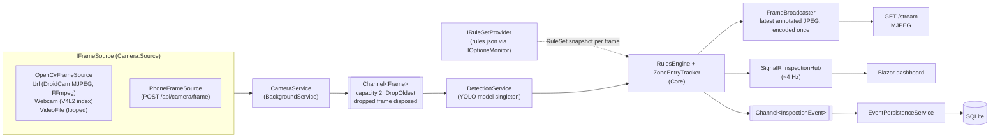
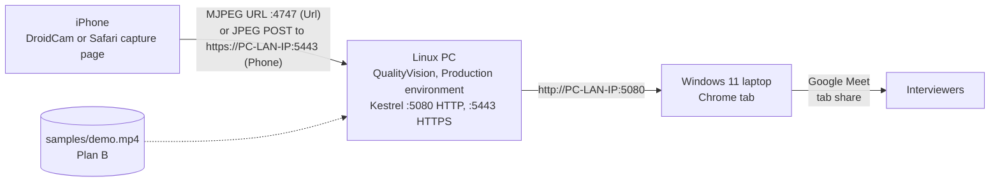

# ADR-001: Layered architecture and inspection pipeline

- **Status:** Accepted (amended 2026-11-15, see [Amendments](#amendments))
- **Date:** 2026-11-15
- **Deciders:** architect, orchestrator, project owner

## Context

QualityVision is an industrial visual quality inspection demo in C#/.NET 10. A live camera image is
shown in the browser with an inspection zone ("Prüfzone"). YOLO11n (ONNX, CPU, YoloDotNet) detects
objects, a configurable rules engine assigns a verdict (OK / NOK / DANGER / UNKNOWN / IGNORE), objects
are counted once when they enter the zone, and a German Blazor dashboard shows KPIs and a live event
log. Events are persisted to SQLite and exportable as CSV.

Forces:

- **Robustness over cleverness.** The demo runs live in a technical interview on Monday; a frozen
  stream or a crash is worse than a lower frame rate.
- **Explainability.** Every decision must be defensible by the project owner in an interview.
- **Real-time on CPU.** Inference (~tens of ms per frame) must not be slowed by I/O (database, slow
  browser clients), and the pipeline must not accumulate latency.
- **Native memory.** `Mat` and `SKBitmap` wrap unmanaged buffers; a leak of one 1280x720 frame per
  iteration exhausts memory within minutes.
- **Testability.** Business rules (verdicts, zone, debounce) must be unit-testable without a camera,
  a model file or real time.
- **Remote presentation.** The interview is held over Google Meet from a Windows laptop whose webcam
  is used for the face; the object camera must be a different device.

## Decision

### 1. Layers and dependency rule

| Project | Responsibility | May reference |
|---|---|---|
| `QualityVision.Core` | Domain model (`Frame`, `Detection`, `Verdict`, `RuleSet`, `InspectionEvent`), `RulesEngine`, `InspectionZone`, `ZoneEntryTracker`, ports (`IFrameSource`, `IObjectDetector`, `IRuleSetProvider`) | nothing — zero NuGet packages |
| `QualityVision.Infrastructure` | Adapters: frame sources (`OpenCvFrameSource`, `PhoneFrameSource`), YoloDotNet detector, `OptionsRuleSetProvider` (`IOptionsMonitor` → `RuleSet`), EF Core + SQLite | Core |
| `QualityVision.Web` | Composition root, hosted services, Blazor Server UI, SignalR hub, minimal API endpoints | Infrastructure, Core |
| `QualityVision.Tests` | xUnit unit tests and `ArchitectureTests` | Core, Infrastructure |

**Web → Infrastructure → Core.** Core does not know that YOLO, OpenCV, SkiaSharp, EF Core or
`Microsoft.Extensions.*` exist; Infrastructure translates library types into Core types (ports and
adapters, "hexagonal light"). The rule is enforced by `ArchitectureTests` (allow-list: Core may only
reference `System.*`, `netstandard`, `mscorlib`), so a violation fails `dotnet test`.

Adapters that contain logic worth testing (`PhoneFrameSource`, `OptionsRuleSetProvider`) live in
Infrastructure, not Web, because the test project references Core and Infrastructure only.

### 2. Pipeline

Key points:

- **`IFrameSource` (Strategy), two implementations.** `Camera:Source` = `Phone | Url | Webcam | VideoFile`.
  - `OpenCvFrameSource` wraps `VideoCapture` for three modes: `Url` (MJPEG/RTSP via the OpenCV FFmpeg
    backend — the default live camera is DroidCam on the iPhone), `Webcam` (V4L2 index) and
    `VideoFile` (looped, paced to the file FPS; Plan B).
  - `PhoneFrameSource` receives JPEG frames pushed by the iPhone capture page (`/kamera`, served on the
    HTTPS endpoint because iOS Safari requires a secure context for `getUserMedia`) to
    `POST /api/camera/frame`, decodes them and keeps only the latest frame.
  - Both are scheduled in M2. On loss of the live source, `CameraService` reconnects with backoff;
    the **automatic fallback to the video file** with a dashboard banner is added in M6.
- **Bounded `Channel<Frame>`, capacity 2, `DropOldest`.** The detector always works on a recent frame
  and latency never accumulates. The `itemDropped` callback disposes the dropped frame, so dropping
  never leaks native memory.
- **YOLO model as singleton.** Loading the ONNX session is expensive; it is created once at startup.
  Inference time is measured per frame and exposed as a KPI.
- **Rules are a per-frame snapshot.** `DetectionService` reads `IRuleSetProvider.Current` once per
  frame and passes the immutable `RuleSet` to the pure `RulesEngine` (see [ADR-002](ADR-002-rules-engine-boundary.md)).
- **Encode once, serve many.** `DetectionService` annotates the frame, encodes it to JPEG once and
  hands it to `FrameBroadcaster`; `GET /stream` (`multipart/x-mixed-replace`) serves the latest JPEG
  to N clients at O(1) cost per client and stops on `RequestAborted`.
- **Database off the hot path.** Inspection events go through a second channel to
  `EventPersistenceService`; a slow SQLite write never delays inference.
- **Dashboard updates throttled to ~4 Hz** over SignalR — readable for humans and cheap for Blazor Server.

### 3. Rules and configuration

- Rules live in a separate `rules.json` loaded with `reloadOnChange: true`. The web rules editor
  writes only this file (fixed path, validated input); `appsettings.json` is never rewritten.
- `IOptionsMonitor<RulesOptions>` is used **only in the Infrastructure adapter** `OptionsRuleSetProvider`,
  which maps the options to an immutable Core `RuleSet` and rebuilds it on `OnChange`. Core sees only
  `IRuleSetProvider` and `RuleSet`. Changes apply on the next frame without restart. Details and
  contract: [ADR-002](ADR-002-rules-engine-boundary.md).
- Other options are validated at startup (`ValidateDataAnnotations().ValidateOnStart()`).
- **Kestrel** is configured through `Kestrel:Endpoints` (not `Urls`, which cannot carry a certificate
  per endpoint):

  | Endpoint | Address | Serves |
  |---|---|---|
  | `Http` | `http://0.0.0.0:5080` | Dashboard, `/stream`, rules editor, CSV export |
  | `Https` | `https://0.0.0.0:5443` | Phone capture page `/kamera` and `POST /api/camera/frame` |

  The HTTPS endpoint uses a self-signed certificate whose `Certificate:Path` / `Certificate:KeyPath`
  come from configuration (environment variables set by `run-demo.sh`, or an uncommitted
  `appsettings.Production.json`) and point to files **outside the repository**. Certificates and keys
  are never committed.

### 4. Time

`TimeProvider` is injected wherever **wall-clock time** matters: event timestamps, per-minute
statistics, the camera health check ("last frame < 2 s"), reconnect backoff and video-file pacing.
Product code never calls `DateTime.Now` / `DateTime.UtcNow`; tests use `FakeTimeProvider` and run
without sleeps. The debounce in §5 is deliberately **not** time-based: it counts frames and needs no clock.

### 5. Counting: per-class debounce in frames

YOLO detections carry no object identity. `ZoneEntryTracker` therefore keeps a state machine **per
class** (case-insensitive class name): *Absent → Present* emits one event when the class appears in
the zone after having been absent for at least **N consecutive evaluated frames**; a gap shorter than
N frames (detector flicker) does not recount. N is configurable (`Inspection:AbsenceFrames`,
default **5**). Detections with verdict `IGNORE` never produce events.

"Evaluated frame" means a frame that went through detection; frames dropped by the channel or skipped
by "infer every 2nd frame" do not count. The time equivalent of N therefore depends on the detection
rate: N = 5 is ~0.5 s at 10 FPS (live) and ~0.17 s at 30 FPS (video file). This is acceptable for the
demo because (a) flicker is a per-frame phenomenon of the detector, so frames are its natural unit;
(b) objects are presented one at a time and removed for well over a second, so either value separates
"flicker" from "removed"; (c) the tracker stays a pure function of its input sequence, testable
without a clock. If the rate turns out very different on demo day, N is retuned in configuration.
Rationale and rejected alternatives: [ADR-002](ADR-002-rules-engine-boundary.md).

**Known limitation (accepted):** two objects of the same class in the zone at the same time count
once. This is a conscious trade-off for a demo where objects are presented one at a time. Future
improvement: a multi-object tracker (SORT / ByteTrack) providing track IDs, which would replace the
per-class key with a per-track key without changing the rest of the pipeline.

### 6. Model artefact

The exported `models/yolo11n.onnx` (opset 17, static 640x640 input, ~10 MB) is **committed to the
repository**, together with a reproducible export script (`tools/export-model/`, Python 3.12 via uv).
The demo must not depend on internet access or a Python environment at runtime.

### 7. Demo topology

The application, the model and the camera ingestion run on the Linux PC (12-thread CPU), started by
`run-demo.sh` with `ASPNETCORE_ENVIRONMENT=Production`. The laptop only joins Google Meet (its webcam
stays on the presenter's face) and shares the Chrome **tab** showing the dashboard, which gives the
best video quality in Meet. Stream settings target legibility after Meet compression: 1280x720,
10–15 FPS, JPEG quality 70–80, thick high-contrast boxes.

## Consequences

**Positive**

- Domain logic is pure C# and fully unit-testable (no camera, model, configuration system or clock needed).
- Camera choice, including the Plan B video, is one configuration value; from M6 the automatic
  fallback keeps the demo alive if the phone or Wi-Fi fails.
- Bounded latency and bounded memory by construction (capacity-2 channel, disposal on drop).
- Slow consumers (database, browsers) cannot slow down detection.
- Rules can be changed live during the demo, which makes the `IOptionsMonitor` hot reload visible.

**Negative / accepted trade-offs**

- Frames are dropped under load — acceptable for monitoring, not for 100 % inspection lines.
- Per-class counting under-counts simultaneous objects of the same class (see §5).
- The debounce window in seconds varies with the detection rate (see §5).
- Self-signed certificate requires a one-time manual trust step on the iPhone (Phone source only).
- MJPEG uses more bandwidth than a video codec; irrelevant on a LAN with one or two viewers.
- CPU-only inference limits FPS (target 10–20 FPS for YOLO11n at 640x640).

### Security considerations

The application is a **LAN-only demo on a trusted network with no authentication, by design**
(authentication is out of scope). Anyone who can reach the ports can watch `/stream`, use the rules
editor, push frames and download the CSV; the dashboard and Blazor circuit travel over plain HTTP.
This is accepted for a single supervised session and mitigated as follows:

- **Network:** run only on the home LAN, never on public or guest Wi-Fi. The host firewall
  (`ufw` / nftables) allows `5080/tcp` only from the laptop's IP and `5443/tcp` only from the
  iPhone's IP; the app is stopped after the demo.
- **Environment:** the demo runs in `Production` (`run-demo.sh`), so no developer exception page or
  stack trace is shown to the interviewers; errors go to the log and a German error page.
- **Frame endpoint (`POST /api/camera/frame`):** request size limit (~2 MB), `Content-Type: image/jpeg`
  only plus JPEG magic-byte check (`FF D8 FF`), undecodable payloads rejected with 400, and the request
  never waits for inference. Mapped on the HTTPS endpoint only (`RequireHost("*:5443")`).
- **Rules editor:** writes a single fixed path (no user-supplied path), validates class names and
  verdicts before writing, writes atomically (temp file + move).
- **CSV export:** fields quoted, leading `= + - @` neutralised (formula injection).
- **Secrets:** TLS certificate and key live outside the repository and are git-ignored; nothing
  sensitive is committed.
- **HSTS** is not used: it has no effect over HTTP and browsers ignore it for IP hosts.

## Alternatives considered

| Alternative | Why rejected |
|---|---|
| YOLO in a Python microservice (FastAPI + ultralytics) | Second runtime and process, network hop per frame, deployment and failure modes multiply; ONNX in-process in .NET is fast enough and keeps the demo a single C# application. |
| WebRTC for video to the browser | Lower bandwidth, but needs signalling and a JS client stack; MJPEG over `` is trivial, robust and good enough on a LAN. |
| Blazor WebAssembly | Would require an API layer and a larger download; Blazor Server gets live updates over its existing SignalR circuit with less code. |
| Docker | Adds camera/device passthrough and networking complexity with no benefit for a single-machine demo. |
| GPU inference (CUDA / DirectML) | Driver and package risk on demo day; YOLO11n on a 12-thread CPU is sufficient. |
| Unbounded queue / no channel | Unbounded latency and memory growth when inference is slower than capture. |
| Writing rules into `appsettings.json` | Risk of corrupting the main configuration; a dedicated `rules.json` isolates the editor. |
| One `IFrameSource` class per mode (Webcam/Url/VideoFile) | Three classes would duplicate the same `VideoCapture` loop; only the opening call differs, so one `OpenCvFrameSource` with a mode switch is simpler. |
| Authentication for the demo | Out of scope; network-level mitigations above are proportionate for a supervised LAN session. |

## Amendments

ADR-001 was amended on 2026-11-15, before any pipeline code existed, to resolve the M1 review
findings (`docs/reviews/M1-review.md` #4, #5, #6, #7, #10). No accepted behaviour was reversed; the
changes make the document consistent and precise:

- §1/§3: `IOptionsMonitor` moved out of the Core story; Core receives `RuleSet` via `IRuleSetProvider`
  (detailed in ADR-002).
- §2: frame sources consolidated into `OpenCvFrameSource` + `PhoneFrameSource` (both M2); auto-fallback in M6.
- §3/§7: Kestrel `Kestrel:Endpoints` with HTTP 5080 and HTTPS 5443; demo runs in `Production`.
- §4/§5: debounce unit fixed to frames of absence (default N = 5); `TimeProvider` scope clarified.
- Consequences: "Security considerations" added.
