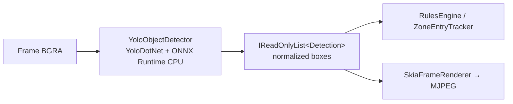

# ADR-003: Object detection model and inference runtime

- **Status:** Accepted
- **Date:** 2026-11-15
- **Deciders:** architect, orchestrator, project owner
- **Refines:** [ADR-001](ADR-001-architecture.md) (`DetectionService`, YOLO singleton)

## Context

M3 adds real object detection to the pipeline. The demo runs on a Linux PC **without GPU**, the camera
is an iPhone (default source: browser page; alternative: DroidCam URL), and the result must be visible live in a shared Meet tab. We need a
model and a runtime that give interactive latency on CPU, are easy to run from C#, and can be explained
and defended in an interview, including their licence.

## Decision

1. **Model: YOLO11n (COCO, 80 classes).** The smallest YOLO11 variant: 10.7 MB ONNX file. Measured on this PC
   (12 CPU threads, YoloDotNet 4.2.0): model load 279 ms, warm-up 70 ms, **~25 ms EMA inference in the
   running app** (~45 ms in a cold scratch benchmark on an 810×1080 image). The stream is capped at
   15 FPS (`Stream:MaxFps`), so the detector keeps up with the live sources. COCO classes cover the demo objects (bottle, cup, scissors, cell phone, …); no
   training is needed. Larger variants (s/m) cost roughly 2–4× the latency for accuracy the demo does
   not need.
2. **Format: ONNX, opset 17, static input `images` 1×3×640×640, output `output0` 1×84×8400.**
   Static shapes keep graph optimisation simple and make the contract with the C# side explicit. The
   export is reproducible via `tools/export-model/export.py` (`uv run`); the `.onnx` is committed, so
   Python is **not** needed to build or run the app.
3. **Runtime: YoloDotNet with `YoloDotNet.ExecutionProvider.Cpu`**, `ImageResize.Proportional`
   (letterbox, keeps aspect ratio). It provides pre/post-processing (letterbox, NMS, box mapping) and
   was verified on `bus.jpg` (bus 0.91, persons 0.83–0.89).
4. **CPU only.** No GPU execution provider, consistent with the out-of-scope list.
5. **Isolation:** YoloDotNet and SkiaSharp types stay in Infrastructure. Core only sees
   `IObjectDetector` and the `Detection` record with normalized boxes. One `YoloObjectDetector`
   instance (singleton) is shared and `Detect` is guarded by a lock.

## Licensing

- **Model:** Ultralytics YOLO11 code **and weights are AGPL-3.0**. Not being "distributed as a product"
  is not enough to ignore it: AGPL-3.0 §13 also applies when users **interact with the software over a
  network** (a hosted inspection UI is enough), so source-offer obligations can arise without any
  distribution. Acceptable for this internal demo; the model file and the test image carry licence
  notices (`models/README.md`, `tests/QualityVision.Tests/Assets/README.md`).
- **Runtime:** YoloDotNet 4.2.0 is **MIT** (verified from the package nuspec). ONNX Runtime is MIT and
  OpenCvSharp is Apache-2.0 (upstream project licences; not re-verified for the pinned versions).
- **Permissive models:** RT-DETR is Apache-2.0 only in the original Baidu / `lyuwenyu` implementation;
  the **Ultralytics RT-DETR port is AGPL-3.0**. YOLOX is Apache-2.0 upstream (confirm the licence of
  the exact weights before use: unverified).
- **Commercial path:** an Apache-2.0/MIT model (YOLOX or original RT-DETR) with YoloDotNet or plain
  ONNX Runtime (both MIT), or an Ultralytics Enterprise licence. The model sits behind
  `IObjectDetector` and only `YoloObjectDetector` knows the YOLO output layout, so replacing it is a
  change in one Infrastructure class plus the exported file. A different output layout needs its own
  post-processing, and YoloDotNet support for other architectures is unverified.

## Consequences

- Good: ~25 ms inference on CPU, 10.7 MB model, no GPU or Python at runtime, swappable detector.
- Good: reproducible model provenance (script with version floors, verified opset and shapes).
- Bad: the AGPL licence blocks shipping the model in a closed-source product without further steps.
- Bad: COCO classes are generic; industrial defect classes would need a custom-trained model
  (and its own licence review).
- Bad: YoloDotNet is a small community library; its API may change between major versions
  (versions are pinned via CPM).
- At ~25 ms per frame the detector is the bottleneck for sources above ~40 FPS (video files); the
  bounded channel with `DropOldest` from ADR-001 absorbs this.

## Alternatives considered

- **Raw ONNX Runtime + own pre/post-processing:** full control and one dependency fewer, but we would
  reimplement letterbox, NMS and box scaling with no benefit for the demo. Rejected for effort and risk.
- **YOLO11s/m:** better accuracy, 2–4× slower on CPU; the demo targets responsiveness.
- **RT-DETR (original) / YOLOX (Apache-2.0):** the right answer for a commercial product (see
  Licensing; commercial stack: Apache-2.0 model + YoloDotNet or ONNX Runtime, both MIT), but more
  integration work today. Kept as the documented migration path.
- **GPU / CUDA provider:** excluded by scope and by the demo machine.
- **Python inference sidecar:** breaks the single-stack goal and adds a process boundary.
