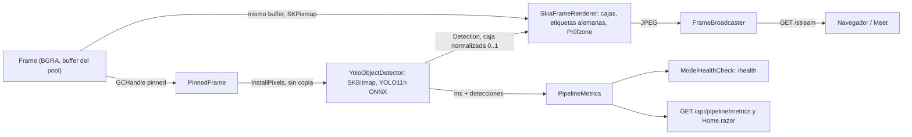

# M3 — Detección con YOLO11n y renderizado con SkiaSharp

> Primer milestone con "visión de verdad": cada frame pasa por una red neuronal (YOLO11n, en CPU) y sale con cajas y etiquetas en alemán dibujadas encima. Todavía **no hay reglas** (Prüfzone como criterio de OK/NOK llega en M4). Su valor en la entrevista: muestra que sabes integrar un modelo ONNX sin copiar píxeles, aislar fallos y explicar la licencia.

---

## Qué se hizo

- **Core (sin paquetes):** `Detection` (clase, confianza y caja **normalizada** 0..1), `IObjectDetector` (el puerto) y `GermanLabels` (nombre COCO → alemán, con *fallback* al nombre original).
- **Infrastructure:** `YoloObjectDetector` (singleton con YoloDotNet + ONNX Runtime CPU), `DetectionOptions` + `DetectionOptionsValidator`, `PinnedFrame` (fija el buffer del frame para que Skia lo lea sin copiar) y `SkiaFrameRenderer`, que **sustituye** a `JpegFrameEncoder` (ya no existe).
- **Web:** `DetectionService` actualizado, `PipelineMetrics`, `ModelHealthCheck` y `GET /api/pipeline/metrics`.
- **Front:** panel de métricas en `Home.razor` (FPS, ms de inferencia, nº de detecciones, lista con etiqueta alemana).
- **Modelo y herramientas:** `models/yolo11n.onnx` (10,7 MB, versionado), `tools/export-model/export.py` (exportación reproducible) y `ADR-003`.
- **Fuente de la etiqueta:** `Assets/Fonts/DejaVuSans-Bold.ttf` con su licencia, copiada a la carpeta de salida.
- **Tests:** **218** en total (lo reporta el orquestador; yo no los he ejecutado).

Flujo de datos de M3, por frame:



Lo que **todavía no existe**: reglas (OK/NOK), seguimiento de entrada en zona, persistencia. `DetectionService` lo dice en su comentario de cabecera: M4 inserta ahí el motor de reglas.

---

## Por qué

- **YOLO11n y no un modelo mayor:** es la variante más pequeña (10,7 MB). Medido en este PC (12 hilos, sin GPU): ~25 ms de media (EMA) dentro de la app. Las variantes s/m cuestan 2–4× más latencia para una precisión que la demo no necesita. COCO ya trae botella, taza, tijeras, móvil… sin entrenar nada.
- **ONNX con forma estática:** es el contrato explícito entre Python (solo para exportar) y C#. En ejecución no hay Python.
- **YoloDotNet y no ONNX Runtime a pelo:** YoloDotNet ya hace el *letterbox*, la NMS y el mapeo de cajas. Reimplementarlo no aporta nada a la demo (alternativa documentada en ADR-003).
- **Solo CPU:** la máquina de la demo no tiene GPU; está fuera de alcance.
- **Singleton con `lock`:** cargar el modelo cuesta 279 ms y consume memoria; se carga una vez. Solo hay un consumidor, pero el `lock` lo hace explícito.
- **Coordenadas normalizadas:** la detección no depende de la resolución. Lo mismo vale para pintar a 1280 px que a 640 px, y M4 podrá comparar contra la Prüfzone (también normalizada).
- **Sin copiar píxeles:** a 15 FPS y 3,7 MB por frame, cada copia son ~55 MB/s de tráfico de memoria. Un solo buffer fijado alimenta a YOLO y a Skia.
- **SkiaSharp con fuente propia:** las fuentes Hershey de OpenCV no soportan "ü" (problema de M2). Skia dibuja TrueType real, pero en Linux sin fontconfig no hay fuente del sistema: hay que **llevar la fuente en el repo**.
- **El fallo del modelo no congela la imagen:** la cámara es la prueba de que la demo está viva. Si la inferencia falla, se muestra el frame sin cajas.
- **Etiquetas grandes (28/32 px sobre 1280):** en Google Meet la imagen se reescala y se comprime; una etiqueta de 20 px se vuelve ilegible (hallazgo de la revisión).
- **`uv` + PEP 723:** quien clone el repo puede regenerar el modelo con un comando, sin gestionar entornos de Python.
- **Licencia:** YOLO11 es AGPL-3.0. Vale para esta demo interna; para un producto comercial hay otro camino (pregunta 2).

---

## Conceptos de C# / .NET

### Qué devuelve YOLO: `1×84×8400`, umbral de confianza y NMS

El modelo recibe una imagen `1×3×640×640` y devuelve **un tensor `1×84×8400`**. Léelo así:

- **8400 *anchors*** (candidatos): 80² + 40² + 20² = 6400 + 1600 + 400, uno por celda en tres escalas (objetos pequeños, medianos y grandes).
- **84 valores por candidato:** 4 de la caja (centro x, centro y, ancho, alto) + **80 puntuaciones de clase** (las clases COCO). En YOLO11 no hay un valor "objectness" aparte: la confianza es la mejor puntuación de clase.

Salen miles de candidatos solapados, así que hace falta filtrar:

1. **Umbral de confianza** (`Detection:Confidence`, 0,45): se descarta todo lo que tenga menos de 45 %.
2. **NMS** (*Non-Maximum Suppression*): si varias cajas cubren el mismo objeto, se queda la de mayor confianza y se descartan las que se le **solapan demasiado**. El solapamiento se mide con **IoU** (*Intersection over Union*: área común dividida entre área total). Con `Iou = 0,7`, dos cajas con IoU > 0,7 se consideran el mismo objeto.

Esto lo hace YoloDotNet; nosotros solo pasamos los dos umbrales **en cada frame**, así que se pueden cambiar en caliente (`IOptionsMonitor`):

```csharp
// src/QualityVision.Infrastructure/Detection/YoloObjectDetector.cs:63-64
// Thresholds are read per frame so a config reload applies immediately.
DetectionOptions options = _options.CurrentValue;
```

```csharp
// src/QualityVision.Infrastructure/Detection/YoloObjectDetector.cs:77
results = yolo.RunObjectDetection(bitmap, options.Confidence, options.Iou);
```

El test `Detect_HigherConfidenceThreshold_ReturnsSubsetAtRuntime` lo comprueba: subir a 0,88 devuelve **menos** detecciones, sin recrear el detector.

### ONNX, opset y forma estática

**ONNX** es un formato de intercambio de modelos: se entrena en PyTorch y se ejecuta en ONNX Runtime (C++ con binding para .NET). El **opset** es la versión del conjunto de operadores; si el runtime no lo conoce, no carga. Exportamos con **opset 17** y **forma estática** (`dynamic=False`): la entrada es siempre 640×640. Con forma fija el grafo se optimiza mejor y el contrato es inequívoco. El *letterbox* (`ImageResize.Proportional`) mete cualquier imagen en 640×640 sin deformarla, rellenando con bordes.

```csharp
// src/QualityVision.Infrastructure/Detection/YoloObjectDetector.cs:47-51
_yolo = new Yolo(new YoloOptions
{
    ExecutionProvider = new CpuExecutionProvider(modelPath),
    ImageResize = ImageResize.Proportional,
});
```

`CpuExecutionProvider` es el "motor" de ONNX Runtime; cambiarlo por otro (GPU) sería solo otro paquete, pero queda fuera de alcance.

### Modelo *singleton* + `lock` (con .NET 9 `Lock`)

El modelo se carga **una vez** en el constructor y se registra como singleton. Dos servicios lo necesitan (`DetectionService` llama a `WarmUp()` y al puerto `IObjectDetector`), así que se registra **la misma instancia** bajo dos tipos:

```csharp
// src/QualityVision.Infrastructure/DependencyInjection.cs:51-53
services.AddSingleton<YoloObjectDetector>();
services.AddSingleton<IObjectDetector>(static sp => sp.GetRequiredService<YoloObjectDetector>());
services.AddSingleton<SkiaFrameRenderer>();
```

Si hubiera dos `AddSingleton` independientes, se cargarían **dos modelos**. La sesión nativa de ONNX no debe usarse desde varios hilos sin pensar, por eso `Detect` va dentro de un `lock` sobre un `System.Threading.Lock` (tipo dedicado de .NET 9, más claro que `lock (object)`):

```csharp
// src/QualityVision.Infrastructure/Detection/YoloObjectDetector.cs:32
private readonly Lock _gate = new();
```

`Dispose` también toma el `lock`: así una inferencia en curso termina antes de liberar la sesión nativa (`YoloObjectDetector.cs:104-108`). Es idempotente (llamarlo dos veces no falla), porque el contenedor de DI puede liberar el singleton por dos rutas; hay un test (`Dispose_CalledTwice_DoesNotThrow`).

### *Pinning* con `GCHandle` e `InstallPixels` sin copia

El `Frame` guarda sus píxeles en un `byte[]` **gestionado**, que el GC puede **mover** al compactar el heap. Skia es código nativo y necesita una dirección que no cambie. `GCHandle.Alloc(..., Pinned)` la fija. Después `InstallPixels` crea un `SKBitmap` que **mira** esa memoria (solo una cabecera, ningún píxel copiado):

```csharp
// src/QualityVision.Infrastructure/Imaging/PinnedFrame.cs:27-28
_handle = GCHandle.Alloc(buffer, GCHandleType.Pinned);
Address = _handle.AddrOfPinnedObject();
```

```csharp
// src/QualityVision.Infrastructure/Imaging/PinnedFrame.cs:49
if (!bitmap.InstallPixels(Info, Address, RowBytes))
```

**El orden de liberación es lo importante.** Lo que mira la memoria (`SKBitmap`, `SKPixmap`, `SKImage`) debe morir **antes** de soltar el pin; si no, Skia leería memoria que el GC ya puede mover (*use-after-free*). Como `using` libera en orden inverso al de declaración, el pin se declara primero:

```csharp
// src/QualityVision.Infrastructure/Detection/YoloObjectDetector.cs:73-77
// Order matters: the bitmap header is disposed before the pin is released (reverse declaration order).
// Neither outlives this block, so no reference to the frame's pixels survives the call.
using var pinned = new PinnedFrame(frame);
using SKBitmap bitmap = pinned.CreateBitmap();
results = yolo.RunObjectDetection(bitmap, options.Confidence, options.Iou);
```

Lo mismo en el renderizador: imagen → pixmap → pin (`SkiaFrameRenderer.cs:128-135`). Una condición: esto es seguro porque la superficie es **raster en CPU** y dibuja al instante. Con una superficie GPU o un `SKPictureRecorder`, el dibujo se aplazaría y el pin ya no estaría. Está comentado en el código. El test `Detect_FrameStillUsableAfterReturn_NoReferenceKept` libera el frame justo después de `Detect` y comprueba que sigue funcionando.

`PinnedFrame.Dispose` es seguro si se llama dos veces: pone `_handle = default` antes de hacer `Free` (`PinnedFrame.cs:63-70`).

### SkiaSharp: texto con fuente incluida (por qué fallaba Hershey con la "ü")

En M2 el texto se dibujaba con OpenCV, cuyas fuentes Hershey son un conjunto de trazos ASCII: no existe la "ü" ni la "ö" ("Löffel"). Por eso en M2 se escribió "PRUEFZONE" como apaño. Skia dibuja TrueType real y soporta Unicode. Pero **en Linux, sin fontconfig, `SKTypeface.Default` no es fiable**. Solución: la fuente (DejaVu Sans Bold, licencia libre) va en el repo y se carga **una vez**:

```csharp
// src/QualityVision.Infrastructure/Imaging/SkiaFrameRenderer.cs:51-52
_typeface = SKTypeface.FromFile(fontPath)
    ?? throw new InvalidOperationException($"Skia could not load the font '{fontPath}'.");
```

Si el archivo no existe, el constructor lanza `FileNotFoundException` al arrancar (falla pronto, no en mitad de la demo). El tamaño de letra se define para 1280 px y escala con la salida:

```csharp
// src/QualityVision.Infrastructure/Imaging/SkiaFrameRenderer.cs:89-90
using var font = new SKFont(_typeface, MathF.Max(14f, 28f * scale)) { Edging = SKFontEdging.Antialias };
using var zoneFont = new SKFont(_typeface, MathF.Max(16f, 32f * scale)) { Edging = SKFontEdging.Antialias };
```

El contrato pedía 18–22 px; la revisión mostró que, con la imagen a ~900 px en el dashboard y Meet encima, eso quedaba en ~14 px. Se subió a 28/32 px. Y el porcentaje se formatea con cultura alemana, así que sale "87 %" y no "87%":

```csharp
// src/QualityVision.Infrastructure/Imaging/SkiaFrameRenderer.cs:115
string label = string.Create(German, $"{GermanLabels.Get(detection.ClassName)} {detection.Confidence:P0}");
```

Cada `SKSurface`, `SKFont`, `SKPaint`, `SKImage` y `SKData` va en un `using`. El `SKCanvas` **no** se libera: lo posee la superficie.

**Coste conocido (MINOR de la revisión, no corregido):** cada frame crea una superficie raster (~3,7 MB nativos a 1280×720), 2 fuentes y 2 pinturas. A 15 FPS son ~55 MB/s de churn nativo. Está medido como aceptable (~25 ms de inferencia, 15 FPS); cachear la superficie sería la optimización futura.

### Coordenadas normalizadas y *clamping*

YOLO devuelve píxeles (`SKRectI`), pero el modelo trabaja en 640×640 con *letterbox*, así que la caja puede salirse un poco del frame. Se convierte a 0..1 y se **recorta** (*clamp*) a ese rango:

```csharp
// src/QualityVision.Infrastructure/Detection/YoloObjectDetector.cs:114-121
double left = Math.Clamp((double)pixelBox.Left / width, 0, 1);
double top = Math.Clamp((double)pixelBox.Top / height, 0, 1);
double right = Math.Clamp((double)pixelBox.Right / width, 0, 1);
double bottom = Math.Clamp((double)pixelBox.Bottom / height, 0, 1);

double boxWidth = FitWithinUnit(left, right - left);
double boxHeight = FitWithinUnit(top, bottom - top);
return boxWidth > 0 && boxHeight > 0 ? new NormalizedRect(left, top, boxWidth, boxHeight) : null;
```

Detalle fino: con `double`, `a + (b - a)` puede dar **un ULP más que `b`** (el redondeo de coma flotante), y entonces una caja pegada al borde fallaría `NormalizedRect.IsValid` (`X + Width <= 1`). `FitWithinUnit` baja el tamaño un ULP con `Math.BitDecrement` hasta que cabe (`YoloObjectDetector.cs:128-136`). Las cajas degeneradas (ancho o alto 0) se descartan devolviendo `null`.

### `Stopwatch`/`TimeProvider` y la media móvil exponencial (EMA)

Un ms suelto fluctúa mucho. Para el panel se usa una **EMA** (*exponential moving average*) con α = 0,2: cada muestra nueva pesa 20 %, el histórico 80 %. Reacciona, pero no salta:

```csharp
// src/QualityVision.Web/Pipeline/PipelineMetrics.cs:130
_ema = _hasSample ? (EmaAlpha * inferenceMs) + ((1 - EmaAlpha) * _ema) : inferenceMs;
```

La primera muestra inicializa la media (no se parte de 0, que la falsearía). El tiempo se mide con `TimeProvider.GetTimestamp()`/`GetElapsedTime()` (un envoltorio de `Stopwatch`, monótono, no afectado por cambios del reloj de pared) en vez de `DateTime.Now`. Como `TimeProvider` es inyectable, los tests usan `FakeTimeProvider` y comprueban la EMA y la ventana de FPS sin dormir. Los FPS usan una ventana de 1 s; si no entra ningún frame en 2 ventanas, devuelve 0 en vez del último valor obsoleto (`PipelineMetrics.cs:53-67`). Los datos que lee la UI desde otro hilo van con `Lock` (números) y con una **copia inmutable** publicada con `Volatile.Write`:

```csharp
// src/QualityVision.Web/Pipeline/PipelineMetrics.cs:119-120
// Copy so later mutation by the caller cannot leak into the published snapshot.
Volatile.Write(ref _lastDetections, detections.ToArray());
```

### `IHealthCheck`: Healthy, Degraded (y qué NO es un fallo del modelo)

Un *health check* responde "¿está bien el servicio?". `Healthy` = sí; `Degraded` = funciona a medias; `Unhealthy` = no funciona. Aquí la semántica es deliberada: **sin frames no es culpa del modelo**.

```csharp
// src/QualityVision.Web/Pipeline/ModelHealthCheck.cs:19-35
if (sinceSuccess is { } s && s <= Window)
{
    result = HealthCheckResult.Healthy("Inferenz erfolgreich.");
}
else if (sinceFrame is null || sinceFrame > Window)
{
    // No frames arriving: the camera is the issue, not the model (unless warm-up never completed).
    result = metrics.ModelReady
        ? HealthCheckResult.Healthy("Keine Bilder")
        : HealthCheckResult.Degraded("Modell noch nicht bereit.");
}
else
{
    result = HealthCheckResult.Degraded(sinceSuccess is null
        ? "Noch keine erfolgreiche Inferenz."
        : "Bilder werden verarbeitet, aber seit über 5 s keine erfolgreiche Inferenz.");
}
```

- **Healthy:** hubo una inferencia correcta en los últimos 5 s.
- **Healthy ("Keine Bilder"):** el modelo se calentó bien pero no llegan frames: el problema es la cámara.
- **Degraded:** llegan frames pero la inferencia falla durante más de 5 s, o el modelo aún no está listo.

La primera versión usaba un `ModelReady` "pegajoso" (una vez verdadero, siempre Healthy aunque todo fallara después). La revisión lo señaló y ahora se mira el **tiempo desde el último éxito**. Se registra con `AddCheck<ModelHealthCheck>("model")` (`Program.cs:22`).

### Aislar fallos: una detección rota no congela el vídeo

La versión inicial metía `Detect`, `RenderJpeg` y `Publish` en un solo `try`. Si `Detect` lanzaba, no se publicaba nada y `/stream` se quedaba **congelado en la última imagen**, en cada frame mientras durase el error. Un disparador realista: editar `appsettings.json` con un umbral inválido hace que `IOptionsMonitor.CurrentValue` lance en cada llamada. La solución (MAJOR #1) es un `try` **solo** alrededor de la inferencia:

```csharp
// src/QualityVision.Web/Pipeline/DetectionService.cs:83-96
IReadOnlyList<Detection> detections;
try
{
    long inferenceStart = timeProvider.GetTimestamp();
    detections = detector.Detect(frame);
    double inferenceMs = timeProvider.GetElapsedTime(inferenceStart).TotalMilliseconds;
    metrics.Record(detections, inferenceMs);
}
catch (Exception ex) when (ex is not OperationCanceledException)
{
    // Inference failure must not freeze the live stream: show the raw frame without boxes.
    LogFrameError(ex, frame.Sequence);
    detections = [];
}
```

Tres detalles: (1) `when (ex is not OperationCanceledException)` deja pasar la cancelación, que es un apagado normal, no un error; (2) el log está limitado a **uno cada 5 s** (`LogFrameError`) para no inundar el log a 15 errores por segundo; (3) el calentamiento (`WarmUp`) tiene su propio `catch` (`DetectionService.cs:41-54`): con el `BackgroundServiceExceptionBehavior.StopHost` por defecto, una excepción ahí **apagaría toda la aplicación**. Hay un test: `ExecuteAsync_DetectorThrows_StillPublishesFrameToBroadcaster`. Y `await Task.Yield()` al inicio (`:39`) devuelve el control al host antes de hacer trabajo pesado de CPU.

### PEP 723 + `uv`: una exportación reproducible

La app es 100 % C#; Python solo se usa para convertir `yolo11n.pt` → ONNX. **PEP 723** permite declarar las dependencias **dentro del propio script** en un bloque de comentarios, y `uv run` crea un entorno aislado para ejecutarlo:

```python
# tools/export-model/export.py:1-9, 13-14
# /// script
# requires-python = "==3.12.*"
# dependencies = [
#     "ultralytics>=8.4,<8.5",
#     "onnx>=1.23",
#     "onnxslim>=0.1.60",
#     "torch",
# ]
#
# [tool.uv]
# exclude-newer = "2026-11-15T00:00:00Z"
```

`exclude-newer` ignora cualquier versión publicada después de esa fecha, así que re-exportar dentro de un año da las mismas versiones. `torch` sale del índice **CPU** para no descargar varios GB de CUDA. Tras exportar, el script **verifica** con `onnx` el opset y las formas, imprime el SHA-256 y copia el resultado a `models/yolo11n.onnx`. Si algo no coincide con lo que C# espera, termina con error. El modelo se versiona, así que quien clone el repo no necesita Python. Detalle de `export.py`: el `domain` del opset puede ser `""` o `"ai.onnx"`; el script acepta ambos.

### Licencias: AGPL-3.0, §13 y la ruta comercial

- **El modelo (Ultralytics YOLO11, código y pesos) es AGPL-3.0.** Es *copyleft* fuerte. Ojo al **§13**: las obligaciones (ofrecer el código fuente) aparecen también cuando usuarios **interactúan con el software por red**, no solo al distribuirlo. Un dashboard de inspección alojado ya cuenta. Para esta demo interna es aceptable; los ficheros llevan aviso (`models/README.md`, `tests/QualityVision.Tests/Assets/README.md`).
- **YoloDotNet 4.2.0 es MIT.** Se verificó en el `nuspec` del paquete (no basta con fiarse de memoria ni de una revisión).
- **ONNX Runtime es MIT**; OpenCvSharp es Apache-2.0 (licencias del proyecto; no re-verificadas para las versiones fijadas, así lo dice ADR-003).
- **Ruta comercial** (ADR-003): un modelo con licencia permisiva (YOLOX o RT-DETR **original**, Apache-2.0; el port de Ultralytics de RT-DETR es AGPL) con YoloDotNet u ONNX Runtime (ambos MIT), o una licencia Enterprise de Ultralytics. Como el modelo está detrás de `IObjectDetector`, el cambio se limita a una clase de Infrastructure más el fichero exportado. Si la capa de salida es distinta, hace falta su propio post-procesado.

---

## La software factory en M3

1. **Verificar antes de escribir el contrato.** El orquestador no se fio de la documentación: creó un proyecto *scratch* y, **por reflexión**, comprobó la API real de YoloDotNet 4.2.0 (`RunObjectDetection(SKBitmap, double, double, SKRectI?)`, `ObjectDetection.BoundingBox` en píxeles…). Con un *benchmark* midió ~45 ms en frío en una imagen 810×1080, y que `bus.jpg` da bus 0,91 y personas 0,83–0,89. Así el contrato (`docs/contracts/M3-contract.md`) empezó con "Facts verified" y los agentes no inventaron firmas.
2. **Cuatro agentes en paralelo** (visión, backend, frontend, arquitectura/herramientas), cada uno con sus carpetas. Después, QA con los tests.
3. **Un agente se cortó por el límite de uso de la cuenta.** Se relanzó con una nota de **lo que ya existía** en el repo, para que continuara y no rehiciera ni pisara trabajo. Lección: los agentes pueden morir a medias; el estado real está en el repo, no en su memoria.
4. **Medidas reales en la app:** carga del modelo 279 ms, *warm-up* 70 ms, ~25 ms de EMA de inferencia (más rápido que los 45 ms en frío del scratch, porque el *warm-up* ya pagó la inicialización).
5. **Revisión independiente: APPROVE** (sin BLOCKER) con **3 MAJOR**:
   - **#1** el stream se congelaba si el detector fallaba (ver el apartado de aislamiento de fallos);
   - **#2** etiquetas demasiado pequeñas para Meet (de ~20 a 28/32 px);
   - **#3** licencias incompletas en ADR-003 (el §13, RT-DETR, aviso junto al modelo).
   Además corrigió dos MINOR de robustez: el calentamiento dentro de `try` y el `ModelReady` pegajoso.
6. **El revisor se equivocó, y se detectó.** Afirmó que YoloDotNet era **GPL-3.0**, con la salvedad de que no podía leer la caché de paquetes. El orquestador abrió el `nuspec` del paquete: es **MIT**. ADR-003 lo recoge como "verificado desde el nuspec". **Lección:** hay que verificar también las afirmaciones de la revisión. Un revisor con acceso parcial puede equivocarse con seguridad aparente; una licencia mal afirmada habría cambiado la conclusión legal.
7. **Resultado:** **218 tests** (124 más que los 94 de M2: etiquetas, métricas con `FakeTimeProvider`, renderizado, health check y la integración con el modelo real). Los de integración llevan `[Trait("Category", "Integration")]` y se pueden excluir con `--filter "Category!=Integration"`.

Qué demuestra el test de integración real (`YoloObjectDetectorIntegrationTests.cs`): carga `bus.jpg`, lo convierte a BGRA y comprueba que hay una `person` y un `bus` con ≥ 0,5, que todas las cajas son válidas y que el frame no se modifica.

```csharp
// tests/QualityVision.Tests/Infrastructure/YoloObjectDetectorIntegrationTests.cs:76-78
Assert.Contains(detections, d => d.ClassName == "person" && d.Confidence >= 0.5);
Assert.Contains(detections, d => d.ClassName == "bus" && d.Confidence >= 0.5);
Assert.All(detections, d => Assert.True(d.Box.IsValid, $"{d.ClassName} box {d.Box} is not valid."));
```

Limitaciones honestas de M3: COCO es genérico (defectos industriales requerirían un modelo propio, con su revisión de licencia); solo CPU (a ~25 ms, el detector es el cuello de botella para fuentes de vídeo por encima de ~40 FPS; el canal con `DropOldest` lo absorbe); AGPL-3.0 impide meter el modelo tal cual en un producto cerrado; las etiquetas pueden solaparse en escenas densas; la superficie Skia se recrea en cada frame; YoloDotNet es una librería comunitaria pequeña cuya API puede cambiar (versiones fijadas con CPM).

---

## 3 preguntas de entrevista

**1. ¿Por qué YOLO11n y no un modelo más grande?**
Porque el requisito es latencia interactiva en una CPU sin GPU, y la precisión extra no la necesita la demo. YOLO11n pesa 10,7 MB y tarda ~25 ms por frame en esta máquina (EMA medida en la app), así que cubrimos 15 FPS. Los modelos s/m cuestan 2–4× más latencia. Como el detector está detrás de `IObjectDetector`, subir de modelo es cambiar un fichero y no el código del pipeline.

**2. ¿Se puede usar esto comercialmente?**
No tal cual. Los pesos y el código de Ultralytics YOLO11 son AGPL-3.0, y su §13 obliga también cuando los usuarios usan el software **por red**, aunque no lo distribuyas. Para un cliente tendría dos caminos: una licencia Enterprise de Ultralytics, o un modelo permisivo (YOLOX o RT-DETR original, Apache-2.0) con ONNX Runtime o YoloDotNet, ambos MIT (verificado en el nuspec). Como el modelo está aislado en una clase de Infrastructure, la migración es acotada. Y lo declaramos en ADR-003, no lo ocultamos.

**3. ¿Qué haces si el modelo falla en producción?**
La imagen de la cámara no debe depender del modelo. Si `Detect` lanza, `DetectionService` lo captura, registra el error (como máximo una vez cada 5 s) y publica el frame **sin cajas**, con la Prüfzone visible. `/health` pasa a `Degraded` cuando llegan frames pero hace más de 5 s que no hay una inferencia correcta, y recupera `Healthy` solo cuando vuelve a haberla. Los fallos graves de configuración (ruta del modelo, umbrales) se detectan al arrancar con `ValidateOnStart`, no a mitad de la demo.
