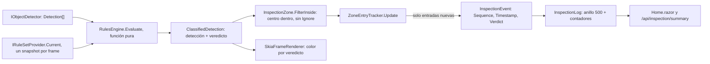
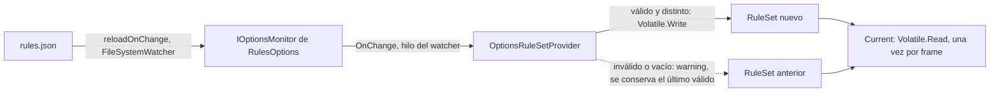
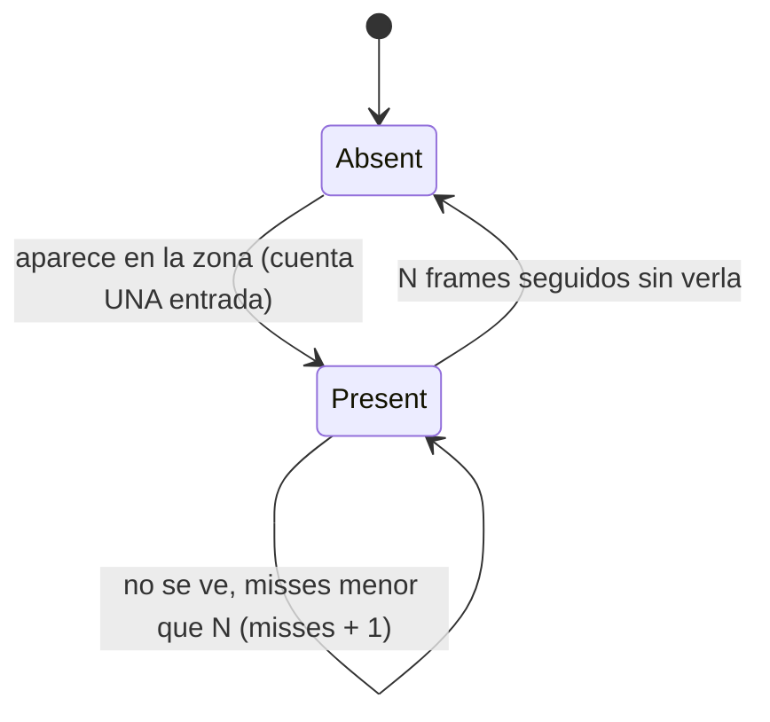

# M4 — Reglas de inspección, Prüfzone, antirrebote y recarga en caliente

> Hasta M3 el sistema "veía" objetos. En M4 **decide**: cada objeto recibe un veredicto (i.O., n.i.O., Gefahr…), solo se juzga lo que está dentro de la zona de inspección (*Prüfzone*), cada objeto se cuenta **una sola vez** y las reglas se pueden cambiar con la app en marcha. Es el milestone con más "lógica de negocio" y el que mejor se defiende en una entrevista.

---

## Qué se hizo

- **Core (sin paquetes):**
  - `Verdict` (enum: `Ok`, `Nok`, `Danger`, `Unknown`, `Ignore`), `RuleSet` (mapa inmutable *clase → veredicto*), `RulesEngine` (función pura), `ClassifiedDetection` (detección + veredicto) e `IRuleSetProvider` (el puerto).
  - `InspectionZone` (¿está el centro de la caja dentro de la zona?), `ZoneEntryTracker` (máquina de estados con antirrebote), `InspectionEvent` y `VerdictLabels` (i.O., n.i.O., GEFAHR…).
- **Infrastructure:** `RulesOptions` y `OptionsRuleSetProvider`, el **único** sitio que conoce `IOptionsMonitor`.
- **Web:**
  - `rules.json` (fichero editable en caliente), `InspectionLog` (anillo de 500 eventos + contadores), `GET /api/inspection/summary`.
  - `DetectionService` ampliado; `InspectionOptions.AbsenceFrames` (N, por defecto 5).
- **Vision:** `SkiaFrameRenderer` pinta cada caja con el color de su veredicto y la zona con el color del veredicto más grave.
- **Front:** tarjetas i.O. / n.i.O. / Gefahr / Unbekannt / Ausschussquote y lista "Letzte Prüfungen".
- **Tests:** **323** en total (cifra del orquestador; yo no los he ejecutado).

Flujo de datos por frame:



Y cómo llegan las reglas (recarga en caliente):



Máquina de estados del antirrebote (una por clase, p. ej. `cup`):



---

## Por qué

### La regla de negocio es una función pura en Core (ADR-002)

`RulesEngine.Evaluate(detection, ruleSet)` no tiene estado, ni reloj, ni configuración: mismos datos de entrada, mismo veredicto. Eso la hace trivial de testear y segura entre hilos.

Había un conflicto: ADR-001 pedía recarga en caliente con `IOptionsMonitor`, pero ese tipo vive en `Microsoft.Extensions.Options`, un paquete que **Core no puede referenciar** (regla de cero paquetes, vigilada por `ArchitectureTests`). La solución de ADR-002:

- Core define el **puerto** `IRuleSetProvider { RuleSet Current }` y el dato inmutable `RuleSet`.
- Infrastructure implementa el **adaptador** `OptionsRuleSetProvider`, que traduce `IOptionsMonitor` a `RuleSet`.
- No hay `IRulesEngine`: una función pura no necesita *fake*. La interfaz solo existe donde hay dos usos reales (producción y tests).

### Un snapshot de reglas por frame

`DetectionService` lee `Current` **una vez por frame**. Así, todas las detecciones de ese frame se juzgan con las mismas reglas, aunque alguien guarde `rules.json` justo a mitad del procesado.

### ¿Por qué una zona rectangular y el punto central?

Lo pidió el propietario del proyecto: **simple, testable y coherente con YOLO**.

- **YOLO devuelve cajas rectangulares**. Un rectángulo con coordenadas normalizadas (0..1) encaja directamente.
- **Testable**: "¿el centro está dentro?" son cuatro comparaciones. Se prueba sin imágenes ni Skia.
- **Estándar en la industria**: una ROI (*region of interest*) rectangular fija es lo habitual con una cámara cenital sobre una cinta o mesa.
- **Por qué el centro y no "toda la caja dentro"**: un objeto a medio entrar ya tiene el centro fuera y no se cuenta; en cuanto el centro cruza, entra. Es estable y no exige que el objeto quepa entero.
- **Limitación honesta**: con una cámara **oblicua** un rectángulo no representa bien la zona real del suelo. La extensión futura es un **polígono** (test punto-en-polígono). No se hizo porque no aporta a la demo y complica los tests.

### Antirrebote en frames, no en tiempo

El detector parpadea: un objeto puede desaparecer uno o dos frames y volver. Sin antirrebote, cada parpadeo sería una "pieza nueva".

- Se cuenta en **frames evaluados**, no en segundos. Con 10 FPS (cámara) y 30 FPS (vídeo) el tiempo daría comportamientos distintos; los frames, no (ADR-002 §2, resuelve el hallazgo #10 de la revisión de M1).
- Un hueco de **N−1 frames no recuenta**; un hueco de **N frames** y luego reaparición **sí cuenta** otra vez. N es `Inspection:AbsenceFrames` (por defecto 5, rango 1–100).
- El tracker **no tiene reloj**: la hora del evento la pone quien lo llama (`DetectionService`, con `TimeProvider`).
- Un frame donde falló la detección **no** se envía al tracker: un error del modelo no puede contar como "ausencia".

### Limitación: se cuenta por clase, no por objeto

El tracker lleva un estado **por clase** (`cup`, `bottle`…). Consecuencias, dichas sin maquillaje:

- **Dos tazas a la vez cuentan una sola vez.** Si entra una segunda taza mientras la primera sigue en la zona, no hay transición Absent→Present y no se cuenta.
- Si hay varias detecciones de una clase en el mismo frame, la entrada es la de mayor confianza.
- La solución real es un **tracker de objetos con identidad** (SORT, ByteTrack): asigna un ID a cada objeto entre frames. Queda como trabajo futuro; para la demo (un objeto cada vez) no hace falta.

Esta limitación está fijada por un test, para que no sea un comportamiento accidental.

### i.O. / n.i.O. y la Ausschussquote

- **i.O.** = *in Ordnung* (pieza buena). **n.i.O.** = *nicht in Ordnung* (pieza defectuosa). Es la terminología estándar en control de calidad alemán, por eso la UI no dice "OK/NOK".
- **Ausschussquote** (tasa de rechazo) = `Nok / (Ok + Nok)`. Es "piezas defectuosas entre piezas inspeccionadas".
- **`Danger` no es Ausschuss, es un KPI de seguridad.** unas tijeras en la célula no son una pieza defectuosa, son un riesgo. Y `Unknown` es "algo que ni siquiera inspeccionamos".
- **La definición cambió tras la revisión.** El contrato decía `Nok / (Ok+Nok+Danger+Unknown)`. El reviewer señaló que así un sofá o un móvil pasando por la zona *diluía* la tasa; un interlocutor de calidad lo habría cuestionado. Se cambió, y los tests se actualizaron.

---

## Conceptos de C# / .NET

### Enums
`Verdict` es un `enum` con cinco casos. Los datos de configuración llegan como texto, así que hay que convertirlos con cuidado.

```csharp
// src/QualityVision.Core/Rules/Verdict.cs:4-19
public enum Verdict
{
    Ok,
    Nok,
    Danger,
    Unknown,
    Ignore,
}
```

Trampa: `Enum.TryParse` acepta también números (`"3"`) y listas (`"Ok,Nok"`). Por eso el adaptador lo restringe:

```csharp
// src/QualityVision.Infrastructure/Rules/OptionsRuleSetProvider.cs:154-158
// Enum.TryParse also accepts numbers ("3") and flag lists ("Ok,Nok"); only a single verdict name is valid.
return !trimmed.Contains(',', StringComparison.Ordinal)
    && !char.IsDigit(trimmed[0]) && trimmed[0] is not ('-' or '+')
    && Enum.TryParse(trimmed, ignoreCase: true, out verdict)
    && Enum.IsDefined(verdict);
```

### Records posicionales
Un `record` es una clase (o struct) con igualdad por valor y constructor generado a partir de los parámetros.

```csharp
// src/QualityVision.Core/Rules/ClassifiedDetection.cs:6
public sealed record ClassifiedDetection(CoreDetection Detection, Verdict Verdict);
```

`InspectionEvent` es igual, con seis propiedades (`Sequence`, `Timestamp`, `ClassName`, `DisplayName`, `Verdict`, `Confidence`). Son datos inmutables que viajan del tracker al log.

### `with`-expressions
Con un record (o record struct) se crea una **copia modificada** sin mutar el original. `InspectionLog` lo usa para incrementar contadores:

```csharp
// src/QualityVision.Web/Pipeline/InspectionLog.cs:89-96
_counts = e.Verdict switch
{
    Verdict.Ok => _counts with { Ok = _counts.Ok + 1 },
    Verdict.Nok => _counts with { Nok = _counts.Nok + 1 },
    Verdict.Danger => _counts with { Danger = _counts.Danger + 1 },
    Verdict.Unknown => _counts with { Unknown = _counts.Unknown + 1 },
    _ => _counts, // Ignore is never counted
};
```

(Combinado con un *switch expression*: cada caso devuelve el nuevo valor.)

### `FrozenDictionary` + `StringComparer.OrdinalIgnoreCase`
`FrozenDictionary` (.NET 8+) es un diccionario de **solo lectura optimizado para lectura**: se construye una vez y no cambia. Es perfecto para un `RuleSet` que se comparte entre hilos sin locks. Con `OrdinalIgnoreCase`, `"Cup"` y `"cup"` son la misma clave.

```csharp
// src/QualityVision.Core/Rules/RuleSet.cs:23-42 (extracto)
var copy = new Dictionary<string, Verdict>(StringComparer.OrdinalIgnoreCase);
foreach ((string name, Verdict verdict) in rules)
{
    ...
    if (!copy.TryAdd(name, verdict))
    {
        throw new ArgumentException($"Duplicate rule for class '{name}' (names are case-insensitive).", nameof(rules));
    }
}

_rules = copy.ToFrozenDictionary(StringComparer.OrdinalIgnoreCase);
```

Se **copia** la entrada: si alguien modifica el diccionario original después, el `RuleSet` no se entera (hay un test). `TryAdd` devuelve `false` si la clave ya existe, y eso detecta duplicados como `cup`/`CUP`.

### Clases estáticas puras
`RulesEngine` e `InspectionZone` son `static class`: sin estado ni instancias. Es la forma natural de una función pura en C#.

```csharp
// src/QualityVision.Core/Rules/RulesEngine.cs:6-17
public static class RulesEngine
{
    public static Verdict Evaluate(CoreDetection detection, RuleSet rules)
    {
        ArgumentNullException.ThrowIfNull(detection);
        ArgumentNullException.ThrowIfNull(rules);
        return rules.VerdictFor(detection.ClassName);
    }
}
```

### Máquina de estados con `Dictionary`
No hay un `enum State`: el estado de cada clase está **codificado en el diccionario**. Si la clase está como clave, está *Present* y el valor es el nº de frames sin verla; si no está, es *Absent*.

```csharp
// src/QualityVision.Core/Inspection/ZoneEntryTracker.cs:16-17
// Present classes → consecutive frames without that class. A class not in the map is Absent.
private readonly Dictionary<string, int> _present = new(StringComparer.OrdinalIgnoreCase);
```

```csharp
// src/QualityVision.Core/Inspection/ZoneEntryTracker.cs:75-83
int misses = _present[className] + 1;
if (misses >= _absenceFrames)
{
    _present.Remove(className);
}
else
{
    _present[className] = misses;
}
```

Detalle: no se puede modificar un diccionario mientras se itera, por eso se recorre una **copia de las claves** (`_presentKeys`, reutilizada para no asignar memoria cada frame).

### `IOptionsMonitor.OnChange` + suscripción `IDisposable`
`IOptionsMonitor<T>` da el valor actual de la configuración y avisa cuando cambia. `OnChange` devuelve un `IDisposable`: quien se suscribe debe liberarlo para no dejar el callback colgado.

```csharp
// src/QualityVision.Infrastructure/Rules/OptionsRuleSetProvider.cs:40
_subscription = monitor.OnChange(OnRulesChanged);
// ...
// :47
public void Dispose() => _subscription?.Dispose();
```

El callback corre en el **hilo del file watcher**, así que nunca debe lanzar una excepción: todo el cuerpo está en `try/catch` y, ante cualquier problema, se conserva el último `RuleSet` válido.

### `Volatile.Read/Write` frente a `lock`
Hay un escritor ocasional (el watcher) y un lector frecuente (el bucle de frames). Lo único que se comparte es **una referencia a un objeto inmutable**. Escribir/leer una referencia es atómico; `Volatile` solo garantiza que el lector vea el valor nuevo (orden de memoria). No hace falta `lock`, que además haría esperar al bucle de vídeo.

```csharp
// src/QualityVision.Infrastructure/Rules/OptionsRuleSetProvider.cs:44
public RuleSet Current => Volatile.Read(ref _current);
// :77
Volatile.Write(ref _current, next);
```

Contraste: `InspectionLog` **sí** usa `lock`, porque ahí hay varios campos que deben cambiar juntos (buffer, índice, contadores). Regla práctica: *referencia inmutable → Volatile; varios campos mutables relacionados → lock*.

### Eventos (`Action<T>`) fuera del lock y aislados por handler
`InspectionLog.EventAdded` avisará al futuro SignalR (M5). Dos decisiones defensivas:

1. Se invoca **fuera del lock**: un suscriptor lento o reentrante no puede bloquear ni provocar un *deadlock*.
2. Cada suscriptor va en su propio `try/catch`: si uno falla, ni los demás ni el resto de entradas del frame se pierden.

```csharp
// src/QualityVision.Web/Pipeline/InspectionLog.cs:100-118
Action<InspectionEvent>? handlers = EventAdded;
if (handlers is null)
{
    return;
}

foreach (Action<InspectionEvent> handler in handlers.GetInvocationList().Cast<Action<InspectionEvent>>())
{
    try
    {
        handler(e);
    }
    catch (Exception ex)
    {
        _logger.LogWarning(ex, "EventAdded subscriber failed for inspection {Sequence}", e.Sequence);
    }
}
```

(El aislamiento por handler salió del hallazgo #4 de la revisión.)

### Buffer circular (*ring buffer*)
Array de tamaño fijo (500); un índice `_next` da la vuelta con `%`. Al llenarse, el evento nuevo sobrescribe el más antiguo. Memoria acotada, sin listas que crezcan.

```csharp
// src/QualityVision.Web/Pipeline/InspectionLog.cs:86-88
_buffer[_next] = e;
_next = (_next + 1) % Capacity;
_count = Math.Min(_count + 1, Capacity);
```

```csharp
// src/QualityVision.Web/Pipeline/InspectionLog.cs:139-145 (leer, el más nuevo primero)
int n = Math.Clamp(max, 0, _count);
var result = new InspectionEvent[n];
for (int i = 0; i < n; i++)
{
    result[i] = _buffer[(_next - 1 - i + Capacity) % Capacity];
}
```

### `readonly record struct` con propiedades calculadas
Un struct inmutable con igualdad por valor; sin asignación en el heap. `Total` y `ScrapRate` no se guardan, se **calculan** al leerlas, así nunca quedan desincronizadas.

```csharp
// src/QualityVision.Web/Pipeline/InspectionLog.cs:35-45
public readonly record struct InspectionCounts(int Ok, int Nok, int Danger, int Unknown)
{
    public int Total => Ok + Nok + Danger + Unknown;

    public double ScrapRate => Ok + Nok == 0 ? 0 : (double)Nok / (Ok + Nok);
}
```

Fíjate en la guardia contra la división por cero y en el `(double)`, para no hacer división entera.

### Configuración: `reloadOnChange` y `OnLoadException`
`AddJsonFile(..., reloadOnChange: true)` vigila el fichero. Dos cuidados en `Program.cs`:

- El `PhysicalFileProvider` apunta al **content root** (la carpeta del proyecto), no a la copia en `bin/`; si no, el watcher vigilaría un fichero que nadie edita.
- `OnLoadException` registra un warning cuando el JSON tiene un error de sintaxis; sin él, la excepción acabaría en una tarea del watcher que nadie observa. `ctx.Ignore = true` evita que la app caiga.

```csharp
// src/QualityVision.Web/Program.cs:20-34
.AddJsonFile(source =>
{
    source.Path = "rules.json";
    source.FileProvider = new PhysicalFileProvider(builder.Environment.ContentRootPath);
    source.Optional = false;
    source.ReloadOnChange = true;
    source.OnLoadException = ctx =>
    {
        using ILoggerFactory loggerFactory = LoggerFactory.Create(static b => b.AddSimpleConsole());
        loggerFactory.CreateLogger("rules.json")
            .LogWarning(ctx.Exception, "rules.json could not be read, keeping the previous rules");
        ctx.Ignore = true;
    };
})
```

### xUnit `Theory` / `InlineData` para el límite N−1 / N
Un `[Theory]` ejecuta el mismo test con varios datos. Ideal para **valores límite**: el comportamiento cambia exactamente entre N−1 y N huecos, y se prueba para N = 1, 3, 5 y 10.

```csharp
// tests/QualityVision.Tests/Core/ZoneEntryTrackerTests.cs:68-81
[Theory]
[InlineData(1)]
[InlineData(3)]
[InlineData(5)]
[InlineData(10)]
public void Update_GapOfNMinusOne_DoesNotRecount(int n)
{
    var tracker = new ZoneEntryTracker(n);

    var total = Feed(tracker, 2, Obj("cup"));
    total += Feed(tracker, n - 1);
    total += Feed(tracker, 2, Obj("cup"));

    Assert.Equal(1, total);
}
```

El gemelo `Update_GapOfNThenReappearance_CountsAgain` (línea 89) comprueba el otro lado de la frontera: hueco de N → cuenta 2.

Y el test que protege la recarga vacía (hallazgo MAJOR de la revisión):

```csharp
// tests/QualityVision.Tests/Infrastructure/OptionsRuleSetProviderTests.cs:89-91
monitor.Fire(new RulesOptions());

Assert.Same(before, provider.Current);
```

---

## La software factory en M4

- **4 agentes en paralelo** sobre el mismo contrato (`docs/contracts/M4-contract.md` + ADR-002): backend-dev (Core, Infrastructure, Web), vision-engineer (renderer), frontend-dev (Home.razor) y qa-engineer (tests).
- **QA escribió los tests contra el contrato ANTES de que existiera la implementación**, al estilo TDD. Por eso los contratos tienen firmas exactas: sin ellas, cuatro agentes en paralelo no compilarían juntos.
- **Verificación en vivo con el iPhone**: una botella se contó **una sola vez** como i.O. (confianza 0,88), sin recontar mientras seguía en la zona.
- **Recarga en caliente verificada en vivo**: un cambio válido en `rules.json` se aplicó sin reiniciar; un error tipográfico (`"Okay-typo"`) se ignoró con un warning y se mantuvieron las reglas anteriores.
- **Revisión del reviewer: APPROVE con 1 MAJOR.**
  - **MAJOR #1**: un `rules.json` vacío (o ausente un instante, como cuando un editor borra y recrea el fichero) se aceptaba como "reglas válidas: 0 clases" y **borraba todas las reglas**; la persona pasaba a contarse como Unbekannt. Corregido: si llega un conjunto vacío y ya había reglas, se conserva el anterior y se avisa (`OptionsRuleSetProvider.cs:62-68`), más el test de arriba.
  - Otras correcciones: no recargar ni loguear si las reglas no cambian (`SameRules`), aislar handlers que fallan, `Snapshot` para leer contadores y recientes bajo un único lock, y "primar" el tracker nuevo si cambia `AbsenceFrames` (para no recontar todo lo que ya está en la zona; `DetectionService.cs:158`).
  - **Cambió la definición de Ausschussquote** (ver arriba).
- **Resultado:** 323 tests (cifra del orquestador).

### Deudas conocidas, para ser honesto en la entrevista
- Conteo por clase, no por objeto (sin ID de objeto).
- La zona es un rectángulo; sin polígonos.
- Los contadores viven en memoria: se pierden al reiniciar (M6 los persistirá en SQLite; no usar `Sequence` como clave, sino un id autoincremental).
- El cableado de `DetectionService` (p. ej. "un frame con error no cuenta como ausencia") solo se verificó en vivo; faltan tests unitarios con un detector simulado (hallazgo #9 de la revisión, pendiente en el momento de escribir esto).
- Publicada la app, el *content root* es el directorio de trabajo: hay que arrancarla desde la carpeta correcta o con `--contentRoot` (hallazgo #6).

---

## 3 preguntas de entrevista

**1. ¿Cómo evitas contar dos veces el mismo objeto?** — Con un antirrebote por clase en `ZoneEntryTracker`: una clase pasa de Absent a Present y solo ahí se emite una entrada; mientras se vea, no se recuenta. Si desaparece, hacen falta N frames seguidos sin verla (por defecto 5) para volver a Absent, así que un parpadeo del detector de N−1 frames no cuenta doble. Cuento en frames, no en segundos, para que 10 FPS y 30 FPS se comporten igual. La limitación: es por clase, no por objeto; dos tazas a la vez cuentan una vez, y la solución sería un tracker con IDs como SORT o ByteTrack.

**2. ¿Qué pasa si alguien edita `rules.json` con un error durante la producción?** — Nada grave: el sistema conserva las últimas reglas válidas y escribe un warning. Un veredicto desconocido (`"Okay-typo"`), un nombre vacío o un JSON roto se rechazan; un fichero vacío o ausente también, porque antes borraba todas las reglas (lo encontró la revisión y está corregido y con test). El cambio es atómico: `Volatile.Write` de un `RuleSet` inmutable, y el bucle de frames lee un solo snapshot por frame. Solo en el arranque un `rules.json` inválido hace fallar la app a propósito (*fail fast*).

**3. ¿Por qué la Prüfzone es rectangular?** — Porque YOLO devuelve cajas rectangulares, un rectángulo normalizado (0..1) es muy simple y el test "¿el centro de la caja está dentro?" son cuatro comparaciones, fáciles de probar sin imágenes. Además es lo habitual en la industria: una ROI fija bajo una cámara cenital. Uso el centro para que un objeto a medio entrar no cuente hasta que cruza. Con una cámara oblicua haría falta un polígono; está identificado como extensión futura, no como olvido.
