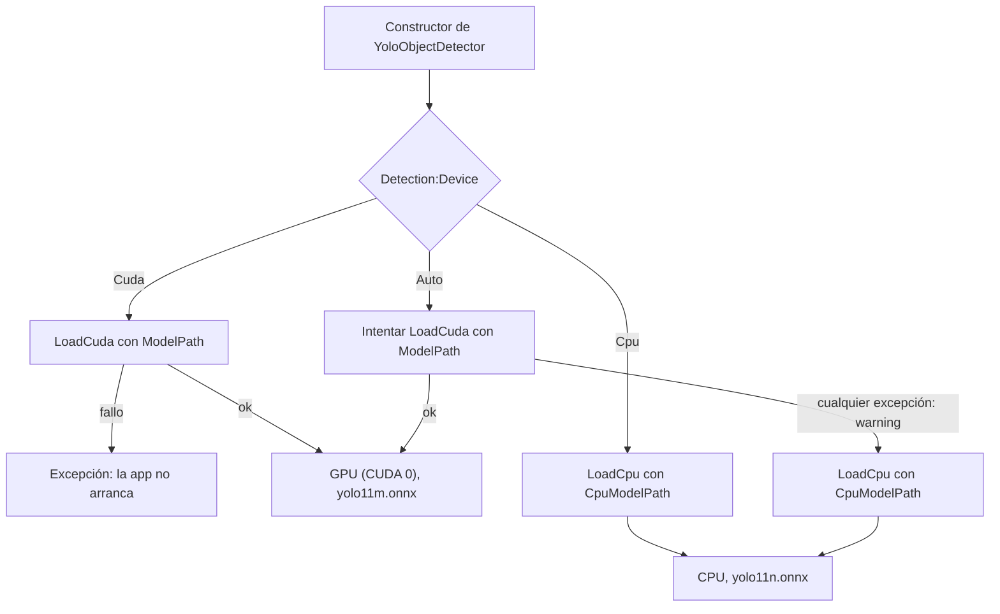

# M4b — Aceleración por GPU (CUDA) con fallback automático a CPU

> Hasta M4 la detección corría en CPU con YOLO11n. En M4b el propietario decidió usar toda la potencia del PC de la demo (RTX 5070 Ti, 16 GB): el modelo **grande (yolo11m) corre en la GPU con CUDA**, y si la GPU no está disponible la app **degrada sola** a yolo11n en CPU. Es un milestone corto en código y largo en trampas de empaquetado; justo por eso se defiende bien en una entrevista.

---

## Qué se hizo

- **Infrastructure:**
  - `DetectionDevice` (enum: `Auto`, `Cuda`, `Cpu`).
  - `DetectionOptions` con campos nuevos: `Device`, `GpuId`, `ModelPath` (modelo para GPU, `yolo11m.onnx`) y `CpuModelPath` (modelo para CPU, `yolo11n.onnx`).
  - `YoloObjectDetector` elige el *execution provider* en el constructor y expone `ActiveDevice` y `ActiveModel`.
- **Paquetes (CPM):** `YoloDotNet.ExecutionProvider.Cuda` 1.1.0, `Microsoft.ML.OnnxRuntime.Gpu` 1.32.0 (compilado contra CUDA 13) y `Microsoft.ML.OnnxRuntime` subido a 1.32.0 **con `ExcludeAssets="native;runtime"`**.
- **Web:**
  - `IPipelineMetrics.Device` y `.Model`, también en `/api/pipeline/metrics`.
  - `ModelHealthCheck` muestra dispositivo y modelo.
  - `appsettings.json`: `Detection:Device = Auto` y `Stream:MaxFps = 20`.
  - El csproj enlaza también `models/yolo11m.onnx`.
- **Front:** una insignia en el panel de métricas: verde "GPU · yolo11m" o ámbar "CPU · yolo11n".
- **Docs:** ADR-004 (acepta GPU y deja sin efecto, en parte, el "solo CPU" de ADR-003).
- **Tests:** `YoloObjectDetectorDeviceTests.cs` (6 tests, incluido el guardián del paquete nativo). Total de la suite: **340 tests en verde**.

Cómo se elige el dispositivo al arrancar:



---

## Por qué

### Tiempos medidos (por inferencia, en el PC de la demo)

| Modelo | CPU | CUDA |
|---|---|---|
| yolo11n | ~25–45 ms | 3,9 ms |
| yolo11s | ~50–85 ms | 4,3 ms |
| yolo11m | 198 ms | **6,4–6,9 ms** |

Medido en vivo con la app completa (yolo11m en CUDA): **6,3 ms** de inferencia (media móvil exponencial, EMA), **20 FPS** de salida y unos **890 MB de VRAM**.

Lectura de la tabla, para explicarla en voz alta:

- yolo11m en CPU (198 ms) es inservible: menos de 5 FPS.
- yolo11m en GPU (≈ 6,5 ms) es **más rápido que yolo11n en CPU** y bastante más preciso.
- Con 6,5 ms la inferencia **deja de ser el cuello de botella**; por eso `Stream:MaxFps` sube a 20.
- yolo11s en GPU (4,3 ms) cuesta casi lo mismo que m pero es menos preciso: se descartó.

### Por qué fallback automático y no "solo GPU"

El día de la demo puede faltar una librería (driver, CUDA 13, cuDNN 9). Con `Auto` la app **sigue funcionando**, más lenta y con el modelo pequeño, y avisa con un *warning*. "Solo GPU" sería frágil. Además, los tests siguen en verde en cualquier máquina.

### Alternativas descartadas (ADR-004)

- **TensorRT:** más rápido, pero construir el motor tarda y añade riesgo de drivers; 6,5 ms ya sobra.
- **DirectML / OpenVINO:** no aplican a una GPU NVIDIA en Linux.
- **Quedarse en CPU con yolo11n:** simple, pero deja el hardware sin usar y baja la precisión.

### Consecuencias, sin maquillaje

- La demo depende de **driver NVIDIA + CUDA 13 + cuDNN 9** (paquetes `cuda` y `cudnn`).
- La **primera carga CUDA tarda ~5,5 s** (inicialización del contexto); las siguientes, 0,1–0,2 s. Hay que arrancar la app antes de la demo.
- **El fallback es solo de arranque.** Si CUDA falla *durante* la demo (memoria agotada, GPU perdida), `DetectionService` sigue publicando vídeo sin cajas y la salud pasa a *Degraded*, pero no hay cambio de proveedor en caliente. Remedio: reiniciar con `Detection__Device=Cpu`. Y la insignia sigue verde mientras tanto (hallazgo #7 de la revisión).
- El modelo añade **80,7 MB** al repositorio y las librerías nativas de CUDA son enormes (`libonnxruntime_providers_cuda.so` solo pesa 289 MB, en cada carpeta de salida).
- Kestrel empieza a escuchar **después** de cargar el modelo (el detector se construye al resolver `DetectionService`), así que `/` y `/stream` no responden unos segundos (hallazgo #8).
- La licencia de yolo11m es AGPL-3.0, igual que yolo11n (ver pregunta 3).

---

## Conceptos de C# / .NET

### Enum como interruptor de configuración
`DetectionDevice` tiene tres casos. Se enlaza desde `appsettings.json` por nombre (`"Device": "Auto"`) y el valor por defecto es `Auto`.

```csharp
// src/QualityVision.Infrastructure/Detection/DetectionDevice.cs:4-14
public enum DetectionDevice
{
    Auto,
    Cuda,
    Cpu,
}
```

```csharp
// src/QualityVision.Infrastructure/Detection/DetectionOptions.cs:9
public DetectionDevice Device { get; set; } = DetectionDevice.Auto;
```

Detalle de la revisión (#10): un typo como `"Gpu"` hace que el *binder* de configuración lance `InvalidOperationException` antes de la validación, así que el mensaje amable del validador no sale. Aun así falla rápido al arrancar, que es lo importante.

### Selección de provider con fallback en el constructor
Todo el criterio vive en **un `switch`** dentro del constructor, dentro de Infrastructure. Core no sabe nada de CUDA (ADR-004 §4). Fíjate en tres cosas del caso `Auto`: el `catch` general (cualquier fallo degrada), el *warning* con el motivo y la pista, y que se **reinicia el cronómetro** para que el tiempo logueado sea el de la carga real.

```csharp
// src/QualityVision.Infrastructure/Detection/YoloObjectDetector.cs:52-87 (extracto)
switch (current.Device)
{
    case DetectionDevice.Cuda:
        // Forced GPU: a failure (no driver, CUDA 13 or cuDNN 9) propagates and stops startup.
        modelPath = current.ResolveModelPath();
        _yolo = LoadCuda(modelPath, current.GpuId);
        ActiveDevice = CudaDeviceName(current.GpuId);
        break;
    ...
    default:
        // Auto: prefer the GPU with the large model; any failure degrades to the small model on the CPU.
        modelPath = current.ResolveModelPath();
        try
        {
            _yolo = LoadCuda(modelPath, current.GpuId);
            ActiveDevice = CudaDeviceName(current.GpuId);
        }
        catch (Exception ex)
        {
            _logger.LogWarning(
                "CUDA unavailable ({ExceptionType}: {Reason}); falling back to CPU. Hint: install cuDNN 9 / CUDA 13 drivers",
                ex.GetType().Name, ex.Message);
            modelPath = current.ResolveCpuModelPath();
            started = Stopwatch.GetTimestamp();
            _yolo = LoadCpu(modelPath);
            ActiveDevice = CpuDeviceName;
        }

        break;
}
```

Por qué un `catch (Exception)` general aquí (normalmente es mala práctica): el fallo puede ser una `OnnxRuntimeException`, una `DllNotFoundException`… y el objetivo es el mismo, degradar. Limitación conocida (#6): solo se registran el tipo y el mensaje, no la excepción interna (que a veces nombra `libcudnn.so.9`).

El dispositivo concreto lo crean dos métodos pequeños. El constructor de `CudaExecutionProvider` **lanza** si falta CUDA o cuDNN; por eso el `try/catch` rodea la carga y no hay que "preguntar" antes:

```csharp
// src/QualityVision.Infrastructure/Detection/YoloObjectDetector.cs:161-171
private static Yolo LoadCuda(string modelPath, int gpuId) => new(new YoloOptions
{
    ExecutionProvider = new CudaExecutionProvider(modelPath, gpuId),
    ImageResize = ImageResize.Proportional,
});

private static Yolo LoadCpu(string modelPath) => new(new YoloOptions
{
    ExecutionProvider = new CpuExecutionProvider(modelPath),
    ImageResize = ImageResize.Proportional,
});
```

Deuda (#5): si el proveedor CUDA se crea bien pero `new Yolo(...)` falla después, el proveedor no se libera. Es improbable con un modelo válido.

### Propiedades `get`-only fijadas en el constructor
`ActiveDevice` y `ActiveModel` solo tienen `get`: se asignan una vez en el constructor y nadie las cambia. Eso es inmutabilidad barata y segura entre hilos.

```csharp
// src/QualityVision.Infrastructure/Detection/YoloObjectDetector.cs:96-100
public string ActiveDevice { get; }

public string ActiveModel { get; }
```

### `ExcludeAssets="native;runtime"` y por qué NO fluye por `ProjectReference`
El problema: `Microsoft.ML.OnnxRuntime` (CPU) y `Microsoft.ML.OnnxRuntime.Gpu` traen un `libonnxruntime.so` **con el mismo nombre**. El proveedor CPU arrastra el paquete CPU como dependencia; si su librería nativa llega a la carpeta de salida, **pisa** a la de GPU y CUDA falla.

La solución: referenciar el paquete CPU directamente con `ExcludeAssets="native;runtime"`. Se conserva su API gestionada (lo que el código compila) pero no se copian sus binarios nativos. La build de GPU **ya incluye** el proveedor CPU, así que ambos funcionan en el mismo proceso.

```xml
<!-- src/QualityVision.Infrastructure/QualityVision.Infrastructure.csproj:27 -->
<PackageReference Include="Microsoft.ML.OnnxRuntime" ExcludeAssets="native;runtime" />
```

La trampa: `ExcludeAssets` es una propiedad de la referencia **de ese proyecto**. No viaja por `ProjectReference`. Web y Tests referencian Infrastructure, pero recibían igualmente el paquete CPU de forma transitiva y copiaban su librería. Por eso hay que **repetir la línea en cada proyecto ejecutable**:

```xml
<!-- src/QualityVision.Web/QualityVision.Web.csproj:26-28 -->
<!-- ExcludeAssets does not flow to consuming projects, so it is repeated here: the CPU-only native
     libonnxruntime.so of Microsoft.ML.OnnxRuntime must not overwrite the GPU build (see ADR-004). -->
<PackageReference Include="Microsoft.ML.OnnxRuntime" ExcludeAssets="native;runtime" />
```

(Idéntico en `tests/QualityVision.Tests/QualityVision.Tests.csproj:32-34`.) El versionado sigue centralizado: las líneas no llevan `Version=` porque lo pone `Directory.Packages.props` (CPM).

Fragilidad reconocida (hallazgo #3): es copiar y pegar por proyecto. Una alternativa más robusta sería un `Directory.Build.targets` que elimine los ítems nativos del paquete CPU en todos los proyectos. No se hizo; el test guardián cubre el riesgo.

### Test guardián con `OrtEnv.GetAvailableProviders()`
Sin este test, si la librería CPU volviera a colarse, `Auto` caería **en silencio** a yolo11n en CPU con solo un warning, y la suite seguiría verde. El test no necesita GPU: la build de GPU *lista* `CUDAExecutionProvider` aunque la máquina no tenga tarjeta; la build solo-CPU no lo lista.

```csharp
// tests/QualityVision.Tests/Infrastructure/YoloObjectDetectorDeviceTests.cs:82-88
[Fact]
public void OnnxRuntimeNativeLibrary_InOutput_IsGpuBuild()
{
    // Hardware independent: the GPU build lists CUDAExecutionProvider even without a GPU. The CPU-only build
    // does not, so this fails if a project's output got the CPU libonnxruntime.so (ADR-004, ExcludeAssets).
    Assert.Contains("CUDAExecutionProvider", OrtEnv.Instance().GetAvailableProviders());
}
```

Idea general: un fallo que se **auto-cura** es peligroso porque esconde regresiones. Si algo degrada solo, hace falta un test que falle cuando degrada sin que lo pidas.

### Test determinista del fallback con un modelo corrupto
Para probar el fallback en *cualquier* máquina (con o sin GPU), el test fuerza que la carga CUDA falle con un fichero que no es ONNX, y comprueba la CPU, el modelo pequeño y el warning.

```csharp
// tests/QualityVision.Tests/Infrastructure/YoloObjectDetectorDeviceTests.cs:126-138 (extracto)
string corrupt = Path.Combine(Path.GetTempPath(), $"qv-corrupt-{Guid.NewGuid():N}.onnx");
File.WriteAllText(corrupt, "not an onnx model");
...
Assert.Equal("CPU", detector.ActiveDevice);
Assert.Equal("yolo11n.onnx", detector.ActiveModel);
Assert.Contains(logger.Entries, e => e.Level == LogLevel.Warning && e.Message.Contains("cuDNN", StringComparison.Ordinal));
```

Dos recursos de test más: un `CapturingLogger` propio (implementa `ILogger<T>` y guarda las entradas) y un `FixedOptionsMonitor<T>` mínimo con *primary constructor* (`(T value)`).

### Test condicional sin `Skip` (xUnit v2) y `[Trait]`
xUnit v2 no puede saltarse un test en tiempo de ejecución. El test de CUDA forzado intenta construir el detector y, si falla, escribe un mensaje y **sale con `return`**. Se marca con `[Trait("Category", "Gpu")]` para poder excluirlo con `--filter "Category!=Gpu"`.

```csharp
// tests/QualityVision.Tests/Infrastructure/YoloObjectDetectorDeviceTests.cs:157-171 (extracto)
[Fact]
[Trait("Category", "Gpu")]
public void Ctor_ForcedCuda_ReportsGpuAndMediumModelAndDetectsBus_WhenCudaAvailable()
{
    YoloObjectDetector detector;
    try
    {
        detector = Create(Options(DetectionDevice.Cuda));
    }
    catch (Exception ex)
    {
        // xUnit v2 cannot skip at runtime: with no usable CUDA/cuDNN this test is a deliberate no-op.
        Console.WriteLine($"CUDA unavailable, forced-Cuda test not run: {ex.GetType().Name}: {ex.Message}");
        return;
    }
```

Debilidad honesta (#11): en el PC de la demo, este test también pasaría si CUDA se rompiera. Por eso se complementa con el guardián de arriba, que sí falla de forma determinista.

### `ActiveDevice` / `ActiveModel` en métricas y health check
Se fijan **una vez** al arrancar (`SetModelInfo`) y se leen desde otros hilos (el endpoint, el health check, la UI). Como son referencias a `string` inmutables, basta `Volatile`, igual que en M4 con el `RuleSet`.

```csharp
// src/QualityVision.Web/Pipeline/DetectionService.cs:48
metrics.SetModelInfo(warmUpTarget.ActiveDevice, warmUpTarget.ActiveModel);
```

```csharp
// src/QualityVision.Web/Pipeline/PipelineMetrics.cs:61-71
public string Device => Volatile.Read(ref _device);

public string Model => Volatile.Read(ref _model);

public void SetModelInfo(string device, string model)
{
    ArgumentNullException.ThrowIfNull(device);
    ArgumentNullException.ThrowIfNull(model);
    Volatile.Write(ref _device, device);
    Volatile.Write(ref _model, model);
}
```

Escribir dos campos por separado no es un problema aquí porque se fijan una sola vez antes de que nadie los lea.

El health check lo muestra con una interpolación y un *guard* para el caso "aún sin datos":

```csharp
// src/QualityVision.Web/Pipeline/ModelHealthCheck.cs:15
string info = string.IsNullOrEmpty(metrics.Device) ? string.Empty : $" ({metrics.Device} · {metrics.Model})";
```

Y el endpoint lo publica en `/api/pipeline/metrics` (`src/QualityVision.Web/Endpoints/PipelineEndpoints.cs:40-41`: `device = metrics.Device`, `model = metrics.Model`). Así el público ve **qué corre de verdad**: log de arranque, health check, JSON e insignia.

### Resolución de rutas relativas
`ModelPath` y `CpuModelPath` son relativas y se resuelven contra `AppContext.BaseDirectory` (la carpeta de salida), donde el csproj copia los modelos con `Link` + `CopyToOutputDirectory`. Los dispositivo y rutas se leen **una vez** (cambiarlos exige reiniciar); los umbrales `Confidence` e `Iou` siguen leyéndose en cada frame y se recargan en caliente.

---

## Trampas encontradas

1. **Librería nativa CPU (34,8 MB) pisando a la de GPU (38,1 MB).** Con `ExcludeAssets` solo en Infrastructure, Web y Tests seguían copiando el `libonnxruntime.so` de CPU. Síntoma: `Auto` caía a CPU sin ruido. Se encontró **por casualidad** durante la integración. Arreglo: repetir la referencia en cada proyecto ejecutable + el test guardián. Verificación: `libonnxruntime.so` ≈ 38 MB y `libonnxruntime_providers_cuda.so` presente en la salida.
2. **cuDNN ausente: `libcudnn.so: cannot open`.** Sin cuDNN 9, el constructor de `CudaExecutionProvider` lanza. En `Auto` se registra el warning con la pista "install cuDNN 9 / CUDA 13 drivers" y se usa la CPU. En `Cuda` forzado, la app no arranca (a propósito).
3. **Primera carga CUDA ≈ 5,5 s.** Es la inicialización del contexto CUDA, no un fallo. En el arranque en caliente baja a ~1,2 s por proceso. Por eso: arrancar la app antes de la demo.
4. **`dotnet publish` sin verificar.** Un publish con RID aplana `runtimes/*/native` y el conflicto de nombres decidiría el ganador. Con `ExcludeAssets` solo la GPU es candidata, así que *debería* ir bien, pero nadie lo comprobó (hallazgo #4). La demo usa `dotnet run`.

---

## La software factory en M4b

- **Decisión del propietario, medida por el orquestador:** los proyectos de prueba con la tabla de tiempos viven fuera del repo; el contrato `docs/contracts/M4b-contract.md` fija paquetes y firmas.
- **Revisión del reviewer: APPROVE, con 2 MAJOR:**
  - **#1:** ningún test detectaba el bug de empaquetado → se añadió el guardián `OnnxRuntimeNativeLibrary_InOutput_IsGpuBuild`.
  - **#2:** ADR-004 no decía que `ExcludeAssets` no fluye por `ProjectReference` → se documentó en el ADR y en el comentario del csproj.
- El reviewer **no ejecutó** build/test/format (necesitaban aprobación interactiva); las cifras de los *gates* son del orquestador.

### Deudas conocidas, para ser honesto en la entrevista
- El fallback es solo de arranque; un fallo de CUDA en plena demo deja vídeo sin cajas (y la insignia sigue verde).
- `ExcludeAssets` repetido por proyecto es frágil; mejor opción: `Directory.Build.targets`.
- Sin tests de `SetModelInfo`, del JSON de métricas ni del sufijo del health check (#12).
- Con 20 FPS, el antirrebote medido en frames (M4) puede necesitar reajuste de `AbsenceFrames`.
- El modelo de 80,7 MB supera el umbral de aviso de GitHub (50 MB); Git LFS queda por decidir.

---

## 3 preguntas de entrevista

**1. ¿Qué pasa si el cliente no tiene GPU?** — Con `Device: Auto` la app intenta cargar yolo11m en CUDA; si falla por cualquier motivo (sin driver, sin CUDA 13, sin cuDNN 9), registra un *warning* con la razón y carga yolo11n en CPU. Sigue funcionando, solo más lento (25–45 ms por frame en vez de ~6,5 ms) y con un modelo menos preciso. El dispositivo real se ve en el log, el health check, `/api/pipeline/metrics` y la insignia del panel. Limitación: el fallback es solo de arranque; si la GPU falla a mitad de ejecución no hay cambio en caliente, hay que reiniciar con `Device=Cpu`.

**2. ¿Por qué has repetido `ExcludeAssets` en tres proyectos y cómo sabes que sigue bien?** — Porque `ExcludeAssets` solo afecta a la resolución de paquetes del proyecto que lo declara y no pasa por `ProjectReference`; sin él, Web y Tests copiaban el `libonnxruntime.so` de CPU (34,8 MB) encima del de GPU (38,1 MB). Lo vigila un test que comprueba que `OrtEnv.Instance().GetAvailableProviders()` contiene `CUDAExecutionProvider`; no necesita GPU porque la build de GPU lista el proveedor aunque no haya tarjeta. Es un parche frágil y lo digo: la alternativa más robusta es un `Directory.Build.targets` central.

**3. YOLO11 es AGPL-3.0: ¿puedes usarlo en un producto comercial?** — Solo con cuidado. Los pesos y el código de Ultralytics son AGPL-3.0, y la cláusula de red (§13) obliga a ofrecer el código fuente completo también a usuarios que interactúan con el software por red, no solo cuando se distribuye. Para un producto cerrado hay que comprar una licencia empresarial de Ultralytics o cambiar a un modelo con licencia permisiva (p. ej. YOLOX, Apache-2.0, a confirmar). Para esta demo de portafolio es aceptable, y el riesgo está documentado en ADR-003; yolo11m tiene la misma licencia que yolo11n (ADR-004).
