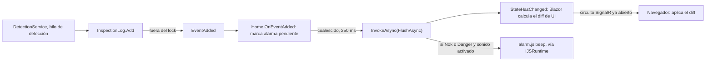
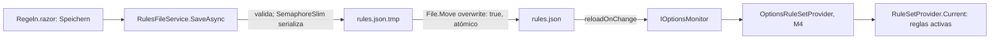

# M5 — Dashboard en tiempo real, alarma sonora y editor de reglas

> Hasta M4 el sistema decidía, pero el resultado solo se veía refrescando una página con sondeo. En M5 la **Prüfstation** se vuelve un panel de control vivo: los eventos llegan al navegador al instante, hay una gráfica "Prüfungen pro Minute", una alarma visual y sonora para n.i.O. y Gefahr, y una página `/regeln` para editar `rules.json` sin tocar ficheros. Es el milestone donde mejor se explica **cómo funciona Blazor Server por dentro**.

---

## Qué se hizo

- **Web (backend):**
  - `IInspectionLog.PerMinute(int minutes = 15)` y `MinuteBucket` (conteos por veredicto y por minuto de reloj, incluidos los minutos vacíos). `InspectionLog` recibe `TimeProvider` por constructor.
  - `Pipeline/RulesFileService` (singleton): lee y escribe `rules.json` de forma **atómica**, validando antes.
- **Web (front):**
  - `Home.razor`: se suscribe a `EventAdded` (empuje, no sondeo), fila de KPIs, protocolo de eventos (50), banner de alarma de 4 s y botón "🔔 Ton an/aus".
  - `Components/Shared/PerMinuteChart.razor`: gráfica de barras apiladas en **SVG generado en el servidor**.
  - `wwwroot/js/alarm.js`: módulo JS con Web Audio API (pitidos con un oscilador, sin ficheros de audio).
  - `Components/Pages/Regeln.razor`: tabla de reglas, añadir/borrar, "Speichern" y el contador "Aktiv: N Klassen".
- **Tests:** **369** en total. Nuevos: `InspectionLogPerMinuteTests` (con `FakeTimeProvider`) y `RulesFileServiceTests` (ida y vuelta, validación, sin `.tmp` residual, el formato lo lee `AddJsonFile` + bind a `RulesOptions`). No hay bUnit: no hay tests de componentes.

Cómo llega un evento al navegador (**sin Hub propio**):



Cómo se guarda una regla y cómo la recoge el sistema:



---

## Por qué

### Sin `InspectionHub` propio (decisión del 16-nov)

El plan original preveía un hub SignalR propio. Se descartó (está en el *decision log* de `PLAN.md`). Razón: **Blazor Server ya es SignalR**. Cada pestaña abre un *circuito*: una conexión SignalR persistente entre el navegador y el servidor. Los componentes viven en el servidor; cuando llamas a `StateHasChanged`, Blazor calcula qué cambió en el DOM y manda **solo ese diff** por esa conexión.

Un hub propio habría añadido: otro endpoint, un cliente JavaScript, serializar los eventos a mano y dos canales abiertos por pestaña. Con la suscripción directa a `EventAdded` hay **un solo transporte**, ninguna línea de JS para el cliente y menos piezas que fallen o que explicar.

Trade-off honesto: el dashboard queda acoplado a Blazor Server. Si algún día hiciera falta otro cliente (app móvil, otro servicio), ahí sí tocaría un hub o una API.

### Gráfica en SVG generado en el servidor

Una librería de gráficas JS (Chart.js…) implicaría dependencia, interop y datos serializados al cliente. Un `<svg>` con `<rect>` y `<text>` pintado por Razor es **HTML normal**: Blazor lo actualiza con el mismo diff, no hay JS y es fácil de razonar. Es una gráfica sencilla (barras apiladas, 15 barras), así que SVG a mano basta.

### Coalescer eventos: máximo un refresco cada 250 ms

Si entran varios objetos a la vez, no tiene sentido renderizar el dashboard por cada uno. `OnEventAdded` solo marca la alarma pendiente y programa **un** vaciado a los 250 ms; los eventos que lleguen mientras tanto se absorben. Resultado: ~4 refrescos por segundo como máximo, sea cual sea la ráfaga. Dentro de una ventana, Danger prevalece sobre Nok.

### La alarma: banner + sonido opcional

El banner (rojo n.i.O., naranja Gefahr) dura 4 s. El sonido es **opt-in**, por una limitación del navegador (ver política de *autoplay* más abajo).

### El editor de reglas escribe el fichero, no la memoria

`RulesFileService` no modifica el `RuleSet` en memoria: reescribe `rules.json` y deja que el mecanismo de M4 (`reloadOnChange` + `IOptionsMonitor` + `OptionsRuleSetProvider`) haga el resto. **Una sola vía de entrada** para las reglas, ya validada y probada en M4 (incluida la protección contra ficheros vacíos o con errores). `/regeln` enseña las reglas **activas** (`IRuleSetProvider.Current`) junto a las del fichero para demostrar la recarga en vivo.

---

## Conceptos de C# / .NET

### Blazor Server: circuito = SignalR, suscripción a eventos y `Dispose`
Un componente se suscribe a un evento del servidor (singleton) y **debe desuscribirse** al destruirse; si no, el singleton mantiene una referencia al componente muerto (fuga de memoria) y sigue llamándolo.

```csharp
// src/QualityVision.Web/Components/Pages/Home.razor:172-175
protected override void OnInitialized()
{
    RefreshMetrics();
    RefreshEvents();
    InspectionLog.EventAdded += OnEventAdded;
```

```csharp
// src/QualityVision.Web/Components/Pages/Home.razor:464-468
public async ValueTask DisposeAsync()
{
    _disposed = true;
    InspectionLog.EventAdded -= OnEventAdded;
    _cts.Cancel();
```

El evento se dispara en **el hilo de detección**, no en el del circuito. Tocar el estado del componente o llamar a `StateHasChanged` desde ahí es incorrecto: Blazor exige hacerlo en su contexto de sincronización. Para eso existe `InvokeAsync`, que encola el trabajo en el renderer del circuito:

```csharp
// src/QualityVision.Web/Components/Pages/Home.razor:236-240
await Task.Delay(EventFlushDelay, Clock, _cts.Token);
Interlocked.Exchange(ref _flushScheduled, 0);
await InvokeAsync(FlushAsync);
```

Y dentro de `FlushAsync` (ya en el contexto correcto) se llama a `StateHasChanged()` (`Home.razor:276`).

Defensas en este patrón:
- El *handler* **nunca lanza** (corre dentro de `InspectionLog.Add`; ya en M4 cada suscriptor está aislado, pero no hay que depender de eso).
- Si el circuito se cierra mientras tanto, saltan `ObjectDisposedException` u `OperationCanceledException`: se capturan y se ignoran.
- Un `volatile bool _disposed` más el `CancellationTokenSource` cortan cualquier trabajo pendiente.
- `Interlocked.CompareExchange(ref _flushScheduled, 1, 0)` garantiza que solo se programa **un** vaciado a la vez, sin `lock`.
- `Task.Delay(..., Clock, ...)` usa el `TimeProvider` inyectado, así que es testable.

### SVG renderizado por Razor y la trampa de `<text>`
Razor puede generar SVG con bucles y expresiones C#. Los números van con `CultureInfo.InvariantCulture`: en `de-DE` un `3,5` en un atributo SVG sería inválido (SVG usa punto decimal).

```csharp
// src/QualityVision.Web/Components/Shared/PerMinuteChart.razor:93
private static string F(double v) => v.ToString("0.##", CultureInfo.InvariantCulture);
```

La barra apilada se construye en un bucle, restando altura desde la base:

```razor
<!-- PerMinuteChart.razor:19-33 (extracto) -->
foreach ((int count, string color) in Segments(b))
{
    if (count <= 0) { continue; }
    double h = count * _unit;
    baseY -= h;
    <rect x="@F(x)" y="@F(baseY)" width="@F(_bar)" height="@F(h)" fill="@color">
```

**La trampa:** dentro de un bloque de código de Razor (`@for`, `@foreach`…), `<text>` **no es una etiqueta SVG**: Razor lo interpreta como su propia directiva (`<text>` sirve para marcar texto literal dentro de un bloque de código). El resultado es que la etiqueta desaparece o rompe el marcado. La solución es envolverla en un elemento normal, aquí `<g>` (grupo SVG, inofensivo):

```razor
<!-- PerMinuteChart.razor:11-13 -->
@* Inside a code block Razor treats <text> as its own directive; wrapping in <g> keeps it SVG markup. *@
<line ... class="chart-grid" />
<g><text x="@F(PadLeft - 6)" y="@F(y + 5)" text-anchor="end" class="chart-axis">@v</text></g>
```

El cálculo de escala está en `OnParametersSet` (`PerMinuteChart.razor:73`): el máximo del eje Y es como mínimo 5 y siempre par, para que la etiqueta del medio sea un entero.

### `PerMinute`: ventana deslizante sobre el buffer circular
Redondea "ahora" al inicio del minuto con aritmética de *ticks* y recorre el anillo **bajo el mismo lock** que `Add`. Los minutos sin eventos salen con ceros, para que la gráfica no tenga huecos.

```csharp
// src/QualityVision.Web/Pipeline/InspectionLog.cs:157-160
int n = Math.Max(minutes, 0);
long nowTicks = _time.GetUtcNow().UtcTicks;
nowTicks -= nowTicks % TimeSpan.TicksPerMinute;
long firstTicks = nowTicks - ((n - 1L) * TimeSpan.TicksPerMinute);
```

Los eventos fuera de la ventana se saltan y el resto se asignan con `idx = (minuteTicks - firstTicks) / TicksPerMinute`. Como depende de `TimeProvider`, los tests usan un `FakeTimeProvider` y **no hay `Thread.Sleep`**. Para que la ventana "avance" sin eventos, `Home` refresca la gráfica una vez cada 10 s (cada 10 ticks del temporizador de 1 s).

### Módulos de aislamiento JS con `IJSRuntime`
Blazor no pone el JS en una etiqueta `<script>` global: importa un **módulo ES** bajo demanda, y recibe un `IJSObjectReference` con sus funciones exportadas. Así `alarm.js` tiene su propio ámbito (no contamina `window`) y solo se carga en la página que lo usa.

```csharp
// src/QualityVision.Web/Components/Pages/Home.razor:187
_alarmModule = await JS.InvokeAsync<IJSObjectReference>("import", _cts.Token, "./js/alarm.js");
```

Se hace en `OnAfterRenderAsync(firstRender)`: durante el prerenderizado o antes del primer render **no existe navegador**, así que `IJSRuntime` no se puede usar en `OnInitialized`. Se capturan `JSDisconnectedException` (el circuito ya se cayó), `OperationCanceledException` y `ObjectDisposedException`. Al terminar, `DisposeAsync` libera la referencia del módulo.

```javascript
// src/QualityVision.Web/wwwroot/js/alarm.js:14, 34, 39
export async function enable() { ... }
export function disable() { ... }
export function beep(kind) { ... }
```

### Política de *autoplay*: el sonido necesita un gesto del usuario
Los navegadores **bloquean el audio hasta que el usuario interactúa** con la página (clic, pulsación de tecla). Un `AudioContext` creado sin gesto nace en estado `suspended`. Por eso el sonido es un botón "🔔 Ton an/aus", apagado por defecto. Al hacer clic se llama a `enable()`, que crea o reanuda el contexto:

```javascript
// alarm.js:14-26 (extracto)
if (!ctx) { ctx = new (window.AudioContext || window.webkitAudioContext)(); }
if (ctx.state === "suspended") { await ctx.resume(); }
enabled = true;
return ctx.state === "running";
```

```csharp
// Home.razor:351-353
// Called from the click: the page has a user gesture, so the AudioContext may start.
_soundOn = await _alarmModule.InvokeAsync<bool>("enable");
```

La clave: el `await` llega a JS desde el *handler* del clic, y Chrome sigue considerando eso un gesto. Si `enable()` devuelve `false` (no hay Web Audio o sigue suspendido), el botón vuelve a "aus" y no se promete un sonido que no suena. Además `beep` se niega a solaparse con otra secuencia en curso (`busyUntil`), y el timbre es un oscilador `square` con rampa de ganancia para evitar *clicks*.

### Escritura atómica: temporal + `File.Move`, y cómo la recoge `reloadOnChange`
Escribir directamente sobre `rules.json` deja una ventana en la que el fichero está **a medias o vacío**; el *file watcher* podría leerlo en ese instante. La técnica: escribir un fichero temporal **en el mismo directorio** y luego renombrarlo encima del original. Un rename dentro del mismo sistema de ficheros es atómico: quien lea ve el fichero viejo completo o el nuevo completo, nunca una mezcla.

```csharp
// src/QualityVision.Web/Pipeline/RulesFileService.cs:94-97
string tmp = _path + ".tmp";
await File.WriteAllTextAsync(tmp, json, ct).ConfigureAwait(false);
File.Move(tmp, _path, overwrite: true);
```

Importa que el temporal esté **en el mismo directorio**: entre volúmenes distintos `File.Move` pasa a copiar y borrar, y deja de ser atómico.

Después no hay que hacer nada más. `AddJsonFile(..., reloadOnChange: true)` (Program.cs, de M4) detecta el cambio con `FileSystemWatcher`, `IOptionsMonitor<RulesOptions>` se actualiza, y `OptionsRuleSetProvider` aplica el `Volatile.Write` de un `RuleSet` nuevo. Si lo guardado fuera inválido, la protección de M4 conserva las reglas anteriores. Pero `SaveAsync` valida **antes** para dar un error útil en alemán (nombres vacíos, duplicados sin distinguir mayúsculas, ninguna regla) en lugar de dejar que el fichero se rechace en silencio:

```csharp
// RulesFileService.cs:66-77 (extracto)
if (!sorted.TryAdd(name, verdict.ToString()))
{
    throw new ArgumentException($"Die Klasse „{name}“ ist doppelt vorhanden.", nameof(rules));
}
```

Detalle de `Read()`: abre con `FileShare.ReadWrite`, para no bloquear al lector de configuración, y ante un fichero ilegible devuelve un diccionario vacío en lugar de romper la página.

### `SemaphoreSlim` como "lock asíncrono"
`lock` **no se puede usar con `await`** dentro (el compilador lo prohíbe: la continuación puede reanudarse en otro hilo). Para serializar guardados concurrentes (dos pestañas pulsando "Speichern") se usa `SemaphoreSlim(1, 1)`: un semáforo con un solo permiso, con `WaitAsync` que no bloquea el hilo.

```csharp
// RulesFileService.cs:16, 92-102
private readonly SemaphoreSlim _saveGate = new(1, 1);
...
await _saveGate.WaitAsync(ct).ConfigureAwait(false);
try
{
    ...escribir y mover...
}
finally
{
    _saveGate.Release();
}
```

El `Release()` en `finally` es obligatorio: si no, un fallo al escribir dejaría el semáforo cogido para siempre. Sin esta serialización, dos guardados a la vez pelearían por el mismo `rules.json.tmp`. Contraste con M4: `InspectionLog` sí usa `lock`, porque ahí no hay `await` dentro de la sección crítica.

---

## Trampa: ejecutar el binario directamente da 404/500 en `_framework/blazor.web.js`

**Síntoma:** si lanzas el ejecutable de `bin/` a mano (sin `dotnet run`), la página carga pero **no es interactiva**: el navegador pide `/_framework/blazor.web.js` y recibe 404 o 500. Sin ese script no hay circuito SignalR, así que no funciona ningún botón, ni el empuje de eventos ni el editor.

**Causa:** en **Development**, ASP.NET Core lee el *static web assets manifest* (un JSON generado en la compilación que dice dónde están los ficheros estáticos, incluidos los de los paquetes del framework como `blazor.web.js`). Ese manifiesto solo se carga automáticamente cuando `ASPNETCORE_ENVIRONMENT=Development`. En Production (el valor por defecto al ejecutar el binario) esa lógica no se activa y los ficheros no se encuentran.

**Solución:**
- En desarrollo: `dotnet run` (usa el perfil de lanzamiento con Development) o establecer `ASPNETCORE_ENVIRONMENT=Development`.
- En producción: **`dotnet publish`**, que copia los assets al `wwwroot` publicado y no depende del manifiesto.

Está relacionado con la deuda de M4: en la app publicada, el *content root* es el directorio de trabajo, y `rules.json` se resuelve desde ahí.

---

## La software factory en M5

- **Contrato único** (`docs/contracts/M5-contract.md`) con las decisiones ya tomadas (sin Hub, SVG en servidor, firmas exactas de `PerMinute` y `RulesFileService`). Backend, frontend y QA trabajaron en paralelo, QA después sobre el contrato.
- **Tiempo acotado:** milestone hecho con la entrevista a la vista; por eso se eligieron las soluciones con menos piezas (SVG a mano, nada de hub, módulo JS de 60 líneas).
- **No se tocaron Core ni Infrastructure:** todo M5 vive en el proyecto Web, gracias a que la recarga en caliente ya existía por M4. Es una buena prueba de que la arquitectura en capas (ADR-001/002) aguantó.
- **Resultado:** 369 tests.

### Deudas conocidas, para ser honesto en la entrevista
- **Sin tests de componentes** (no hay bUnit): `Home`, `Regeln` y `PerMinuteChart` solo se verificaron a mano. Se prueba la lógica (`PerMinute`, `RulesFileService`), no el renderizado.
- **El sonido depende del navegador:** requiere activarlo manualmente en cada sesión y no se persiste la preferencia.
- **Autenticación:** `/regeln` puede modificar las reglas de producción y no tiene login ni roles. Para una demo local vale; en una planta real, no.
- **Varias instancias:** el empuje por evento funciona porque todo vive en un solo proceso (`InspectionLog` en memoria). Con varios servidores haría falta un bus compartido (Redis, un hub con backplane) o la base de datos de M6.
- **Estado en memoria:** los contadores y el historial se pierden al reiniciar.
- **Guardado "a ciegas":** tras `Speichern`, la UI dice "Gespeichert" en cuanto el fichero se escribe; la confirmación real de que las reglas se aplicaron es el contador "Aktiv" (que se actualiza por sondeo en `Regeln`).

---

## 3 preguntas de entrevista

**1. ¿Por qué no un Hub SignalR propio?** — Porque Blazor Server ya mantiene una conexión SignalR por pestaña (el circuito) y, al llamar a `StateHasChanged`, envía por ella el diff de la UI. El componente se suscribe a `InspectionLog.EventAdded` y empuja con `InvokeAsync(StateHasChanged)`. Un hub propio habría duplicado el transporte: otro endpoint, un cliente JS, serialización manual y dos conexiones por pestaña, para el mismo resultado. Con un solo transporte hay menos piezas que fallen. La contrapartida es el acoplamiento a Blazor Server: si hubiera otros clientes (móvil, otro servicio) o varias instancias del servidor, entonces sí haría falta un hub con *backplane* o un bus de mensajes.

**2. ¿Cómo evitas que una escritura de `rules.json` deje el fichero a medias, y qué pasa con dos guardados simultáneos?** — Escritura atómica: primero valido y escribo `rules.json.tmp` en el mismo directorio y luego `File.Move(tmp, path, overwrite: true)`, que es un rename atómico en el mismo volumen; el watcher de `reloadOnChange` solo ve el fichero antiguo completo o el nuevo completo. Los guardados concurrentes se serializan con un `SemaphoreSlim(1,1)`, porque `lock` no admite `await`; el `Release` va en `finally`. Después no hay que cablear nada: `IOptionsMonitor` y `OptionsRuleSetProvider` de M4 recogen el cambio, y si el contenido fuera inválido conservarían las reglas anteriores.

**3. ¿Por qué el sonido de la alarma no suena solo y cómo lo resuelves?** — Por la política de *autoplay* de los navegadores: un `AudioContext` nace `suspended` hasta que hay un gesto del usuario. Por eso hay un botón "Ton an/aus", apagado por defecto; al pulsarlo, el *handler* del clic llama al módulo JS (`enable()`), que crea o reanuda el contexto, y solo si devuelve `true` se activa el sonido. El módulo `alarm.js` se importa con `IJSRuntime` en `OnAfterRenderAsync(firstRender)` (antes no hay navegador) y se libera en `DisposeAsync`, capturando `JSDisconnectedException` por si el circuito ya se cayó. Los pitidos los genera un oscilador de Web Audio, sin ficheros de audio.
