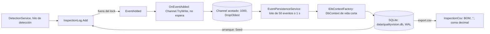

# M6 — Persistencia SQLite, exportación CSV y grabación del Plan B (más el modelo open-vocabulary)

> Hasta M5 todo el estado vivía en memoria: al reiniciar, contadores e historial desaparecían. En M6 cada inspección se guarda en **SQLite** con EF Core, los contadores del día **sobreviven a un reinicio**, hay un botón "CSV exportieren" pensado para **Excel alemán** y se puede **grabar un vídeo** de la cámara para usarlo como Plan B si la cámara falla en la entrevista. Antes de M6 se hizo un cambio de detección (ADR-005) que también se explica aquí, porque sin él la demo no reconocía el objeto real: un rotulador.

---

## Qué se hizo

- **Detección (commit previo a M6, `4727471`):**
  - `docs/adr/ADR-005-open-vocabulary-model.md`: modelo **YOLO-World v2 L** exportado a ONNX (`models/yoloworld-qv.onnx`, 177 MB), con 14 clases de texto fijadas en la exportación.
  - Clases "distractoras" mapeadas a `Ignore` en `rules.json` y umbral de confianza subido a **0,45**.
  - `run-demo.sh`: lanza la demo en **Production** desde un `dotnet publish`.
  - **Ningún cambio de C#:** el ONNX resultante es un YOLO normal que YoloDotNet ya sabía ejecutar.
- **Infrastructure:**
  - `Persistence/InspectionDbContext` + `InspectionRecord` (una tabla, índice por `Timestamp`).
  - `AddInspectionPersistence` registra un `IDbContextFactory<InspectionDbContext>`.
  - `Camera/FrameRecorder`: graba los fotogramas crudos en un mp4 a 15 fps fijos (`CameraOptions.RecordTo`, `RecordMaxSeconds`).
- **Web:**
  - `Pipeline/EventPersistenceService` (`BackgroundService`): canal acotado + inserciones por lotes.
  - `Pipeline/InspectionDatabaseInitializer` (`IHostedService`): crea el esquema, activa WAL y **siembra** `InspectionLog` con los datos de hoy (`IInspectionLog.Seed`).
  - `Pipeline/LocalDay`: rango [inicio, fin) del día local, con `TimeProvider`.
  - `Pipeline/DatabaseHealthCheck`: `CanConnectAsync` en `/health`.
  - `Endpoints/InspectionCsv` + `GET /api/inspection/export.csv?from=&to=` y el botón en `Home.razor`.
  - `run-demo.sh --video`: arranca con `Camera__Source=VideoFile` y la ruta absoluta de `samples/demo.mp4`.
- **Tests:** **417** en total. Nuevos: `InspectionCsvTests` (formato y escape, incluida la inyección), `EventPersistenceServiceTests` (SQLite en memoria), `InspectionDatabaseInitializerTests`, `InspectionLogSeedTests`, `FrameRecorderTests` (se vuelve a leer el mp4 con OpenCV) y el ayudante `InMemoryDb`.

Camino de un evento hasta la base de datos (sin bloquear nunca la detección):



---

## Por qué

### ADR-005: el rotulador no existe en COCO

El objeto de la demo es un **rotulador**. YOLO11 está entrenado con COCO (80 clases) y **ninguna es "marker pen"**. Un modelo no puede nombrar lo que no está en su vocabulario, da igual el tamaño (`n`, `m`) o el umbral. Las opciones que se barajaron:

1. **Bajar el umbral en YOLO11:** inútil. La clase no existe; solo se obtienen más falsos positivos de otras clases.
2. **Hacer fine-tuning de un YOLO11 propio:** es lo mejor a largo plazo (clases fijas, explicables, más precisión), pero exige dataset etiquetado, entrenamiento y validación. No cabía en el tiempo que quedaba.
3. **Detector de vocabulario abierto (YOLO-World v2):** las clases se dan **como texto**. Probado en la mesa real: rotulador 0,86–0,97, taza 0,94, botella 0,91, móvil 0,46–0,71. (YOLOE-11-L no encontró nada en una foto de producto.)

**Decisión:** YOLO-World v2 L. Las clases de texto se fijan en la exportación (`set_classes([...])` y luego export a ONNX), así que el resultado es un ONNX YOLO estándar (entrada `1x3x640x640`, salida `1x(4+14)x8400`, nombres de clase en los metadatos). Por eso **no hubo que tocar C#**.

**Clases distractoras (*negative prompting*).** Con conf 0,25 aparecían falsos "marker pen" con 0,25–0,36. Se añadieron clases parecidas (lápiz, cable, difusor de varillas, cuaderno, teclado…) para que el modelo las **asigne a ellas** en vez de al rotulador, y en `rules.json` se mapean a `Ignore`. Con ese "absorbedero" se puede subir el umbral a **0,45** sin perder el rotulador (que da 0,86+). El orden de la lista importa y vive en `tools/export-model/world-classes.txt`.

Consecuencias honestas:
- ~10 ms en CUDA frente a 6,5 ms de yolo11m: sigue muy por debajo del intervalo entre fotogramas.
- El **fallback a CPU** (YOLO11n, COCO) **no detecta el rotulador**. Aceptable para la demo, documentado.
- Cambiar la lista de clases es **re-exportar (segundos), no reentrenar**. Un nuevo parecido que dé falsos positivos se arregla añadiéndolo a la lista y mapeándolo a `Ignore`.
- **Licencia:** YOLO-World es GPL-3.0 y Ultralytics AGPL-3.0: un producto comercial necesitaría licencia comercial o un modelo alternativo (mismo aviso que ADR-003).
- El modelo **no está en git** (177 MB > 100 MB de GitHub): está en `.gitignore` y se reproduce con `tools/export-model/export.py`; el SHA256 está en `models/README.md`. Aquí sí hace falta Python/`uv` una vez.
- **Camino profesional:** con un cliente real, recoger y etiquetar imágenes de las piezas reales y hacer fine-tuning (opción 2). El vocabulario abierto es un puente pragmático para la demo, no el estado final.

### `run-demo.sh`: Production necesita `publish`

Es la misma trampa de M5 (`_framework/blazor.web.js` da 404/500 al ejecutar el binario de `bin/` sin Development), resuelta de forma permanente: el script hace `dotnet publish -c Release -o artifacts/demo` y ejecuta `ASPNETCORE_ENVIRONMENT=Production ./QualityVision.Web` **desde ese directorio**. Consecuencias que el script gestiona:

- El *content root* es el directorio de publicación: `rules.json`, `appsettings.Local.json` y `data/qualityvision.db` se resuelven ahí. El script copia `appsettings.Local.json` (ignorado por git) y **imprime las rutas** de `rules.json` y de la base de datos. `rm -rf artifacts` borra el historial de la demo; `dotnet publish -o` no lo borra.
- Con `--video` calcula la ruta **absoluta** de `samples/demo.mp4` (la app corre desde `artifacts/demo`, no desde la raíz del repo, y una ruta relativa no resolvería) y comprueba que existe.
- Usa `exec`, así SIGTERM llega a la aplicación y el cierre ordenado (con el vaciado final de la persistencia) funciona.
- Comprueba puertos 5080/5443 libres y avisa si no hay GPU.

### SQLite y no SQL Server

Ver pregunta 1 de la entrevista. En resumen: una tabla, un solo proceso, cero administración, un fichero que se copia; encaja con una demo local en red de planta. El código usa EF Core, así que cambiar de proveedor es sobre todo cambiar el `UseSqlite(...)`.

### `EnsureCreated` en vez de migraciones

El contrato lo dice sin rodeos: demo con **una sola tabla**, así que `EnsureCreatedAsync()` al arrancar. Contrapartida: `EnsureCreated` **no entiende de versiones**; si mañana añades una columna, no altera la tabla existente (habría que borrar el fichero). En producción se usan **migraciones** (`dotnet ef migrations add`, `Database.MigrateAsync()`), que guardan el historial de cambios del esquema y los aplican de forma incremental. Está documentado como compromiso en el código.

### Decisiones de diseño de la persistencia

- **Los contadores sobreviven al reinicio:** al arrancar se leen los conteos de hoy por veredicto y los 50 últimos eventos, y se llama a `InspectionLog.Seed(...)`. `Seed` **no dispara `EventAdded`**, así que lo sembrado no se vuelve a guardar. Los eventos sembrados usan `Sequence` **negativo** para no chocar con los de esta ejecución (la UI usa `@key`).
- **Orden de arranque explícito:** los `IHostedService` arrancan en el orden de registro, de forma secuencial. `InspectionDatabaseInitializer` va **antes** de `EventPersistenceService`, `CameraService` y `DetectionService`; así `EnsureCreated` y `Seed` terminan antes de que entre el primer fotograma. Al parar, el orden es inverso: Detection → Camera → Persistence → Initializer, de modo que los últimos eventos entran al canal antes de cerrar la persistencia.
- **Si la base de datos falla, la demo sigue** (contadores a cero, nada se guarda). Se registra el error: la persistencia nunca debe tumbar el pipeline en vivo.

---

## Conceptos de C# / .NET

### EF Core + SQLite: el `DbContext`, `DateTimeOffset` y el *value converter*
SQLite no tiene tipo fecha propio ni sabe ordenar `DateTimeOffset` de forma nativa. Solución: un **value converter** que guarda los *ticks* UTC como `long`. Así `OrderBy`, los filtros por rango y el índice se traducen a comparaciones de enteros, y los parámetros de las consultas también pasan por el conversor.

```csharp
// src/QualityVision.Infrastructure/Persistence/InspectionDbContext.cs:18-24
modelBuilder.Entity<InspectionRecord>(b =>
{
    b.Property(static r => r.Timestamp).HasConversion(
        static v => v.UtcTicks,
        static v => new DateTimeOffset(v, TimeSpan.Zero));
    b.HasIndex(static r => r.Timestamp);
});
```

Al leer, el offset sale siempre 0 (UTC); la UI y el CSV convierten a hora local. El veredicto se guarda como **texto** (`Verdict.ToString()`), legible en cualquier visor de SQLite, y se agrupa en SQL y se parsea después.

### `EnsureCreated` frente a migraciones
```csharp
// src/QualityVision.Web/Pipeline/InspectionDatabaseInitializer.cs:28-29
await using InspectionDbContext db = await dbFactory.CreateDbContextAsync(cancellationToken).ConfigureAwait(false);
await db.Database.EnsureCreatedAsync(cancellationToken).ConfigureAwait(false);
```
`EnsureCreated` crea la base y las tablas **si no existen**, y nada más. No se puede mezclar con migraciones en la misma base de datos (si la creó `EnsureCreated`, `Migrate` falla porque no hay tabla `__EFMigrationsHistory`). Regla: prototipo/demo → `EnsureCreated`; cualquier cosa que evolucione → migraciones.

### `IDbContextFactory` para singletons y servicios en segundo plano
Un `DbContext` **no es seguro entre hilos**, está pensado para una unidad de trabajo corta y suele registrarse como *scoped* (uno por petición). Un `BackgroundService` es un **singleton** que vive toda la aplicación: inyectarle un `DbContext` scoped da error de ciclo de vida, y uno singleton acumularía el *change tracker* para siempre. La solución es inyectar la **fábrica** y crear un contexto de vida corta por cada lote:

```csharp
// src/QualityVision.Infrastructure/DependencyInjection.cs:78
services.AddDbContextFactory<InspectionDbContext>(o => o.UseSqlite(connectionString));
```
```csharp
// src/QualityVision.Web/Pipeline/EventPersistenceService.cs:105-114 (extracto)
await using InspectionDbContext db = await _dbFactory.CreateDbContextAsync(cancellationToken).ConfigureAwait(false);
db.Inspections.AddRange(events.Select(static e => new InspectionRecord { ... }));
await db.SaveChangesAsync(cancellationToken).ConfigureAwait(false);
```
El `await using` libera el contexto al acabar el lote. Un contexto por lote también significa que un fallo no deja un *tracker* sucio para el siguiente.

### SQLite en modo WAL
Por defecto SQLite usa un *rollback journal*: un lector con el cursor abierto **bloquea** al escritor. El export CSV hace `await foreach` sobre una consulta mientras transmite al cliente, así que mantendría un cursor abierto y podría bloquear el commit del lote (hasta `busy_timeout`, 30 s, y se perdería el lote). **WAL** (*write-ahead log*) permite lectores y un escritor a la vez. Se activa una vez; queda guardado en el fichero de la base de datos:

```csharp
// src/QualityVision.Web/Pipeline/InspectionDatabaseInitializer.cs:31-32
// WAL: the CSV export's read cursor must not block persistence commits (persisted in the database file).
await db.Database.ExecuteSqlRawAsync("PRAGMA journal_mode=WAL;", cancellationToken).ConfigureAwait(false);
```
(Esto salió de la revisión, MINOR-3. Los ficheros `*-wal` y `*-shm` ya están en `.gitignore`.)

### Desacoplar con un `Channel<T>` acotado + *batching*
Escribir en base de datos desde el hilo de detección añadiría latencia (disco) a cada evento y arriesgaría bloquearlo. Se aplica el patrón productor/consumidor: `OnEventAdded` solo hace `TryWrite` en un canal en memoria, que **nunca espera ni lanza**; un `BackgroundService` consume.

```csharp
// src/QualityVision.Web/Pipeline/EventPersistenceService.cs:22-27
private readonly Channel<InspectionEvent> _channel = Channel.CreateBounded<InspectionEvent>(
    new BoundedChannelOptions(1000)
    {
        FullMode = BoundedChannelFullMode.DropOldest,
        SingleReader = true,
    });
```
```csharp
// EventPersistenceService.cs:94
private void OnEventAdded(InspectionEvent e) => _channel.Writer.TryWrite(e);
```

- **Acotado:** si la base de datos se atasca, la memoria no crece sin límite.
- **`DropOldest`:** con el canal lleno se descarta el evento más viejo y `TryWrite` sigue devolviendo `true`; el productor jamás se bloquea. Es *backpressure* por pérdida: para telemetría de una demo es mejor perder un evento antiguo que parar la detección. (Deuda: esas pérdidas son silenciosas.)
- **`SingleReader = true`:** permite a .NET usar una implementación más barata.

El **batching** reduce el coste: una transacción con 50 filas es mucho más barata que 50 transacciones. Se lee un primer evento (espera indefinida) y luego se acumulan más durante **como máximo 1 s o 50 eventos**, con un token vinculado que se cancela a los 1000 ms:

```csharp
// EventPersistenceService.cs:60-73 (extracto)
batch.Add(await _channel.Reader.ReadAsync(stoppingToken).ConfigureAwait(false));
using var window = CancellationTokenSource.CreateLinkedTokenSource(stoppingToken);
window.CancelAfter(MaxWait);
try { while (batch.Count < MaxBatch) { batch.Add(await _channel.Reader.ReadAsync(window.Token)...); } }
catch (OperationCanceledException) when (!stoppingToken.IsCancellationRequested) { /* ventana cumplida: escribe */ }
```
El `when` distingue "pasó 1 s" (escribir lo que haya) de "apagado" (salir del bucle). Al apagar se **vacía** el canal con `TryRead` y se escribe con `CancellationToken.None`, para que el token ya cancelado no aborte el guardado final. Y se hace `EventAdded -= OnEventAdded` antes de drenar para no recibir más.

### CSV para Excel alemán
Tres detalles que hacen que el fichero "se abra bien con doble clic" en una Windows en alemán:
1. **BOM UTF-8** al inicio: sin él, Excel supone ANSI y rompe las "ü", "ö" y "ß" de "Prüfzone" o "n.i.O.".
2. **Separador `;`**: en configuración regional alemana el separador de lista es `;` porque la coma es el separador decimal.
3. **Coma decimal**: la confianza se formatea con `CultureInfo.GetCultureInfo("de-DE")`, `"0,00"`; la fecha, en cambio, con cultura invariante (`yyyy-MM-dd HH:mm:ss`, sin ambigüedad).

```csharp
// src/QualityVision.Web/Endpoints/InspectionCsv.cs:25-31
return string.Join(
    ';',
    localTime.ToString("yyyy-MM-dd HH:mm:ss", CultureInfo.InvariantCulture),
    Escape(className),
    Escape(displayName),
    Escape(VerdictLabels.Get(verdict)),
    confidence.ToString("0.00", De));
```
Es una **función pura** (sin I/O), por eso se prueba con facilidad. La respuesta es `text/csv; charset=utf-8`, se transmite en *streaming* y el nombre sale en `Content-Disposition` como `pruefungen-YYYYMMDD.csv`. Solo se acepta `yyyy-MM-dd` y las fechas se interpretan como **día local** con `LocalDay` (rango semiabierto [inicio, fin), con `TimeProvider`, sin `DateTime.Now`).

### Inyección CSV / de fórmulas (OWASP)
Hallazgo **MAJOR-1** de la revisión. El escape RFC-4180 (comillas dobles, `;`, saltos de línea) estaba bien, pero **no** la inyección: si un campo de texto empieza por `=`, `+`, `-` o `@` (o tabulador/CR), Excel lo **evalúa como fórmula** al abrir el fichero. Ejemplo: `=HYPERLINK("http://malo","Clic")` o, en versiones antiguas, DDE para ejecutar comandos. `Klasse` y `Bezeichnung` vienen de la configuración, que en este diseño (solo LAN, sin autenticación, ADR-001) puede editar cualquiera que llegue al editor `/regeln`: el payload se ejecutaría en el Excel de quien abra la exportación. Baja probabilidad, pero es el hallazgo clásico de OWASP "CSV Injection".

Defensa: **prefijar con `'`** los valores peligrosos (Excel lo muestra como texto literal) y **después** aplicar el entrecomillado normal:

```csharp
// src/QualityVision.Web/Endpoints/InspectionCsv.cs:41-48
if (value.Length > 0 && "=+-@\t\r".Contains(value[0], StringComparison.Ordinal))
{
    value = "'" + value;
}

return value.IndexOfAny([';', '"', '\r', '\n']) >= 0
    ? "\"" + value.Replace("\"", "\"\"", StringComparison.Ordinal) + "\""
    : value;
```
El orden importa: un valor como `=a;b` necesita **ambas** cosas (prefijo y comillas), y hay un test para ese caso, además de `=1+1`, `+x`, `-x` y `@x`. Los campos generados por la aplicación (fecha, etiqueta del veredicto, confianza) son seguros. Matiz honesto: el prefijo altera ligeramente el dato original; es el compromiso recomendado por OWASP frente a no defender.

### Grabación por *slots* para fps constantes
Hallazgo **MAJOR-2** de la revisión. La primera versión *saltaba* los fotogramas que llegaban a menos de 66,7 ms del último escrito, pero nunca repetía uno para rellenar huecos. Con `Camera:MaxFps = 20` (50 ms entre fotogramas) escribía a 0, 100, 200 ms… es decir, **10 fps de contenido en un fichero que declara 15 fps**: el vídeo se reproducía a **1,5× de velocidad** (los objetos pasaban demasiado rápido ante los entrevistadores). Y una fuente más lenta que 15 fps lo "subrellenaba" igual.

Corrección: escribir **por hueco de tiempo (*slot*)**, no por intervalo. Cada fotograma sabe cuándo se capturó (`CapturedAt`), así que se calcula el hueco de 1/15 s al que pertenece y se escribe el fotograma **tantas veces como huecos falten**, con tope para sobrevivir a bloqueos:

```csharp
// src/QualityVision.Infrastructure/Camera/FrameRecorder.cs:66-72
// 1-based slot this frame belongs to; write it once per missing slot (skip when the slot is already filled).
long due = (long)Math.Round((frame.CapturedAt - _firstAt).TotalSeconds * OutputFps, MidpointRounding.AwayFromZero) + 1;
long repeats = Math.Min(due - _frames, MaxRepeats);
if (repeats > 0)
{
    Write(frame, (int)repeats);
}
```
Una fuente de 20 fps da exactamente 15 fps en tiempo real (se salta alguno); una de 10 fps duplica cada fotograma. La conversión BGRA→BGR y el *resize* se hacen **una vez** y solo se repite `_writer.Write`. El reloj es `Frame.CapturedAt`, no el reloj de pared, así que es **determinista en los tests**: se alimentan N fotogramas separados 50 ms durante 2 s, se vuelve a leer el mp4 con `VideoCapture` y se esperan ~30 fotogramas, no ~20.

Otros puntos del grabador, de la revisión y del contrato:
- **Propiedad del fotograma:** `TryWrite` lee el frame de forma **síncrona** (con `PinnedMat`, sin copiar) antes de que el canal de la cámara tome posesión y lo libere. Todos los `Mat` van en `using`.
- **Nunca rompe la captura:** `try/catch` general; el primer error se registra **una vez** y el grabador se desactiva solo (`_stopped`).
- `using FrameRecorder?` en `ExecuteAsync` finaliza el mp4 (el *moov atom*; sin él el fichero no se puede reproducir) al apagar y sobrevive a reconexiones.
- Se detiene a los `RecordMaxSeconds` (120 por defecto) y escribe `Recorded {Frames} frames to {Path}`.

---

## Trampas y limitaciones

- **Dos bases de datos distintas:** `dotnet run` usa `src/QualityVision.Web/data/…` y la demo publicada usa `artifacts/demo/data/…`. Por eso `run-demo.sh` imprime la ruta, y `rm -rf artifacts` borra el historial de la demo.
- **`Camera:VideoFile` relativo no resuelve** desde `artifacts/demo` salvo con `--video` (ruta absoluta). Y grabar con `RecordTo` apuntando al mismo `samples/demo.mp4` que se está reproduciendo lo sobrescribiría.
- **`DatabaseHealthCheck` es casi siempre "Healthy":** con SQLite, `CanConnectAsync` **crea el fichero** si no existe. Vale para la demo; no demuestra que el esquema esté bien.
- **Sin cambio de día:** los contadores en memoria siguen siendo los del día anterior hasta reiniciar, aunque el *seed* y el CSV sí son por día.
- **Pérdidas silenciosas** con `DropOldest` (no hay `LogWarning`), y si la inicialización falla la persistencia sigue intentándolo y registra "no such table" cada segundo.
- **Fallback a CPU no detecta el rotulador** (ADR-005) y el modelo hay que regenerarlo con Python (no está en git).

---

## La software factory en M6

- **Contrato reducido** (`docs/contracts/M6-contract.md`) por tiempo (entrevista el mismo día): backend, visión y QA con responsabilidades separadas; QA después sobre el contrato.
- **La revisión de código encontró 2 MAJOR reales** (inyección CSV y velocidad del vídeo) y 12 MINOR; ambos MAJOR y el WAL se corrigieron **antes** del commit, con tests que fijan el comportamiento. Es un buen argumento: el proceso de revisión sirve de verdad.
- **El ciclo de vida de hosts ya estaba bien aislado:** `InspectionLog.Add` ya aislaba a cada suscriptor (M4), así que la persistencia se enchufó sin tocar la ruta de detección.
- **Resultado:** 417 tests.

### Deudas conocidas, para ser honesto en la entrevista
- Sin migraciones (`EnsureCreated`) y sin política de retención: la tabla crece sin límite.
- Sin autenticación en `/regeln` ni en el export (diseño solo LAN, ADR-001).
- `Program.cs` referencia `Microsoft.Data.Sqlite` directamente para resolver la ruta; debería vivir en `AddInspectionPersistence` en Infrastructure (MINOR-4).
- Una sola instancia: SQLite de fichero local no sirve para varios servidores escribiendo.
- Sin tests de componentes Blazor (igual que en M5).

---

## 3 preguntas de entrevista

**1. ¿Por qué SQLite y no SQL Server?** — Porque el problema no lo pide: una sola tabla de eventos, un único proceso que escribe, decenas de eventos por minuto y despliegue en un PC de la planta. SQLite es una librería embebida: **cero servidor, cero administración, un fichero** que se copia o se borra, y se instala con un paquete NuGet; en la demo eso reduce piezas que pueden fallar justo en la entrevista. Con EF Core el código es casi idéntico, así que el día que haga falta (varias estaciones escribiendo a la vez, usuarios concurrentes, copias de seguridad y alta disponibilidad, auditoría, seguridad por roles) se cambia el proveedor (`UseSqlServer`) y se pasa de `EnsureCreated` a **migraciones**. Las limitaciones reales de SQLite que ya tuve que gestionar: un solo escritor a la vez (por eso el canal con lotes y WAL para que el export no bloquee), sin tipo fecha nativo (conversor a ticks) y ningún acceso en red. Es la herramienta correcta para este tamaño; no la defendería para una planta con varias líneas.

**2. ¿Qué es la inyección CSV y cómo la evitas?** — Si un campo de texto que acaba en el CSV empieza por `=`, `+`, `-`, `@` (o tabulador/CR), Excel lo interpreta como **fórmula** al abrir el fichero y puede ejecutar funciones como `HYPERLINK`, filtrar datos o, en versiones antiguas, lanzar comandos por DDE. Escapar comillas y separadores (RFC-4180) **no protege**: es otro problema. En el export, `Klasse` y `Bezeichnung` vienen de configuración editable, así que la revisión lo marcó como MAJOR. La defensa que recomienda OWASP está en `InspectionCsv.Escape`: si el primer carácter es peligroso, **se antepone `'`** (Excel lo trata como texto) y *después* se aplica el entrecomillado normal. Es una función pura y se prueba con `=1+1`, `+x`, `-x`, `@x` y con `=a;b`, que necesita prefijo y comillas. Los campos que genera la propia app (fecha, veredicto, confianza) no son atacables. La defensa de fondo es no confiar en datos que cruzan un límite hacia otro programa.

**3. ¿Por qué no se escribe en la base de datos directamente desde la detección y cómo lo desacoplas?** — Porque el disco puede tardar o bloquearse y la detección corre en tiempo real: no debe esperar. `InspectionLog.EventAdded` se dispara fuera del lock y el *handler* solo hace `TryWrite` en un `Channel<InspectionEvent>` **acotado** (1000, `DropOldest`), que nunca espera ni lanza. Un `BackgroundService` consume el canal y hace **inserciones por lotes** (hasta 50 eventos o 1 s) con un `DbContext` de vida corta obtenido de `IDbContextFactory`, porque un `DbContext` no es seguro entre hilos y el servicio es singleton. Los errores se registran y se sigue; al apagar se vacía el canal y se escribe el último lote con `CancellationToken.None`. Contrapartida asumida: si la base de datos va más lenta que la entrada durante mucho tiempo, `DropOldest` pierde eventos antiguos (aceptable para telemetría, pero hoy sin aviso en el log).
