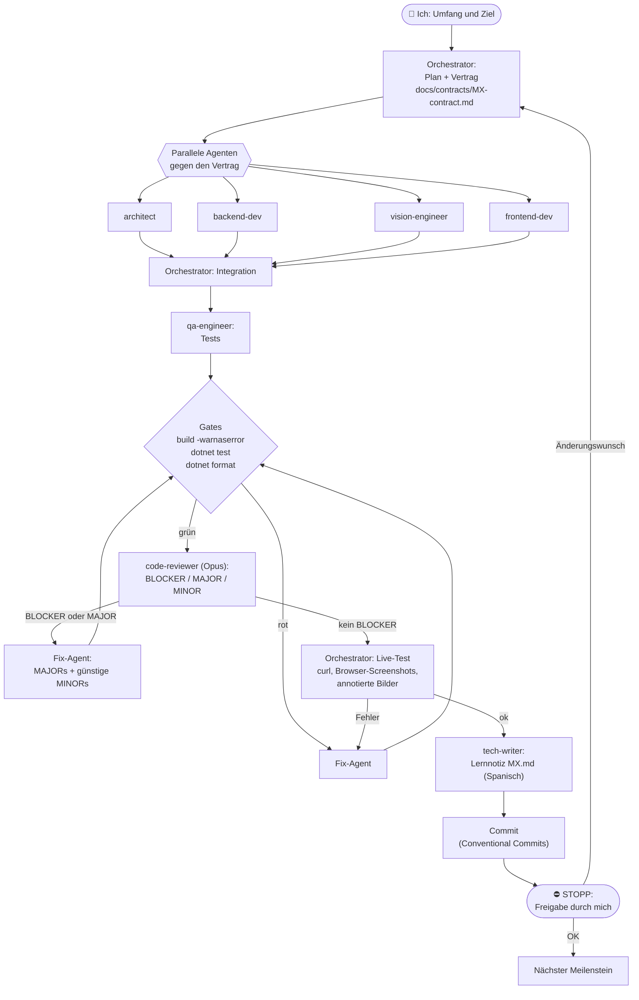

# Wie ich QualityVision mit KI-Agenten gebaut habe

> Einfaches Deutsch, zum Vorlesen oder Erzählen.
> Grundlage: `docs/entrevista/HECHOS_FLUJO_IA.md` (Fakten), `CLAUDE.md`, `docs/PLAN.md`.

---

## Kurz gesagt

Ich habe das Projekt wie ein kleines Softwareteam organisiert.
Das Team bestand aus KI-Agenten. Ich war der Product Owner und der verantwortliche Entwickler.
Eine KI-Sitzung war der **Orchestrator**. Sie hat geplant, Aufgaben verteilt und alles geprüft.
**Spezialisierte Agenten** haben den Code geschrieben.
Jeder Meilenstein musste durch feste **Quality Gates**. Danach habe ich ihn freigegeben – oder nicht.

---

## Die Rollen

| Rolle | Wer | Aufgabe |
|---|---|---|
| **Ich (Owner)** | Mensch | Umfang festlegen, Entscheidungen treffen, jeden Meilenstein freigeben, Systemrechte (z. B. `sudo`) |
| **Orchestrator** | Claude Code, Hauptsitzung (Opus) | Planen, Verträge schreiben, Agenten starten, integrieren, Build/Tests/Format ausführen, live prüfen, Git |
| `architect` | Agent | Struktur, Schnittstellen zwischen Schichten, ADRs |
| `backend-dev` | Agent | Pipeline, DI, Hintergrunddienste, EF Core, Endpoints |
| `vision-engineer` | Agent | Kamera, ONNX-Modell, Erkennung, Performance |
| `frontend-dev` | Agent | Blazor-Dashboard, deutsche Oberfläche |
| `qa-engineer` | Agent | xUnit-Tests, Verifikation |
| `code-reviewer` | Agent | Review-Bericht. **Darf keinen Code ändern.** |
| `tech-writer` | Agent | README, Lernnotizen, Interview-Kit |

Wichtige Regel: **Der Orchestrator schreibt selbst keinen Produktcode.** Er delegiert.
Die Agenten dürfen kein `dotnet` ausführen. Build und Tests macht nur der Orchestrator.
So gibt es eine klare Trennung: Wer schreibt, prüft nicht sein eigenes Ergebnis.

Jeder Agent lief in einem **eigenen, sichtbaren Terminalfenster**. Ich konnte jedem Agenten bei der Arbeit zusehen.

Das Modell wurde je nach Aufgabe gewählt:
Sonnet für die meiste Implementierung und Tests – schnell und günstig.
Opus für Code-Reviews und schwierige UI-Arbeit. Haiku für eine triviale Korrektur.
Insgesamt waren es **67 Agenten-Aufträge**.

---

## Der Ablauf pro Meilenstein

In Worten:

1. **Vertrag.** Der Orchestrator schreibt einen Vertrag für den Meilenstein. Darin stehen genaue Signaturen, wer was macht und welche Dateien jede Rolle ändern darf.
2. **Parallel arbeiten.** Unabhängige Rollen arbeiten gleichzeitig gegen diesen Vertrag. Zum Beispiel Backend und Frontend.
3. **Integrieren.** Der Orchestrator baut alles zusammen und führt Build, Tests und Format-Prüfung aus.
4. **Testen und reviewen.** QA schreibt Tests. Der Reviewer schreibt einen Bericht mit BLOCKER, MAJOR und MINOR. Ein Fix-Agent behebt die MAJORs und die einfachen MINORs.
5. **Live prüfen.** Der Orchestrator testet die echte App: mit `curl`, mit Screenshots im Browser und mit den Bildern aus dem Stream.
6. **Dokumentieren.** Eine Lernnotiz auf Spanisch, damit ich jede Entscheidung verstehe. Mit drei möglichen Interviewfragen.
7. **Commit und Stopp.** Ein Commit pro Meilenstein. Dann wartet alles auf mein OK.

---

## Quality Gates (Definition of Done)

Ein Meilenstein ist erst fertig, wenn **alles** grün ist:

1. Build mit null Warnungen (`TreatWarningsAsErrors`, Analyzer)
2. Alle Tests grün
3. Formatierung sauber (`dotnet format --verify-no-changes`)
4. Review ohne BLOCKER
5. Echter Funktionstest
6. Lernnotiz geschrieben
7. Commit

Diese Gates sind nicht verhandelbar. Auch nicht unter Zeitdruck.

---

## Die Zahlen

| Was | Wert |
|---|---|
| Zeitraum | ca. 2 Tage (14.–16. November) |
| Commits (M1–M6, M4b, Erkennung) | 8 |
| Produktcode (C#/Razor) | ca. 5.600 Zeilen |
| Testcode | ca. 4.500 Zeilen |
| Tests | 417 |
| ADRs / Verträge / Reviews / Lernnotizen | 5 / 6 / 7 / 8 |
| Agenten-Aufträge | 67 |

---

## Was gut funktioniert hat – echte Beispiele

### Das Review hat echte Fehler gefunden

- **M5:** Der Regel-Editor hätte **alle Regeln gelöscht**, wenn in `rules.json` ein Kommentar stand.
- **M6:** **CSV-Injection** nach OWASP. Excel hätte Felder mit `=` als Formel ausgeführt.
- **M6:** Das Plan-B-Video lief mit **1,5-facher Geschwindigkeit**.
- **M4b:** Die CPU-Version von `libonnxruntime.so` hat die GPU-Version **still überschrieben**. Grund: `ExcludeAssets` wirkt nicht über `ProjectReference`. Jetzt sichert ein Test das ab.

Alle diese Fehler wurden **vor** dem Commit behoben.

### Prüfen statt glauben

- Ein Reviewer hat behauptet, YoloDotNet sei **GPL**. Wir haben die Lizenz im NuGet-Paket geprüft: Sie ist **MIT**. Die Aussage wurde korrigiert.
- Ein Agent hat eine **falsche Anzahl Tests** gemeldet. Die Zahl wurde aus dem echten Testlauf korrigiert.

Das ist für mich der wichtigste Punkt: **Eine KI-Aussage ist eine Hypothese, kein Fakt.**

### Entscheidungen mit Daten

- **GPU:** gemessen, nicht geschätzt. yolo11m: 198 ms auf der CPU, 6,5 ms auf der GPU.
- **Marker:** Er ist keine COCO-Klasse. Einen Schwellwert zu senken hilft nicht. YOLO-World mit Textklassen und Ablenkungsklassen erreichte live 0,86–0,97. Der professionelle Weg wäre Fine-Tuning mit echten Bildern.
- **Kein eigener SignalR-Hub:** Blazor Server hat schon eine SignalR-Verbindung. Weniger Teile, weniger Fehler.

---

## Was schiefging – und was ich daraus gelernt habe

| Vorfall | Lehre / neue Regel |
|---|---|
| `pkill -f <Projektname>` hat einen Agenten beendet, weil der Name in seinem Prompt stand | Prozesse nur noch per **PID** beenden |
| Ein Heredoc ohne Anführungszeichen hat Backticks aus einem Prompt in der Shell ausgeführt (ohne Schaden) | Prompts immer mit **gequotetem Heredoc** schreiben |
| Ein Nutzungslimit hat einen Agenten mitten im Meilenstein gestoppt | Neu gestartet mit Hinweis, welche Dateien schon existieren |
| Ein Agent war nur halb fertig | Fortgesetzt mit: „Prüfe `git diff`, behalte das Richtige, ergänze den Rest“ |
| Die KI durfte `sudo` nicht ausführen (cuDNN-Installation) | Richtig so. Ich habe es selbst installiert. |
| Ursprünglich geplantes Werkzeug (OpenCode) hatte kein Kontingent mehr | Umgestiegen auf Claude-CLI-Sitzungen, Plan im Entscheidungsprotokoll festgehalten |

---

## Mensch im Loop – was **ich** entschieden habe

- den **Umfang** und die Meilensteine,
- die **Freigabe** jedes Meilensteins (harter Stopp nach jedem),
- **Systemrechte**: `sudo` hat nie eine KI ausgeführt,
- das **iPhone** als Kamera über eine eigene Webseite statt DroidCam – wegen der Latenz,
- **volle GPU-Leistung** statt nur CPU,
- die **Erkennung des Markers** als echtes Prüfobjekt,
- **Nein** zu Vorschlägen ohne Bezug zum Projekt, zum Beispiel Tailscale.

---

## Meine Haltung: Verantwortung und Verifikation

Ich möchte hier ehrlich sein.

**Die KI hat den größten Teil des Codes geschrieben.** Das verstecke ich nicht.

**Aber die Verantwortung liegt bei mir.** Wenn der Code beim Kunden läuft und ein Fehler passiert, sagt niemand: „Das war die KI.“
Deshalb gilt für mich:

1. **Ich muss jede Zeile erklären können**, die ich ausliefere. Dafür gibt es die Lernnotizen und die ADRs.
2. **Vertrauen ist kein Prozess. Prüfen ist ein Prozess.** Build, Tests, Review und Live-Test sind Pflicht – für Menschen und für KI gleich.
3. **Wer schreibt, prüft nicht sich selbst.** Der Reviewer ist ein anderer Agent, darf nichts ändern und arbeitet mit einem stärkeren Modell.
4. **Die KI bekommt Grenzen.** Kein `sudo`, keine Änderungen außerhalb des Vertrags, keine Geheimnisse im Repo.
5. **Die KI irrt.** Falsche Lizenz, falsche Testzahl. Solche Aussagen prüfe ich an der Quelle.

Was ich daraus mitnehme:
KI macht mich deutlich schneller beim Schreiben.
Sie ersetzt aber nicht das Denken über Architektur, Risiken und Qualität.
Im Gegenteil: Je schneller Code entsteht, desto wichtiger werden gute Tests, klare Verträge und ein ehrliches Review.

---

## Wenn jemand kritisch fragt

**„Haben Sie das dann überhaupt selbst gemacht?“**
> „Ich habe die Architektur verantwortet, die Entscheidungen getroffen und alles geprüft.
> Die KI hat getippt. Fragen Sie mich gern zu jeder Stelle im Code.“

**„Ist das bei Kundenprojekten erlaubt?“**
> „Das hängt vom Kunden ab. Code und Daten von Kunden gebe ich nur an Werkzeuge, die der Kunde freigegeben hat.
> Der Prozess mit Gates und Review funktioniert aber auch ohne KI genauso.“

**„Was machen Sie, wenn die KI Unsinn schreibt?“**
> „Das passiert. Die Gates fangen es: Build, Tests, Review, Live-Test.
> Zum Beispiel hat ein Reviewer eine falsche Lizenz behauptet. Ich habe im Paket nachgesehen und es korrigiert.“
